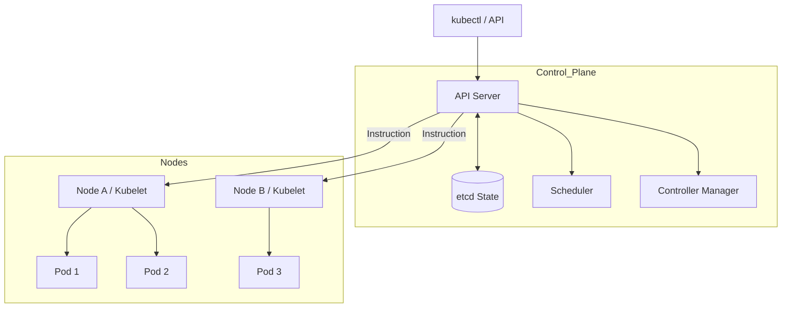

# Kubernetes (K8s) Architecture: The Operating System of the Cloud
============================================================
0. Architectural Vision: The Distributed Orchestrator
============================================================
- **K8s is the "Manager" of Containers.** It doesn't run containers itself (containerd does); it decides *where* and *how* they should run across a cluster of 1,000 servers.
- **The Control Plane (The Brain).** Consists of the API Server, ETCD (Storage), Scheduler, and Controller Manager.
- **The Data Plane (The Muscle).** The worker nodes that run the **Kubelet** (the agent) and **Kube-proxy** (the networker).
- **Desired State. (Declarative).** You don't say "Start a container". You say "Ensure there are 5 replicas of App X running". K8s makes it happen.
- **Self-Healing.** If a node crashes, K8s detects it and restarts the affected containers on healthy nodes automatically.
- **Architect's View.** We move from "Server Management" to "Cluster Management". We use **Kubernetes** to achieve **Resilience**, **Zero-Downtime Updates**, and **Elastic Scalability**.

============================================================
1. Foundational Problem: The "Fleet" Management Nightmare
============================================================
- **Real-World Impact:** You have 100 microservices. Each needs 3 replicas. That's 300 containers across 20 servers. 
- **What breaks?** "The Coordination". Which server has enough RAM for Service A? If Server 5 dies, how do you know which 15 services were on it and where to move them? How do you update Service B without taking the whole site offline?
- **Scale Boundary:** Manually managing 300 connections and IP addresses in a spreadsheet is impossible. You will have "Traffic Black Holes" where a service is alive but unreachable.
- **Failure Story:** A major fintech app tried to manage 50 Docker nodes using manual shell scripts. When a major cloud region had a networking blip, the scripts failed, and half the app stayed down for 12 hours because no one knew which service was supposed to be where. Migrating to **Kubernetes** allowed the system to self-heal in 30 seconds, automatically re-routing traffic and re-scheduling pods without a single human intervention.

============================================================
2. Internal System Mechanics: The Control Loop
============================================================

### The K8s Architecture
1. **API Server:** The only point of contact. Everything talks to the API server.
2. **etcd:** The "Source of Truth". A distributed key-value store that holds the cluster state.
3. **Scheduler:** The "Matchmaker". Watches for new pods and assigns them to the best-fit nodes.
4. **Controllers:** The "Maintainers". If you want 3 pods and there are only 2, the Controller creates the 3rd one.



============================================================
3. Production Engineering in .NET 8 (K8s Manifests)
============================================================

### Anti-Pattern: Using 'latest' tags in Deployments
```yaml
# TERRIBLE: image: mywebapp:latest. 
# You have no idea which version is running. 
# Rollbacks become impossible because 'latest' keeps changing.
```

### Production-Ready Implementation: Deployment & Service
```yaml
# 1. Deployment (The Desired State)
apiVersion: apps/v1
kind: Deployment
metadata:
  name: dotnet-api
spec:
  replicas: 3
  selector:
    matchLabels:
      app: orders
  template:
    metadata:
      labels:
        app: orders
    spec:
      containers:
      - name: api
        image: myregistry.azurecr.io/orders:v1.2.3
        ports:
        - containerPort: 8080
        # CRITICAL: Resource Limits
        resources:
          limits:
            cpu: "500m"
            memory: "512Mi"
          requests:
            cpu: "100m"
            memory: "128Mi"
        # CRITICAL: Health Checks
        livenessProbe:
          httpGet:
            path: /health/live
            port: 8080
        readinessProbe:
          httpGet:
            path: /health/ready
            port: 8080

# 2. Service (The Load Balancer)
apiVersion: v1
kind: Service
metadata:
  name: orders-svc
spec:
  selector:
    app: orders
  ports:
    - protocol: TCP
      port: 80
      targetPort: 8080
```

**Architecture Strategy:** 
- Implement **Horizontal Pod Autoscaling (HPA)**. K8s will automatically increase your pods from 3 to 30 when CPU usage hits 70%.
- Use **Helm** to package your K8s manifests. This allows you to manage "Releases" and "Templates" instead of raw YAML files.

============================================================
4. System Interaction & Flow (ASCII Architecture)
============================================================

                 ┌──────────────────┐
                 │    The User      │ (Web Request)
                 └────────┬─────────┘
                          │ 1. DNS -> Ingress Controller
          ┌───────────────▼───────────────┐
          │      K8s CLUSTER FABRIC       │ (The Orchestrator)
          │  ┌─────────┐   ┌─────────┐    │
          │  │ Ingress │ → │ Service │    │
          │  │ (Nginx) │   │ (Cluster)│    │
          │  └────┬────┘   └────┬────┘    │
          └───────┼─────────────┼─────────┘
                  │             │ 2. Route to any Healthy Pod
          ┌───────▼─────────────▼─────────┐
          │       The Pod Fleet           │ (The Workloads)
          └───────────────┬───────────────┘
                          │ 3. Self-Healing LB
                ┌─────────▼─────────┐
                │   Global Availability│
                └───────────────────┘

============================================================
5. Strategic Scaling & System Evolution
============================================================
- **Cluster Autoscaler.** When K8s can't find a node for your new pods, it tells Azure/AWS to spin up a new physical server and add it to the cluster (Node Scaling).
- **Service Mesh (Istio / Linkerd).** Managing the "Service-to-Service" communication with mTLS, retries, and circuit breakers directly in the K8s network plane.
- **Serverless K8s (KEDA).** Scaling your pods based on "Events" (e.g., number of messages in a queue) rather than just CPU/RAM.

============================================================
6. Reliability, Observability & Runtime Governance
============================================================
- **Key Metrics:**
    - `Pod Restart Count`: Identifying crashing apps (CrashLoopBackOff).
    - `Pending Pods`: Cluster is out of resources.
- **Observability:** Use **Prometheus and Grafana** to scrape metrics from the K8s API and your .NET pods. Use **Kube-state-metrics** to see the health of the cluster itself.

============================================================
7. Compromises, Tradeoffs & Alternatives
============================================================
- **Steep Learning Curve.** K8s is incredibly complex. If you have 1 small app, K8s is massive overkill. 
    - *Architect's Tip:* Use **Azure Container Apps** or **AWS Fargate** for a "Serverless K8s" experience with less management.
- **Networking Complexity.** Debugging "Why can't Pod A talk to Pod B" often requires deep knowledge of Overlay Networks (Calico/Flannel).

============================================================
8. Security Posture & Risk Mitigation
============================================================
- **RBAC for K8s.** Never give a pod `cluster-admin` access. Use the principle of least privilege for the Service Accounts.
- **Network Policies.** By default, every pod in K8s can talk to every other pod. Use **NetworkPolicies** to "Firewall" your database from the public frontend.

============================================================
9. Technical Edge Cases & System Failure Modes
============================================================
- **The "OOMKill".** Your app uses more RAM than the `limit` you set. K8s will kill the process instantly.
    - *Architect's Rule:* Set your RAM `requests` close to your `limits` to ensure predictable scheduling.
- **The "Split-Brain" etcd.** If the etcd cluster loses consensus, K8s goes into a "Read-Only" state where no new pods can be created or updated.

============================================================
10. Architectural Assessment & Career Progression
============================================================
- **Senior:** "We use Kubernetes to manage our containers and ensure they scale and self-heal automatically."
- **Principal:** "Architecture is the **Abstraction of the Host**. We leverage **Kubernetes and Declarative Reconcilliation** to eliminate the manual orchestration of compute. We architecturalize for **Infrastructure Invisibility**, utilizing **Control Plane Intelligence and Overlay Networking** to ensure that our distributed system is a living, adaptive entity that persists through hardware failure and traffic volatility. For us, a server is just a **Pool of Schedulable Resources**, and K8s is the **Governor of the Cloud Fabric**."
- **Interview Strategy:** Describe the "Control Plane" components. Explain "Liveness" vs "Readiness" probes.

============================================================
11. Real-World Case Study: 10,000 Nodes at OpenAI / Large Corp
============================================================
**Scenario:** A company running massive AI training or a huge SaaS platform.
- **The Problem:** 10,000 servers. Manual management is impossible.
- **The Design:** Implemented a **Multi-Cluster Kubernetes Architecture**.
- **Result:** They can deploy to 100,000 containers in minutes. K8s handles the massive bin-packing optimization, saving millions of dollars by ensuring servers are 90% utilized rather than 10%.

============================================================
12. Structural Dependencies & Learning Path
============================================================
- **Foundations:** Docker, YAML, Linux Networking.
- **Future Steps:** Operators, CRDs (Custom Resource Definitions).
- **Integration Points:** Azure Kubernetes Service (AKS), Amazon EKS, Google GKE.
