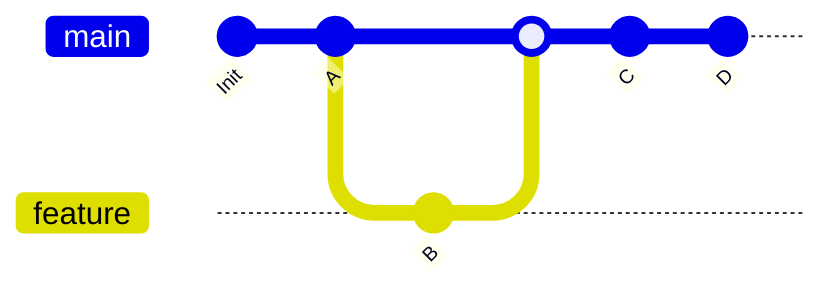

# Branching Strategies: Trunk-Based Development vs GitFlow
**0. Architectural Vision: The Flow of Code**
- **Trunk-Based Development (TBD).** Everyone works on one branch (`main`). Branches are short-lived (< 1 day). Merges are frequent.
- **GitFlow.** A structured model with `main`, `develop`, `feature`, `release`, and `hotfix` branches. Large, long-lived branches.
- **Pull Requests (PRs).** The gatekeeper for code quality. A chance for peers to review and for CI to run.
- **Continuous Integration (CI).** TBD requires perfect CI (automated tests) because the code goes to `main` instantly.
- **Architect's View.** We move from **GitFlow** to **Trunk-Based Development** to achieve **High Velocity** and eliminate **Merge Hell**. We understand that branching is a tax on integration, and the goal is to integrate as often as possible.

**1. Foundational Problem: The "Merge Hell" and the "Stale Code"**
- **Real-World Impact:** You have a `feature/massive-refactor` branch that has been open for 3 weeks. In that time, 50 other PRs have been merged into `main`.
- **What breaks?** "The Integration". When you finally try to merge, you have 200 merge conflicts. Logic that you refactored has been deleted or changed in `main`. You spend 2 days resolving conflicts, only to find that the app is now broken because of "Logical Conflicts" that Git couldn't catch.
- **Scale Boundary:** In a team of 100 developers, GitFlow creates a "Traffic Jam" at the `develop` branch. You need "Release Trains" and "Freeze Windows" that slow down the business.
- **Failure Story:** A major tech company used 6-month feature branches. By the time the features were "Finished", the market had moved, the code was incompatible with the new architecture, and the entire 6-month project was scrapped. Migrating to **Trunk-Based Development** allowed them to ship small pieces of those features every day, getting feedback and course-correcting in real-time.

**2. Internal System Mechanics: Integration Patterns **

### Trunk-Based Development (TBD)
1. **Develop:** Code locally.
2. **Push:** Small PR (50-100 lines) to `main`.
3. **Merge:** After CI/Review, it goes to `main` immediately.
4. **Deploy:** `main` is always in a releasable state.



### GitFlow
1. **Main:** Production code only.
2. **Develop:** The "Integration" branch for the next release.
3. **Feature:** Work isolated for weeks.
4. **Release:** A branch for final hardening and bug fixes.

**3. Production Engineering in .NET 8 (Branch Protection)**

### Anti-Pattern: Long-Lived Feature Branches
```bash
# TERRIBLE: Keeping a branch open for more than 48 hours. 
# The longer it's open, the more 'Stale' it becomes and the harder the merge will be.
```

### Production-Ready Implementation: GitHub Branch Protection
```json
// 1. Mandatory PRs: Cannot push to 'main' directly.
// 2. Status Checks: 'Build & Test' GitHub Action must pass.
// 3. Approval: 1-2 Senior developers must approve.
// 4. Linear History: 'Squash Merge' or 'Rebase' only. No 'Merge Commits'.
```

**Architecture Strategy:** 
- Use **Feature Flags**. If you're using Trunk-Based Development and your feature isn't finished, merge it anyway! Just wrap it in a `if (featureFlags.IsEnabled("NewUI"))` block so it's hidden from users.
- Implement **Small PRs**. A 500-line PR is hard to review. A 50-line PR takes 5 minutes and is much safer.

**4. System Interaction & Flow (ASCII Architecture)**

                 ┌──────────────────┐
                 │   The Developer  │ (Pushing Small Slices)
                 └────────┬─────────┘
                          │ 1. Git Push (Short-lived branch)
          ┌───────────────▼───────────────┐
          │      THE TRUNK (MAIN)         │ (The Source of Truth)
          │  ┌─────────┐   ┌─────────┐    │
          │  │ CI      │ → │ Review  │    │
          │  │ Verify  │   │ Gating  │    │
          │  └────┬────┘   └────┬────┘    │
          └───────┼─────────────┼─────────┘
                  │             │ 2. Squash & Merge (Linear History)
          ┌───────▼─────────────▼─────────┐
          │       The Build Artifact      │ (Releasable units)
          └───────────────┬───────────────┘
                          │ 3. Instant feedback loop
                ┌─────────▼─────────┐
                │   High Velocity   │
                └───────────────────┘

**5. Strategic Scaling & System Evolution**
- **Stacked PRs.** Splitting a large feature into 5 sequential PRs. PR 2 depends on PR 1, but they are both small and easy to integrate.
- **Monorepo Strategy.** Putting multiple services in one Git repo to ensure that a change to the Shared Library and the API that uses it can be merged in a single, atomic commit.

**6. Reliability, Observability & Runtime Governance**
- **Key Metrics:**
    - `Lead Time for Changes`: Time from first commit to production.
    - `Deployment Frequency`: How often are we merging to `main`?
- **Observability:** Track **Cycle Time** per team. If a team has a 10-day cycle time, they are likely using long-lived branches (GitFlow) and suffering from merge bottlenecks.

**7. Compromises, Tradeoffs & Alternatives**
- **TBD Requires Discipline.** You cannot break `main`. One bad commit stops the whole company. 
    - *Architect's Tip:* You must have **Automated Rollbacks** and **Instant Reverts** if a bad merge happens.
- **GitFlow is better for 'Versions'.** If you are building a downloadable app (like Photoshop) and need to support Version 1.0 and 2.0 simultaneously, GitFlow's release branches are helpful.

**8. Security Posture & Risk Mitigation**
- **CODEOWNERS.** Automatically assigning the "Security Team" to review any change to the `Auth/` or `Security/` folders.
- **Signed Commits.** Requiring GPG keys for developers so you know exactly who wrote every line of code in `main`.

**9. Technical Edge Cases & System Failure Modes**
- **The "Broken Main".** A developer merges code that passes tests locally but fails in CI due to environment differences. No one else can deploy until it's fixed.
    - *Architect's Rule:* "The Build is Broken" is a **P0 Emergency**. The whole team stops to fix it.
- **The "Silent Conflict".** Two developers change the same logic in two different files. Git merges them perfectly, but the app crashes at runtime.

**10. Architectural Assessment & Career Progression**
- **Senior:** "We use Pull Requests and Branch Protection to ensure that all code in the main branch is tested and reviewed."
- **Principal:** "Architecture is the **Optimization of Integration Velocity**. We leverage **Trunk-Based Development and Linear History** to eliminate the inventory of unmerged code. We architecturalize for **Continuous Synthesis**, utilizing **Feature Flags and Small Batch Sizes** to ensure that our source of truth is always in a releasable state. For us, a branch is a **Communication Gap**, and merging is the **Closing of the Feedback Loop**."
- **Interview Strategy:** Compare Trunk-Based Development vs GitFlow. Explain "Merge" vs "Rebase".

**11. Real-World Case Study: Google/Meta Scale**
**Scenario:** 10,000+ developers working on one codebase.
- **The Problem:** GitFlow would be a mathematical impossibility (10,000 merge requests daily).
- **The Design:** Implemented **Trunk-Based Development** with an automated **Merge Queue** (Verifies the build *before* allowing the merge to complete).
- **Result:** Thousands of deploys a day. The code is always fresh, and "Merge Conflicts" are rare because code is integrating every minute.

**12. Structural Dependencies & Learning Path**
- **Foundations:** Git CLI (Merge, Rebase, Log).
- **Future Steps:** Feature Flags (LaunchDarkly), Merge Queues.
- **Integration Points:** GitHub, GitLab, Bitbucket.
