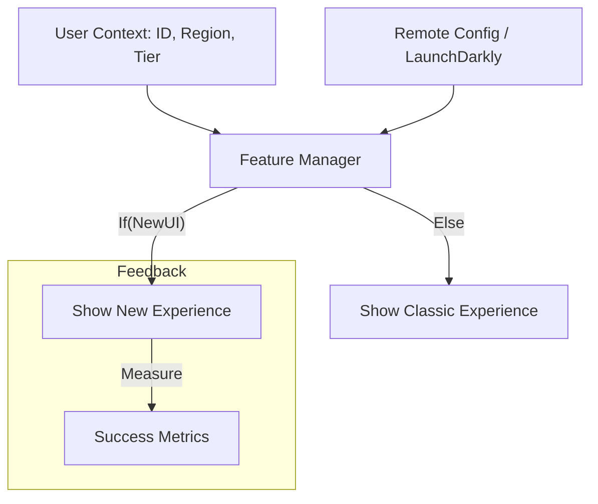

# Feature Flags and Dark Launching: Decoupling Deployment from Release
**0. Architectural Vision: The Runtime Switch**
- **Decoupling Deployment from Release.** Deployment is "Moving bits to servers". Release is "Turning those bits on for users". Feature flags allow you to do the first without the second.
- **Dark Launching.** Turning on a complex feature in production for 0% of users, but having it process background data or perform "Invisible" work to test its performance.
- **Toggles vs Flags.** 
    - **Release Toggles:** Temporary flags to hide unfinished work (Trunk-Based Development).
    - **Ops Toggles:** Flags to turn off "Heavy" features (like AI search) if the server is under high load.
    - **Experimentation Toggles:** A/B testing different UI versions.
- **Architect's View.** We move from "Static Code" to "Dynamic Behavior". We use **Feature Management** to achieve **Zero-Risk Releases**, **Instant Features Off**, and **Continuous Experimentation**.

**1. Foundational Problem: The "All-or-Nothing" Release**
- **Real-World Impact:** You have a new "Checkout Flow". (1) If it has a bug, *every* customer is affected. (2) If it's slow, *the whole site* is slow. 
- **What breaks?** "The Speed". You have to wait until 100% of the code is "Done and Perfect" before you merge it to `main`. This results in 3-week-long branches and painful merges.
- **Scale Boundary:** In a microservices mesh, you cannot coordinate the simultaneous release of 5 services. You need to deploy them one by one and then "Turn the Flag On" once they are all ready.
- **Failure Story:** A major social media app released a "Video Auto-Play" feature. Within 5 minutes, their bandwidth costs tripled and users complained about data usage. Because the code was hardwired, they had to perform an emergency hotfix and redeploy, which took 2 hours. If they had used a **Feature Flag**, they could have toggled it "OFF" in **300ms**, saving the company $100,000 in bandwidth and preserving their reputation.

**2. Internal System Mechanics: The Flag Lifecycle**

### The Feature Management Flow
1. **Definition:** Flag `NewSearch` is added to Config (JSON/SQL/Cloud).
2. **Context:** The app gets the User Context (e.g., "Is User Premium?", "Is User in NYC?").
3. **Evaluation:** The `FeatureManager` decides `True` or `False`.
4. **Execution:** The app runs `if (isEnabled)` block.



**3. Production Engineering in .NET 8 (Microsoft.FeatureManagement)**

### Anti-Pattern: Hardcoded 'if (config["MyFlag"] == "true")'
```csharp
// TERRIBLE: String-based checks scattered across the app. 
// Hard to test, easy to typo, and difficult to audit.
```

### Production-Ready Implementation: .NET Feature Flags
```csharp
// 1. Definition (appsettings.json)
"FeatureManagement": {
  "NewRecommendationEngine": {
    "EnabledFor": [
      {
        "Name": "Percentage",
        "Parameters": { "Value": 10 } // Start with 10%
      }
    ]
  }
}

// 2. Usage in Controller
public class HomeController : Controller {
    private readonly IFeatureManager _featureManager;
    public HomeController(IFeatureManager fm) => _featureManager = fm;

    public async Task<IActionResult> Index() {
        if (await _featureManager.IsEnabledAsync("NewRecommendationEngine")) {
            return View("Index_New");
        }
        return View("Index_Old");
    }
}

// 3. Usage in Middleware (FeatureGate)
[FeatureGate("BetaTesting")]
public class BetaController : Controller { /* ... */ }
```

**Architecture Strategy:** 
- Use **Feature Filters**. Build custom filters like `TimeWindowFilter` ("Enable only from Friday-Monday") or `TargetingFilter` ("Enable only for @company.com emails").
- Implement **Remote Configuration**. Use **Azure App Configuration** to change flags in production in real-time without an app restart or redeploy.

**4. System Interaction & Flow (ASCII Architecture)**

                 ┌──────────────────┐
                 │   The Architect  │ (Toggle Switch)
                 └────────┬─────────┘
                          │ 1. Set 'NewFeature' to True
          ┌───────────────▼───────────────┐
          │      REMOTE CONFIG SERVICE    │ (Azure App Config / LaunchDarkly)
          │  ┌─────────┐   ┌─────────┐    │
          │  │ Weights │ → │ Polling │    │
          │  │ Audit   │   │ Push    │    │
          │  └────┬────┘   └────┬────┘    │
          └───────┼─────────────┼─────────┘
                  │             │ 2. Signal App instances (EventGrid)
          ┌───────▼─────────────▼─────────┐
          │       The Running Pods        │ (Context-Aware Execution)
          └───────────────┬───────────────┘
                          │ 3. Instant Behavior Change
                ┌─────────▼─────────┐
                │   Zero-Downtime FX│
                └───────────────────┘

**5. Strategic Scaling & System Evolution**
- **Micro-Experimentation.** Running 50 different "Small" flags simultaneously to find the exact combination of buttons and colors that maximize user conversion (A/B testing at scale).
- **Kill Switch (Circuit Breaker).** If the "New Search v2" is causing SQL timeouts, a monitor automatically pings the Feature Management API to flip the flag to "OFF", saving the database.

**6. Reliability, Observability & Runtime Governance**
- **Key Metrics:**
    - `Flag Evaluation Latency`: Is the Feature Manager adding 50ms to every request?
    - `Active Flags Count`: Are we accumulating "Flag Debt"?
- **Observability:** Tag your **Telemetry (OpenTelemetry)** with the active flags. When looking at a crash log, you need to know "Was this user on the NewSearch flag?".

**7. Compromises, Tradeoffs & Alternatives**
- **Technical Debt.** "A feature flag is a debt that must be paid." If you don't delete the flag after the rollout is 100%, your code becomes a "Spaghetti" mess of `if/else` statements.
    - *Architect's Rule:* Set an **Expiry Date** for every flag. If the flag is older than 30 days, it must be deleted.
- **Complexity.** Testing 2 versions of the code (Flag ON and Flag OFF) doubles your QA effort.

**8. Security Posture & Risk Mitigation**
- **Restricted Access.** Only a few specific people (Release Managers) should have permission to flip a "Production" flag.
- **Audit Logging.** Every flag change must be logged with: WHO changed it, WHAT was the old value, and WHAT is the new value?

**9. Technical Edge Cases & System Failure Modes**
- **The "Context Inconsistency".** An API request says the flag is ON, but the subsequent call to the database says the flag is OFF because the config was updated mid-request.
    - *Architect's Rule:* Use **Scoped Feature Management** to ensure a flag value is fixed for the duration of a single HTTP request.
- **The "Missing Config".** The remote config service is down. 
    - *Architect's Rule:* Always define a **Local Default** in your `appsettings.json`.

**10. Architectural Assessment & Career Progression**
- **Senior:** "We use feature flags so we can merge unfinished code to main without users seeing it."
- **Principal:** "Architecture is the **Post-Deployment Management of Risk**. We leverage **Dynamic Feature Management and Remote Configuration** to dissociate the delivery of bits from the activation of value. We architecturalize for **Real-Time Adaptivity**, utilizing **Contextual Filters and Circuit Breaker Integration** to ensure that our platform can recover from regression in milliseconds without a redeploy. For us, code is **Inert**, and feature flags are the **Enzymes that Catalyze Intent**."
- **Interview Strategy:** Explain how to handle "Flag Debt". Describe a scenario where a "Kill Switch" saved a production environment.

**11. Real-World Case Study: 1,000 Flags at Netflix**
**Scenario:** A global streaming service with 200 million users.
- **The Problem:** Deploying a new "Video Player" to 200M people at once is impossible.
- **The Design:** Used **LaunchDarkly**. They roll out features by "Device Brand", "Network Speed", and "User Region".
- **Result:** They can test a new compression algorithm on exactly 1,000 users in Brazil using Android phones. If it increases buffertime, they kill it. If it works, they expand. They maintain 1,000+ active flags without crashing the site.

**12. Structural Dependencies & Learning Path**
- **Foundations:** ASP.NET Core Middleware, IOptions.
- **Future Steps:** LaunchDarkly, Optimizely, Azure App Configuration.
- **Integration Points:** Microsoft.FeatureManagement.AspNetCore, LaunchDarkly.NET.
