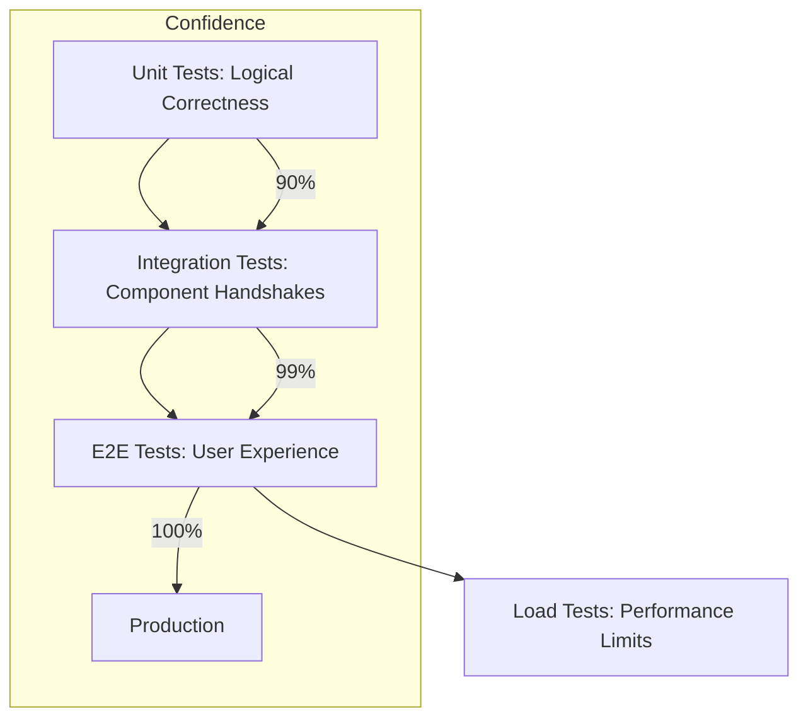

# Testing Strategies: The Architecture of Quality Assurance
**0. Architectural Vision: The Pyramid of Confidence**
- **The Testing Pyramid.** 
    - **Unit Tests:** (The Base). Fast, cheap, isolated logic.
    - **Integration Tests:** Verifying the "Handshakes" between components (DB, API, Registry).
    - **E2E Tests:** (The Tip). Slow, expensive, mimic a real user flow.
- **TDD (Test-Driven Development).** Writing the test *before* the code to drive better architectural design.
- **Load Testing.** Simulating 1,000s of users to find performance bottlenecks *before* they hit production.
- **Architect's View.** We move from "Manual Testing" to "Automated Verification". We focus on **Reliability**, **Coverage**, and **Regression Prevention**. We understand that a system without tests is a system with "Hidden Costs" (bugs) that will bankrupt the project's velocity.

**1. Foundational Problem: The "Feature Fragility"**
- **Real-World Impact:** You make a "Simple Change" to the Discount Logic. 2 weeks later, you realize that the "Member Login" is broken. 
- **What breaks?** "The Confidence". You are now afraid to touch the code. Every change is a "Prayer" that nothing else breaks. You spend 50% of your time fixing bugs from the *last* release instead of building new value.
- **Scale Boundary:** In a system of 1 million lines of code, no single human knows every impact of a change. Manual QA takes 3 weeks per release, slowing the business to a crawl.
- **Failure Story:** A major e-commerce platform had zero **Integration Tests** for their third-party payment gateway. One day, the gateway updated their API format, and every checkout on the site failed with a 500 error. The site was down for 12 hours. Migrating to **Automated Integration Testing (with Testcontainers)** ensured that they caught the API change in their daily CI build, fixing it in 15 minutes before any customer was affected.

**2. Internal System Mechanics: The Quality Gates**

### The Testing Lifecycle
1. **Unit:** Test a single class/method in 1ms.
2. **Integration:** Spin up a real SQL DB (Docker) and test the `Repository` class.
3. **E2E:** Fire up the Browser and perform a full "Signup -> Purchase" flow.
4. **Load:** Run 1,000 "Purchase" flows per second to check CPU/RAM.



**3. Production Engineering in .NET 8 (XUnit & Testcontainers)**

### Anti-Pattern: Mocking the Database
```csharp
// TERRIBLE: Using an In-Memory List to 'Mock' your SQL Repository.
// Real databases have Constraints, Triggers, and SQL syntax that Mocks don't.
// Your 'fake' DB works, but the 'real' SQL fails in production.
```

### Production-Ready Implementation: Integration Test with Testcontainers
```csharp
// 1. Defining the Test with a Real SQL Container
public class OrderRepositoryTests : IAsyncLifetime {
    private readonly MsSqlContainer _dbContainer = new MsSqlBuilder().Build();

    public async Task InitializeAsync() => await _dbContainer.StartAsync();
    public async Task DisposeAsync() => await _dbContainer.StopAsync();

    [Fact]
    public async Task CreateOrder_ShouldSaveToDb() {
        // Arrange
        var context = new OrderDbContext(_dbContainer.GetConnectionString());
        var repo = new OrderRepository(context);

        // Act
        await repo.AddAsync(new Order { Id = 1, Total = 50.0m });

        // Assert
        var saved = await context.Orders.FindAsync(1);
        Assert.NotNull(saved);
        Assert.Equal(50.0m, saved.Total);
    }
}
```

**Architecture Strategy:** 
- Implement **Contract Testing (Pact)**. Instead of full E2E, test that the "Consumer" (Frontend) and "Provider" (API) agree on the JSON format. This replaces slow E2E tests with fast, resilient contract checks.
- Use **Mutation Testing (Stryker.NET)**. This tool changes your code slightly (e.g., changes `>` to `<`) to see if your tests catch it. If your tests still pass, your tests are weak.

**4. System Interaction & Flow (ASCII Architecture)**

                 ┌──────────────────┐
                 │    The Code      │ (Pull Request)
                 └────────┬─────────┘
                          │ 1. Run Gate 1: Unit
          ┌───────────────▼───────────────┐
          │      THE TESTING PIPELINE     │ (Confiner of Quality)
          │  ┌─────────┐   ┌─────────┐    │
          │  │ Integration│ → │ Load    │    │
          │  │ (Docker)   │   │ (k6)    │    │
          │  └────┬────┘   └────┬────┘    │
          └───────┼─────────────┼─────────┘
                  │             │ 2. Analyze Coverage & Performance
          ┌───────▼─────────────▼─────────┐
          │       The Approval Board      │ (Auto-Approve/Reject)
          └───────────────┬───────────────┘
                          │ 3. Manifest Stable Code
                ┌─────────▼─────────┐
                │   Zero Regression │
                └───────────────────┘

**5. Strategic Scaling & System Evolution**
- **Parallel Execution.** Running 5,000 unit tests on 8 CPU cores to finish in < 5 seconds.
- **Testing in Production.** Using **Feature Flags** (Dark Launching) to run a new feature for "Internal Users" in the real production environment, ensuring it works with real scale and real data.

**6. Reliability, Observability & Runtime Governance**
- **Key Metrics:**
    - `Test Coverage %`: Is it increasing or decreasing?
    - `Flaky Test Ratio`: How many tests need a "Retry" to pass?
- **Observability:** Monitor **Load Test Heatmaps**. Where does the system fail? Is it the DB connection pool? The thread pool? The network?

**7. Compromises, Tradeoffs & Alternatives**
- **Cost of E2E.** Playwright tests take minutes to run and break often when CSS classes change. 
    - *Architect's Tip:* Keep E2E tests to the **"Happy Path"** only (e.g., "Can a user log in?"). Use Unit/Integration for the other 99% of edge cases.
- **100% Coverage is a Lie.** You can have 100% coverage and still have bugs if your assertions are weak.

**8. Security Posture & Risk Mitigation**
- **Static Analysis (SAST).** Running tools like `SonarQube` during the test phase to find "Insecure Code Patterns" like potential SQL Injections.
- **Dependency Scan.** Checking every NuGet package for "Known Vulnerabilities" (CVEs) during the build.

**9. Technical Edge Cases & System Failure Modes**
- **The "Stale" Mock.** You mocked the API in your tests, but the real API changed. Your tests say "Green" but production is "Red".
- **The "Phantom Load Bug".** Your load tests pass because you testing "1,000 users reading". In production, the system fails because you had "1,000 users writing", which caused database deadlocks.

**10. Architectural Assessment & Career Progression**
- **Senior:** "We have 80% code coverage and we use Testcontainers to run our integration tests against a real database."
- **Principal:** "Architecture is the **Institutionalization of Verification**. We leverage **Multi-Dimensional Testing and Mutation Analysis** to neutralize the risk of regression. We architecturalize for **Continuous Assertion**, utilizing **Ephemeral Infrastructure and Contract Enforcement** to ensure that our system's behavior is a deterministic, provable outcome of our specifications. For us, a line of code is a **Liability** until it is surrounded by an immutable layer of automated proof."
- **Interview Strategy:** Explain the "Testing Pyramid". Describe how you would fix a "Flaky Test".

**11. Real-World Case Study: Global Tax Calculator**
**Scenario:** A company calculating tax for 50 countries (1,000,000 rules).
- **The Problem:** One small change to the "VAT Rule in France" broke the "Corporate Tax in Japan".
- **The Design:** Implemented **Massive Unit Testing** (100,000 tests) and **Data-Driven Testing** (1,000,000 tax scenarios).
- **Result:** They can change any rule with 100% confidence. The system runs all 100k tests in 10 minutes on a build cluster. The "Japanese Bug" never happened again because it was caught in CI.

**12. Structural Dependencies & Learning Path**
- **Foundations:** xUnit/NUnit, Moq/NSubstitute.
- **Future Steps:** Playwright (E2E), k6 (Load Testing), Stryker (Mutation).
- **Integration Points:** GitHub Actions (the runner), Testcontainers.NET.
