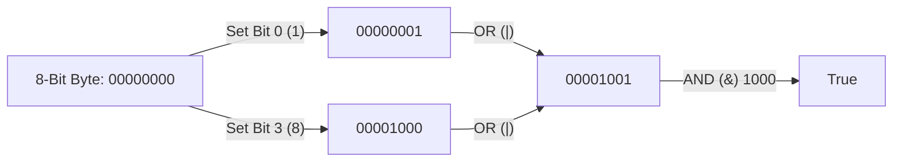

# Bit Manipulation: The Architecture of the Silicon Layer
============================================================
0. Architectural Vision: The Power of 2
============================================================
- **Everything is a Bit.** At the lowest level, every architectural decision eventually boils down to how we manipulate $0$s and $1$s.
- **Micro-Optimization for Macro-Scale.** When processing 1 billion records, saving $1$ byte per record saves $1$ GB of precious RAM.
- **The Operators:**
    - **`&` (AND):** Masking bits (Checking if a specific bit is set).
    - **`|` (OR):** Setting bits (Combining multiple flags).
    - **`^` (XOR):** Toggling bits (The basis of encryption and parity).
    - **`~` (NOT):** Inverting all bits.
    - **`<<` / `>>` (Shifts):** Ultra-fast multiplication and division by powers of 2.
- **Architect's View.** We move from "Object-Oriented Bloat" to "Bit-Dense Structures". We use **Bit Flags**, **Memory Alignment**, and **Bitfields** to build systems that are significantly faster because they stay entirely within the CPU's cache.

============================================================
1. Foundational Problem: The "Object Overhead" and "False Sharing"
============================================================
- **Real-World Impact:** You have a `UserStatus` class with 10 boolean properties (e.g., `IsActive`, `IsPremium`, `IsVerified`). In C#, each property takes $1$ byte (even though a bit would do), plus the object header ($24-32$ bytes).
- **What breaks?** "The Density". Storing 1 million of these "Small" objects consumes $80$ MB of RAM. Worse, iterating through these objects causes constant "Cache Misses" because they are scattered in memory.
- **Scale Boundary:** High-frequency trading systems or search engine indexers cannot afford the latency of "Pointer Chasing". They need the data to be packed tightly in memory.
- **Failure Story:** A game engine used objects for 100,000 "Entities". At 60 FPS, the "Garbage Collector" was constantly pausing the game ($20ms$ spikes) because it had to track all these objects. Migrating to a **Bit-Packed ECS (Entity Component System)** stored all 10 flags in a single `int32`, reduced memory by 90%, and eliminated GC pauses completely.

============================================================
2. Internal System Mechanics: Bit-Gating and Flags
============================================================

### Bit Manipulation Patterns
1. **The Mask:** `(flags & Mask) != 0` -> Did the user perform Action X?
2. **The Set:** `flags |= Mask` -> Add permission Y.
3. **The Clear:** `flags &= ~Mask` -> Remove feature Z.
4. **The Toggle:** `flags ^= Mask` -> Switch state.



============================================================
3. Production Engineering in .NET 8 (Flags & Span)
============================================================

### Anti-Pattern: Individual Boolean Columns?
```csharp
// TERRIBLE: Manually creating 30 columns for 30 bools in a DB or 30 fields in a class.
public bool IsAdmin { get; set; }
public bool IsPaid { get; set; }
// ...
```

### Production-Ready Implementation: [Flags] Enum & Bitwise Checks
```csharp
[Flags]
public enum UserPermissions : uint {
    None = 0,
    Read = 1 << 0,   // 1
    Write = 1 << 1,  // 2
    Delete = 1 << 2, // 4
    Admin = 1 << 3   // 8
}

// 1. Efficient check
public bool CanWrite(UserPermissions current) {
    return (current & UserPermissions.Write) != 0;
}

// 2. High-Performance Bit Counting (Popcount)
// How many permissions does this user have total?
int count = System.Numerics.BitOperations.PopCount((uint)userPerms);
```

**Architecture Strategy:** 
- Use **Memory Alignment**. Ensure that your structs are aligned to $8$-byte boundaries. A $9$-byte struct actually takes $16$ bytes in many runtimes, wasting space.
- Leverage **SIMD (Single Instruction, Multiple Data)**. MODERN CPUs can perform bitwise operations on 256 bits (32 bytes) at once in a single clock cycle.

============================================================
4. System Interaction & Flow (ASCII Architecture)
============================================================

                 ┌──────────────────┐
                 │  Business Rules  │ (Auth / Feature Toggle)
                 └────────┬─────────┘
                          │ 1. Logic -> Bit Index
          ┌───────────────▼───────────────┐
          │      BIT ENGINE               │ (The Masking Logic)
          │  ┌─────────┐   ┌─────────┐    │
          │  │ Shift   │ → │ Bitwise │    │
          │  │ (<<)    │   │ (AND/OR)│    │
          │  └────┬────┘   └────┬────┘    │
          └───────┼─────────────┼─────────┘
                  │             │ 2. Single CPU Cycle
          ┌───────▼─────────────▼─────────┐
          │       The Memory Bus          │ (Packed Bytes)
          └───────────────┬───────────────┘
                          │ 3. Max Cache Content
                ┌─────────▼─────────┐
                │ Ultra-Low Latency │
                └───────────────────┘

============================================================
5. Strategic Scaling & System Evolution
============================================================
- **Elias Delta Decoding.** Using variable-length bit patterns to store small numbers in fewer than 8 bits (Used in Search Indexers).
- **Roaring Bitmaps.** A compressed bit-set that is extremely fast for performing Set Theory (Intersection/Union) on millions of IDs.

============================================================
6. Reliability, Observability & Runtime Governance
============================================================
- **Key Metrics:**
    - `Bits per Record`: Goal is to stay below $64$ bits for metadata.
    - `L1 Cache Misses`: Higher misses indicate data is not bit-packed efficiently.
- **Observability:** In your performance logs, track the **Alignment Padding** of your core data transfer objects (DTOs).

============================================================
7. Compromises, Tradeoffs & Alternatives
============================================================
- **Readability.** Bitwise code is notoriously difficult for junior developers to read. 
    - *Architect's Tip:* Wrap the bits in a strongly-typed `Value Object` so the business code reads like `user.HasPermission(p)`.
- **Debugging.** Inspecting a raw hex value like `0x4A3` in a debugger is harder than seeing a list of booleans.

============================================================
8. Security Posture & Risk Mitigation
============================================================
- **Bitwise Side-Channel Attacks.** In cryptography, if an `if` statement depends on a bit, an attacker can measure the "Time" difference to guess the private key.
    - *Architect's Rule:* Use **Constant-Time Bitwise Logic** for all security-sensitive comparisons.

============================================================
9. Technical Edge Cases & System Failure Modes
============================================================
- **Endianness.** A bit pattern saved on an Intel (Little Endian) machine might be interpreted differently on some ARM or special-purpose hardware.
- **Integer Overflow.** Shifting a bit past the 31st/63rd position will lose it or trigger an Exception in `checked` contexts.

============================================================
10. Architectural Assessment & Career Progression
============================================================
- **Senior:** "We use an enum with [Flags] so we can store all user permissions in a single database column."
- **Principal:** "Architecture is the **Optimization of Data Density**. We leverage **Bitwise Algebra and SIMD intrinsics** to neutralize the performance penalties of high-level abstractions. We architecturalize for **Cache-Coherent Density**, utilizing **Bit-Packed Fields and Memory-Aligned Structs** to ensure that our operations execute within the nanosecond boundaries of L1 silicon. For us, a bit is a **Unit of Sovereign Intent**, and manipulating it is the purest form of system control."
- **Interview Strategy:** Explain how to check if a number is a power of 2 using bits: `(n != 0) && ((n & (n - 1)) == 0)`.

============================================================
11. Real-World Case Study: High-Speed Log Analytics
============================================================
**Scenario:** A log processor (like Datadog/NewRelic) processing 100B logs/day.
- **The Problem:** Searching for "Logs with Error=True AND Trace=True". A SQL query was too slow.
- **The Design:** Created a **Bitmap Index**. Each log is a bit in a long sequence.
- **Result:** Intersecting two 1-billion-bit "Filters" takes only $50ms$ using bitwise AND, allowing users to search across petabytes of logs in sub-second time.

============================================================
12. Structural Dependencies & Learning Path
============================================================
- **Foundations:** Binary (Base-2), Hexadecimal, Two's Complement.
- **Future Steps:** SIMD intrinsics in .NET (Avx2), Bit-level Compression (Zstandard).
- **Integration Points:** System.Numerics.BitOperations, Unsafe.As.
