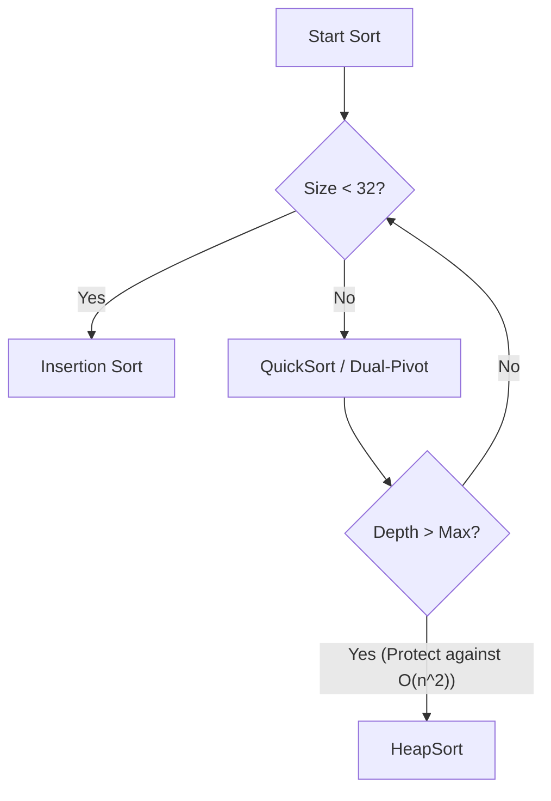

# Advanced Sorting and Searching: The Engineering of Order
============================================================
0. Architectural Vision: The Speed of Comparison
============================================================
- **Sorting is the Backbone of Optimization.** An unsorted list is $O(n)$ to search; a sorted list is $O(\log n)$. Most complex systems spend $30\%$ of their CPU time just putting things in order.
- **Timsort (The Modern King).** A hybrid of Merge Sort and Insertion Sort. Used in Python, Java, and many .NET scenarios for real-world data (which is often partially sorted).
- **Dual-Pivot QuickSort.** Improvements to the standard QuickSort that reduce CPU branch mispredictions.
- **IntroSort (Introspective Sort).** What `.Sort()` actually uses. Starts with QuickSort, switches to HeapSort if it gets too deep, and uses Insertion Sort for small arrays.
- **Architect's View.** We don't just call `.Sort()`; we understand **Stability**, **Locality**, and **Pivot Selection**. We choose algorithms based on the "Shape" of our data to minimize memory swaps and maximize CPU cache usage.

============================================================
1. Foundational Problem: The "Worst-Case Scenario" and "Stability"
============================================================
- **Real-World Impact:** You are building a "Top 100" Leaderboard. You use a basic QuickSort.
- **What breaks?** "The Consistency". If your pivot selection is poor (e.g., choosing the first element of an *already sorted* list), QuickSort's $O(n \log n)$ performance collapses into $O(n^2)$. Your leaderboard calculation goes from $1ms$ to $10$ seconds.
- **Scale Boundary:** "Stability" is critical. If you have a list of `Orders` sorted by `Date`, and you then sort them by `CustomerID`, a **Stable** sort (Merge Sort/Timsort) will keep the orders in date order *within* each customer. An **Unstable** sort will shuffle the dates.
- **Failure Story:** A major trading platform used an unstable sort for bid processing. When two identical bids arrived at the same millisecond, the sort order became random on every refresh, leading to "Bid Jumping" complaints. Migrating to a **Stable Timsort ($O(n \log n)$ worst-case)** ensured that original order (time-seniority) was always preserved for identical bids.

============================================================
2. Internal System Mechanics: Hybridization and Recursion
============================================================

### The Sorting Hierarchy
1. **Divide and Conquer:** Breaking the problem into smaller pieces (QuickSort/MergeSort).
2. **Min-Max Heaps:** Maintaining the smallest/largest element at the top ($O(1)$ peek, $O(\log n)$ insert).
3. **Small Array Optimizations:** Using Insertion Sort ($O(n^2)$ but very fast) for lists smaller than 32 elements to avoid recursion overhead.



============================================================
3. Production Engineering in .NET 8 (Array.Sort & PriorityQueue)
============================================================

### Anti-Pattern: Manual Bubble Sort (Ever)
```csharp
// TERRIBLE: Any loop where you move items one by one in a nested loop.
// O(n^2) is almost never acceptable for arrays larger than 50 items.
```

### Production-Ready Implementation: PriorityQueue (The Heap)
```csharp
// 1. Efficient 'Top K' Search (Finding the top 5 scores out of 1 million)
// Instead of sorting the whole million (O(n log n)), use a Min-Heap (O(n log k)).
var topK = new PriorityQueue<string, int>();

foreach (var player in players) {
    topK.Enqueue(player.Name, player.Score);
    if (topK.Count > 5) {
        topK.Dequeue(); // Remove the lowest of the 'Top 5'
    }
}
// Final 5 in topK are the highest scorers.

// 2. Linear Sorting (Radix Sort)
// If you are sorting ONLY integers or strings, you can sometimes achieve O(n)
// time by using the bits of the data as buckets (Radix Sort).
```

**Architecture Strategy:** 
- **Binary Search is not just for Lists.** Use it for "Search Spaces" (e.g., "What is the lowest percentage of CPU I can allow while still meeting my target?").
- **External Sorting.** If your data is $1TB$ and your RAM is $32GB$, use **Merge Sort** to sort "Chunks" on disk and then merge them.

============================================================
4. System Interaction & Flow (ASCII Architecture)
============================================================

                 ┌──────────────────┐
                 │  Input Data      │ (Random / Sorted / Reversed)
                 └────────┬─────────┘
                          │ 1. Estimate Entropy
          ┌───────────────▼───────────────┐
          │      THE SORTING ENGINE       │ (IntroSort / Timsort)
          │  ┌─────────┐   ┌─────────┐    │
          │  │ Pivot   │ → │ Memory  │    │
          │  │ Picker  │   │ Swapper │    │
          │  └────┬────┘   └────┬────┘    │
          └───────┼─────────────┼─────────┘
                  │             │ 2. Logarithmic Reduction
          ┌───────▼─────────────▼─────────┐
          │       The L3 Cache            │ (Locality of Reference)
          └───────────────┬───────────────┘
                          │ 3. Sorted Continuous Memory
                ┌─────────▼─────────┐
                │   Stable Order    │
                └───────────────────┘

============================================================
5. Strategic Scaling & System Evolution
============================================================
- **分布式排序 (Distributed Sort).** Partitioning data by range (e.g., A-M to Server 1, N-Z to Server 2) and sorting in parallel.
- **Topological Sort.** Sorting nodes in a directed graph where children must come after parents (Used in Build Systems like MSBuild).

============================================================
6. Reliability, Observability & Runtime Governance
============================================================
- **Key Metrics:**
    - `Sort Inversions`: How "Out of order" was the data initially?
    - `Comparison Count`: The true cost of the sort.
- **Observability:** Track the **Recusion Depth** of your custom sorts to pre-emptively catch data distributions that might cause stack overflows.

============================================================
7. Compromises, Tradeoffs & Alternatives
============================================================
- **Space vs Time.** Merge Sort is stable but costs $O(n)$ extra memory. QuickSort is $O(1)$ extra memory but is unstable.
- **In-Place Sort.** If memory is tight, an in-place QuickSort is your only option.

============================================================
8. Security Posture & Risk Mitigation
============================================================
- **Pivot Selection Randomization.** Using a random pivot prevents an attacker from sending a "Killer Sequence" that triggers $O(n^2)$ behavior for malicious DoS.
- **Data Poisoning.** Ensuring that the `IComparer` is deterministic. If `a < b` and `b < c`, then `a` MUST be `< c`. An inconsistent comparer can crash the `.Sort()` method.

============================================================
9. Technical Edge Cases & System Failure Modes
============================================================
- **The "Equal Key" Trap.** Sorting a list of 1 million identical numbers. A poorly implemented QuickSort might still perform $O(n^2)$ splits.
    - *Architect's Rule:* Use **3-Way Partitioning** (Dutch National Flag) to handle duplicate keys in $O(n)$ time.
- **Cache Pollution.** A Merge Sort that copies data to new arrays constantly will flush the CPU cache, slowing down the entire server.

============================================================
10. Architectural Assessment & Career Progression
============================================================
- **Senior:** "I use Binary Search on this sorted array because it's much faster than scanning."
- **Principal:** "Architecture is the **Orchestration of Sequence**. We leverage **Hybridized IntroSorts and Heap-Based Priority Queues** to neutralize the entropy of incoming data streams. We architecturalize for **Cache-Aware Locality**, utilizing **In-Place Swapping and Stable Merging** to ensure that our ordering logic maintains structural integrity without sacrificing throughput. For us, a sort is not an isolated function, but a **Preprocessing Strategic Choice** that empowers the efficiency of all downstream layers."
- **Interview Strategy:** Compare QuickSort and MergeSort. Explain when you would use a Heap instead of a full Sort.

============================================================
11. Real-World Case Study: High-Volume Logistics Tracker
============================================================
**Scenario:** A delivery company tracking 10 million packages a day.
- **The Problem:** Showing the "Oldest 10 Pending Deliveries" for each city in real-world.
- **The Design:** Instead of sorting the packages every minute, they used a **Min-Heap (Priority Queue)** for each city.
- **Result:** CPU usage dropped by 80%. What was once an $O(n \log n)$ operation became a near-constant $O(k \log n)$ operation, where $k$ is only 10.

============================================================
12. Structural Dependencies & Learning Path
============================================================
- **Foundations:** Recursion, Binary Trees, Swapping logic.
- **Future Steps:** Parallel Sort (PLINQ), GPU-accelerated sorting.
- **Integration Points:** System.Collections.Generic.PriorityQueue, Array.Sort<T>.
