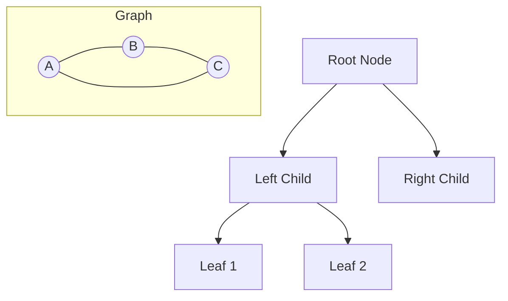

# Tree & Graph Architectures: The Topology of Systems
============================================================
0. Architectural Vision: The Hierarchy and the Mesh
============================================================
- **Trees are about Hierarchy and Fast Search.** B-Trees keep our databases fast; Tries keep our search bars responsive.
- **Graphs are about Relationships and Navigation.** Social networks, recommendation engines, and network routing are all just large-scale graph traversals.
- **B-Trees vs. LSM Trees.** The classic database debate. B-Trees optimize for **Reads** (SQL Server/Postgres); LSM Trees optimize for **Writes** (Cassandra/LevelDB).
- **DAG (Directed Acyclic Graph).** The engine of modern logic. If you use GitHub Actions, Docker, or MSBuild, you are using a DAG to handle dependencies.
- **Architect's View.** We don't just "Store Data"; we **Architect the Connections**. We choose **B-Trees for reliable indexing** and **Graphs for complex link analysis**. We understand that the "Shape" of our data structure defines the "Ceiling" of our system's complexity.

============================================================
1. Foundational Problem: The "Flat List" Bottleneck
============================================================
- **Real-World Impact:** You are building a "Comment Thread" system where comments can have infinite replies. You store them in a flat SQL table with a `ParentId`.
- **What breaks?** "The Traversal". To render a single post with 1,000 nested comments, your app has to perform 1,000 separate SQL queries (The N+1 problem) or load everything into RAM and build a tree manually every time.
- **Scale Boundary:** In a social graph with 1 billion users, finding a "Friend of a Friend" using standard SQL JOINS is computationally impossible. The join operation becomes $O(n^k)$, where $k$ is the depth.
- **Failure Story:** A major project management tool used a flat list for tasks. When a project reached 5,000 tasks with complex dependencies, the "Auto-Schedule" feature took 10 minutes to run because it was recalculating everything using nested loops. Migrating to a **DAG-based scheduler** allowed them to recalculate only the "Affected Nodes" in $50ms$ using **Topological Sorting**.

============================================================
2. Internal System Mechanics: Branching and Balancing
============================================================

### The Structural Landscape
1. **Self-Balancing Trees (AVL/Red-Black):** Keeping the tree height at $\log n$ so search is always fast.
2. **B+-Trees:** Leaf nodes are linked in a list, making "Range Scans" (e.g., `WHERE Price > 100`) ultra-fast.
3. **Adjacency Lists:** Storing a graph as a list of "Who is connected to whom".
4. **BFS vs. DFS:** **BFS** finds the "Shortest Path" (LinkedIn 1st-degree friends); **DFS** explores deep "Dependency Chains".



============================================================
3. Production Engineering in .NET 8 (Dictionaries & Graphs)
============================================================

### Anti-Pattern: Deep Recursion for Trees
```csharp
// TERRIBLE: Simple recursion without depth limits.
public int GetTotalWeight(Node node) {
    return node.Weight + node.Children.Sum(c => GetTotalWeight(c));
}
// For a tree with depth 10,000 (possible in some data sets), 
// this will trigger a StackOverflowException.
```

### Production-Ready Implementation: Iterative BFS (The Queue)
```csharp
// 1. Finding a node in a large graph/tree safely
public Node FindNode(Node root, string targetId) {
    var queue = new Queue<Node>();
    queue.Enqueue(root);
    var visited = new HashSet<string>(); // Prevent Infinite Loops in Graphs

    while (queue.Count > 0) {
        var current = queue.Dequeue();
        if (current.Id == targetId) return current;

        foreach (var child in current.Children) {
            if (visited.Add(child.Id)) {
                queue.Enqueue(child);
            }
        }
    }
    return null;
}
```

**Architecture Strategy:** 
- Use **B-Trees for Storage**. The wide branching factor (e.g., 100 children per node) means you only need 3-4 "Disk Hops" to find one specific record out of 100 million.
- Implement **Cycle Detection** in your DAGs to prevent infinite build loops.

============================================================
4. System Interaction & Flow (ASCII Architecture)
============================================================

                 ┌──────────────────┐
                 │   Root Request   │ (Search / Navigation)
                 └────────┬─────────┘
                          │ 1. Start Traversal
          ┌───────────────▼───────────────┐
          │      BRANCHING LOGIC          │ (The Binary Choice)
          │  ┌─────────┐   ┌─────────┐    │
          │  │ Left    │ → │ Right   │    │
          │  │ (< X)   │   │ (> X)   │    │
          │  └────┬────┘   └────┬────┘    │
          └───────┼─────────────┼─────────┘
                  │             │ 2. O(log n) Reduction
          ┌───────▼─────────────▼─────────┐
          │       The Page Cache          │ (B-Tree Node Buffer)
          └───────────────┬───────────────┘
                          │ 3. Target Data Reached
                ┌─────────▼─────────┐
                │   Rapid Retrieval │
                └───────────────────┘

============================================================
5. Strategic Scaling & System Evolution
============================================================
- **Graph Databases (Neo4j / Cosmos DB Graph).** Storing data as "Nodes" and "Edges" natively, allowing for complex "Pattern Matching" queries that would kill a SQL database.
- **LSM Tree Compaction.** Background "Merging" of small sorted tree files into larger ones to keep Read performance high in write-heavy systems (like Prometheus).

============================================================
6. Reliability, Observability & Runtime Governance
============================================================
- **Key Metrics:**
    - `Tree Balance Factor`: Is our search speed degrading?
    - `Graph Connectivity Score`: Detecting "Islands" in the network.
- **Observability:** Monitor the **Index fragmentation** of your B-Trees. If fragmentation is high, your $O(\log n)$ search becomes $O(n)$ disk scans.

============================================================
7. Compromises, Tradeoffs & Alternatives
============================================================
- **Complexity.** Coding a Red-Black Tree correctly is one of the hardest tasks in CS.
    - *Architect's Tip:* Use the built-in `SortedDictionary<T, K>`—it's already a tested Red-Black Tree.
- **Memory Overhead.** Each "Edge" in a graph and each "Pointer" in a tree takes up RAM.

============================================================
8. Security Posture & Risk Mitigation
============================================================
- **Circular Dependency Attacks.** Injecting a loop into a workflow engine to crash the server via infinite resource consumption.
- **Graph Infiltration.** In highly connected systems, ensuring that one "Public" node doesn't have an "Edge" to a "Private" node through a series of inconspicuous hops (The "Reachability" problem).

============================================================
9. Technical Edge Cases & System Failure Modes
============================================================
- **The "Unbalanced" Tree.** If you insert data in sorted order into a basic BST, it becomes a Linked List, losing all efficiency.
- **The "Super-Node".** A celebrity on a social network with 100 million followers. Loading their "Edges" into memory can crash a single server.

============================================================
10. Architectural Assessment & Career Progression
============================================================
- **Senior:** "We use a B-Tree for indexing because it's optimized for disk-based storage."
- **Principal:** "Architecture is the **Formalization of Connectivity**. We leverage **B+-Tree Indices and Directed Acyclic Graphs** to neutralize the chaos of unstructured data. We architecturalize for **Structural Predictability**, utilizing **Self-Balancing Rotations and Topological Flows** to ensure that our retrieval paths remain logarithmic regardless of volume. For us, a connection is an **Actionable Link**, and our job is to optimize the navigation of that reality."
- **Interview Strategy:** Explain how a B-Tree differs from a Binary Search Tree. Describe "Topological Sort" and its use in dependency management.

============================================================
11. Real-World Case Study: Global Ride-Sharing Route Optimization
============================================================
**Scenario:** A company like Uber or Lyft calculating the "Shortest Path" through 1 million city streets.
- **The Problem:** Dijkstra's algorithm is $O(E \log V)$. Running it across a whole city for every request is too slow.
- **The Design:** Implemented a **Hierarchical Graph**. The city is broken into "Neighborhood Graphs" connected by "Highway Edges".
- **Result:** Search time dropped from $2s$ to $10ms$. By traversing the "Tree of Neighborhoods" instead of every individual street, they achieved real-time routing for millions of concurrent users.

============================================================
12. Structural Dependencies & Learning Path
============================================================
- **Foundations:** Pointers/References, Recursion, Queue/Stack.
- **Future Steps:** Persistent Data Structures, Fractal Trees.
- **Integration Points:** System.Collections.Generic.SortedDictionary, Microsoft.Extensions.Caching.Memory.
