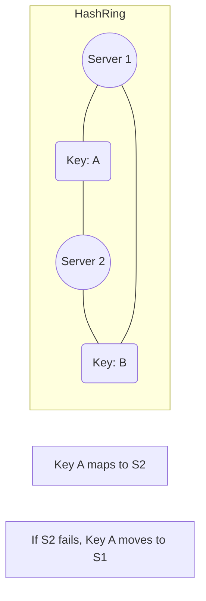

# Consistent Hashing: The Architecture of Distributed Balance
============================================================
0. Architectural Vision: The Immutable Ring
============================================================
- **Standard Hashing Breaks at Scale.** Using `hash(key) % server_count` means that if you add ONE server, you have to move $90\%+$ of your data.
- **Consistent Hashing is Stable.** When you add or remove a server, only $1/n$ of the keys need to be re-sharded (moved).
- **The Hash Ring.** Nodes (Servers) and Keys are both mapped into the same $360$-degree conceptual circle.
- **Virtual Nodes (VNodes).** Mapping one physical server to multiple points on the ring to ensure a perfectly even distribution of data.
- **Architect's View.** We move from "Static Sharding" to "Dynamic Participation". We use **Consistent Hashing** to build stateless, elastic clusters that can grow from 10 to 1,000 nodes without a system-wide rebalancing disaster.

============================================================
1. Foundational Problem: The "Re-sharding Storm"
============================================================
- **Real-World Impact:** You have 3 Cache Servers. You use `id % 3` to decide where to store user sessions. 
- **What breaks?** "The Availability". You add a 4th server to handle the load. Now you use `id % 4`. Suddenly, $75\%$ of your keys are looking at the *wrong* server. You effectively have a cold cache, causing your database to crash under the resulting "Cache Miss Storm".
- **Scale Boundary:** In a distributed database like **Cassandra** or **Dynamo**, moving terabytes of data every time a server fails is unacceptable. You need a system where a failure only affects the neighbors of that node.
- **Failure Story:** A major photo-sharing site used standard Modulo hashing for their image storage cluster. When they tried to increase the cluster size from 10 to 11 nodes during a peak period, the data migration traffic was so heavy it saturated the internal LAN, causing the entire site to go offline for 6 hours. Migrating to **Consistent Hashing** allowed them to add nodes in 5 minutes with only $9\%$ of the data moving.

============================================================
2. Internal System Mechanics: Nodes and Successors
============================================================

### The Ring Logic
1. **Hash the Servers:** Hash the IP/ID of each server and place them on the circle ($0$ to $2^{32}-1$).
2. **Hash the Keys:** Hash your object key (e.g., `user_456`) and place it on the same circle.
3. **The Rule:** The key belongs to the **First Server** it encounters while moving clockwise on the ring (the Successor).
4. **VNodes:** Instead of one point, Server A is placed at "ServerA-1", "ServerA-2", etc., to prevent "Hotspots".



============================================================
3. Production Engineering in .NET 8 (ConsistentHash.cs)
============================================================

### Anti-Pattern: Simple Modulo %
```csharp
// TERRIBLE: The 'Resharding' killer
var server = servers[key.GetHashCode() % servers.Length];
```

### Production-Ready Implementation: Hash Ring with SortedDictionary
```csharp
// 1. Maintaining the Ring
private readonly SortedDictionary<uint, string> _ring = new();
private readonly int _virtualNodes = 100;

public void AddServer(string serverIp) {
    for (int i = 0; i < _virtualNodes; i++) {
        uint hash = GetHash($"{serverIp}:{i}");
        _ring[hash] = serverIp;
    }
}

// 2. Finding the Server
public string GetServer(string key) {
    if (_ring.Count == 0) return null;
    uint hash = GetHash(key);

    // Find the first server with hash >= keyHash
    var tail = _ring.Keys.Where(k => k >= hash).ToList();
    uint nodeHash = tail.Any() ? tail.First() : _ring.Keys.First();
    
    return _ring[nodeHash];
}
```

**Architecture Strategy:** 
- **Replication.** In a production ring, don't just store an item on the *first* server; store it on the first **N** servers for high availability.
- **Rendezvous Hashing (HRW).** An alternative to ring-based consistent hashing that is even better for "Highest Random Weight" selection and simplifies some edge cases.

============================================================
4. System Interaction & Flow (ASCII Architecture)
============================================================

                 ┌──────────────────┐
                 │   Incoming Key   │ (Session / Data)
                 └────────┬─────────┘
                          │ 1. Hash(Key)
          ┌───────────────▼───────────────┐
          │      THE HASH RING            │ (The Distributed Map)
          │  ┌─────────┐   ┌─────────┐    │
          │  │ Sorted  │ → │ Binary  │    │
          │  │ Array   │   │ Search  │    │
          │  └────┬────┘   └────┬────┘    │
          └───────┼─────────────┼─────────┘
                  │             │ 2. Find Next Node (Clockwise)
          ┌───────▼─────────────▼─────────┐
          │       The Target Node         │ (Owner of the data)
          └───────────────┬───────────────┘
                          │ 3. Direct Route to Partition
                ┌─────────▼─────────┐
                │   Stable Access   │
                └───────────────────┘

============================================================
5. Strategic Scaling & System Evolution
============================================================
- **Weighted Consistent Hashing.** Giving a Beefy server ($128GB$ RAM) more Virtual Nodes than a small server ($8GB$ RAM) so it takes a larger share of the ring.
- **Ring-Based Partitioning.** How databases (DynamoDB) handle billions of keys by carving the ring into fixed-size "Ranges".

============================================================
6. Reliability, Observability & Runtime Governance
============================================================
- **Key Metrics:**
    - `Load Variance`: How unevenly is data spread across nodes? (Aim for < $5\%$ difference).
    - `Data Migration Volume`: How many megabytes move when a node joins?
- **Observability:** Visualize the **Ring Distribution** in your dashboard. If one physical node owns $40\%$ of the ring, you have a Virtual Node configuration problem.

============================================================
7. Compromises, Tradeoffs & Alternatives
============================================================
- **Memory.** Storing the "Ring" (Sorted Map) on every client/gateway takes some RAM.
- **Latency.** Finding the successor takes $O(\log N)$ time, where $N$ is the count of Virtual Nodes.

============================================================
8. Security Posture & Risk Mitigation
____________________________________________________________
- **Targeted Load Injection.** An attacker finds a set of keys that all map to a single "Victim" server in the ring to cause a Targeted DoS.
    - *Architect's Rule:* Rotate your **Hash Seed** periodically to prevent attackers from pre-calculating keys that target specific shards.

============================================================
9. Technical Edge Cases & System Failure Modes
============================================================
- **The "Cascading Failure".** Node A fails. All its load moves to Node B. Node B then fails from the extra load, moving it to Node C.
    - *Architect's Tip:* Implement **Virtual Node Shuffling** (e.g. from Akka.NET) so a single physical node's load is distributed across MANY peers, not just its immediate neighbor.

============================================================
10. Architectural Assessment & Career Progression
============================================================
- **Senior:** "We use consistent hashing for our cache cluster so that adding a node doesn't clear the whole cache."
- **Principal:** "Architecture is the **Equilibrium of Elastic Capacity**. We leverage **Consistent Hash Rings and Virtual Projections** to neutralize the instability of dynamic sharding. We architecturalize for **Minimal Data Flux**, utilizing **Clockwise Successor Logic and Weight-Based Proportionality** to ensure that our cluster's state entropy is minimized during topological shifts. For us, a server is a **Point in a Probability Space**, and its ownership is a stable, cryptographically determined contract."
- **Interview Strategy:** Draw the Hash Ring. Explain "Virtual Nodes" and why they are necessary for load balancing.

============================================================
11. Real-World Case Study: Global Distributed Cache (Memcached/Redis)
============================================================
**Scenario:** A company like Facebook with 10,000 Memcached servers.
- **The Problem:** Servers fail every hour. Rebalancing 10,000 servers would be a nightmare.
- **The Design:** Implemented **Consistent Hashing** in the client library.
- **Result:** $99.9\%+$ availability. When a server dies, only a tiny fraction of the users are logged out; for the rest, the ring remains identical, and the cache continues to work seamlessly.

============================================================
12. Structural Dependencies & Learning Path
============================================================
- **Foundations:** Hashing, Binary Search, Modular Arithmetic.
- **Future Steps:** Jump Consistent Hash, Maglev Hashing (Google's Load Balancer).
- **Integration Points:** Akka.Cluster, Microsoft.Orleans, Memcached.
