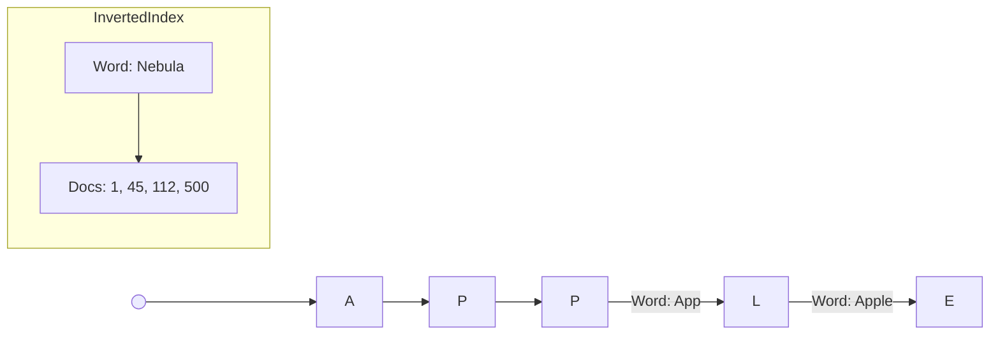

# Search Engine Internals: The Architecture of Information Retrieval
============================================================
0. Architectural Vision: The Instant Answer
============================================================
- **Search is about "Preprocessing".** You cannot search a trillion documents by scanning them; you must build a structure that knows where the answer is *before* the question is asked.
- **The Inverted Index.** The core of Lucene/Elasticsearch. Instead of "Document -> Words", it stores "Word -> List of Documents".
- **Tries (Prefix Trees).** Storing strings such that the prefix is shared. Optimized for "Autofill" and "Typeahead".
- **Suffix Trees.** Allowing for "Substring" search (finding a pattern anywhere in the text) in $O(Length of Pattern)$ time.
- **Architect's View.** We move from "Scanning" to "Navigating". We use **Inverted Indices for full-text search** and **Tries for low-latency auto-completion**. We understand that the "Index" is a space-time tradeoff that enables real-time interaction with global-scale data.

============================================================
1. Foundational Problem: The "Full-Text Scan" Nightmare
============================================================
- **Real-World Impact:** You are building a "Library Search". You have 1 million books. A user searches for the word "Nebula".
- **What breaks?** "The Performance". If you use `SQL LIKE '%Nebula%'`, the database has to read every single word of all 1 million books. This takes minutes and blocks other users.
- **Scale Boundary:** Google searches 100+ petabytes of web pages in $0.2s$. This is mathematically impossible without an index that maps every word to its location in $O(1)$ time.
- **Failure Story:** A major codebase hosting site used a simple string scan for their "Search Code" feature. As the number of repos grew to 1 million, the search feature became so slow (30s latency) that it was effectively a "DDoS" on their own database whenever someone searched for common terms like `if` or `while`. Migrating to a **Suffix Array + Inverted Index** reduced search time to $50ms$ regardless of codebase size.

============================================================
2. Internal System Mechanics: Nodes and Postings
============================================================

### The Trie (Prefix Tree)
- Each node represents a single character.
- Walking down the tree from the root to a leaf reconstructs a word.
- **Advantage:** Finding all words starting with "App" is just finding the "App" node and listing its children.

### The Inverted Index
- **Dictionary:** A sorted list of unique terms.
- **Postings List:** A list of document IDs (and positions) where each term appears.



============================================================
3. Production Engineering in .NET 8 (Trie Implementation)
============================================================

### Anti-Pattern: Using 'String.StartsWith' for Autocomplete
```csharp
// TERRIBLE: Scanning a list of 1 million strings for every keystroke.
var results = allWords.Where(w => w.StartsWith(input)); // O(n * L)
```

### Production-Ready Implementation: A Simple Trie
```csharp
public class TrieNode {
    public Dictionary<char, TrieNode> Children = new();
    public bool IsEndOfWord;
}

public class Trie {
    private readonly TrieNode _root = new();

    public void Insert(string word) {
        var current = _root;
        foreach (var ch in word) {
            if (!current.Children.ContainsKey(ch))
                current.Children[ch] = new TrieNode();
            current = current.Children[ch];
        }
        current.IsEndOfWord = true;
    }

    public bool StartsWith(string prefix) {
        var current = _root;
        foreach (var ch in prefix) {
            if (!current.Children.ContainsKey(ch)) return false;
            current = current.Children[ch];
        }
        return true; 
    }
}
```

**Architecture Strategy:** 
- **Compressed Tries (Radix Tree).** Merging nodes with only one child (e.g., "apple" becomes `a -> pple` instead of `a -> p -> p -> l -> e`) to save memory.
- **Segment Sharding.** Breaking your Inverted Index into "Shards" based on document ID so you can search in parallel across 100 servers.

============================================================
4. System Interaction & Flow (ASCII Architecture)
============================================================

                 ┌──────────────────┐
                 │  Search Query    │ (User Intent)
                 └────────┬─────────┘
                          │ 1. Tokenize & Stem (Running -> Run)
          ┌───────────────▼───────────────┐
          │      THE INDEX GATEWAY        │ (Lucene / Elasticsearch)
          │  ┌─────────┐   ┌─────────┐    │
          │  │ Term    │ → │ Postings│    │
          │  │ Lookup  │   │ Fetcher │    │
          │  └────┬────┘   └────┬────┘    │
          └───────┼─────────────┼─────────┘
                  │             │ 2. Intersect Doc Lists (AND/OR)
          ┌───────▼─────────────▼─────────┐
          │       The Scoring Engine      │ (TF-IDF / BM25)
          └───────────────┬───────────────┘
                          │ 3. Rank by Relevance
                ┌─────────▼─────────┐
                │   Top 10 Results  │
                └───────────────────┘

============================================================
5. Strategic Scaling & System Evolution
============================================================
- **Vector Search (Semantic Search).** Using AI (Embeddings) to find "Meanings" rather than "Words". Finding "Fast car" when the user searches for "Quick vehicle".
- **Incremental Indexing.** Updating the index as new documents arrive (using a "Write Buffer") rather than rebuilding the whole thing every day.

============================================================
6. Reliability, Observability & Runtime Governance
============================================================
- **Key Metrics:**
    - `Query Latency (P99)`: How long for the slowest search?
    - `Index Size`: RAM/Disk ratio. 
- **Observability:** Monitor **Term Frequency** to identify "Stop Words" (like `the`, `a`) that should be excluded from the index to save space and speed up queries.

============================================================
7. Compromises, Tradeoffs & Alternatives
============================================================
- **Index Latency (Near Real-Time).** It usually takes 1 second for a "New" document to appear in the search results because of index-refresh cycles.
- **Index Size.** An inverted index can be $2x-3x$ the size of the original text data.

============================================================
8. Security Posture & Risk Mitigation
============================================================
- **Search Term Enumeration.** An attacker uses the "Autocomplete" feature to guess sensitive internal IDs or usernames.
- **Fuzzing and Regex DoS.** Maliciously crafted search queries (e.g., extremely long strings or complex regex) that freeze the search engine's parser.

============================================================
9. Technical Edge Cases & System Failure Modes
============================================================
- **The "Large Postings List".** A very common word (like `cloud`) appears in 90% of documents. Fetching and intersecting this massive list in memory can crash a node.
    - *Architect's Rule:* Use **Skip Lists** or **Bit-packing** (PFOR) to compress and navigate large postings lists efficiently.
- **Character Encoding.** Confusion between UTF-8 and UTF-16 in trie node keys, leading to "Missing" results for non-English text.

============================================================
10. Architectural Assessment & Career Progression
============================================================
- **Senior:** "We use an inverted index for our product search so it's much faster than SQL."
- **Principal:** "Architecture is the **Optimization of Discoverability**. We leverage **Inverted Indices, Segmented Sharding, and Probabilistic Scoring Models** to neutralize the latency of information retrieval. We architecturalize for **Near-Instant Clarity**, utilizing **Compressed Tries for low-latency entry and BM25-driven relevance** to ensure that user intent is resolved against petabyte-scale corpus in sub-second time. For us, a search is not a query, but a **Traversal of the Enterprise Knowledge Mesh**."
- **Interview Strategy:** Describe how an Inverted Index works. Explain the use of a Trie for autocomplete.

============================================================
11. Real-World Case Study: Global E-Commerce Search
============================================================
**Scenario:** A giant like Amazon or eBay.
- **The Problem:** 1 billion products. Every search must consider titles, descriptions, categories, and price ranges.
- **The Design:** Implemented a **Distributed Inverted Index (Elasticsearch)** sharded by Category.
- **Result:** $100ms$ search time. When a user searches in "Electronics", the query is only sent to the "Electronics Shard", reducing the workload on the rest of the cluster and allowing for massive scale.

============================================================
12. Structural Dependencies & Learning Path
============================================================
- **Foundations:** String manipulation, Hash Maps, File I/O.
- **Future Steps:** Vector Databases (Pinecone/Milvus), Learning to Rank (LTR).
- **Integration Points:** Lucene.NET, Elasticsearch, Azure Cognitive Search.
