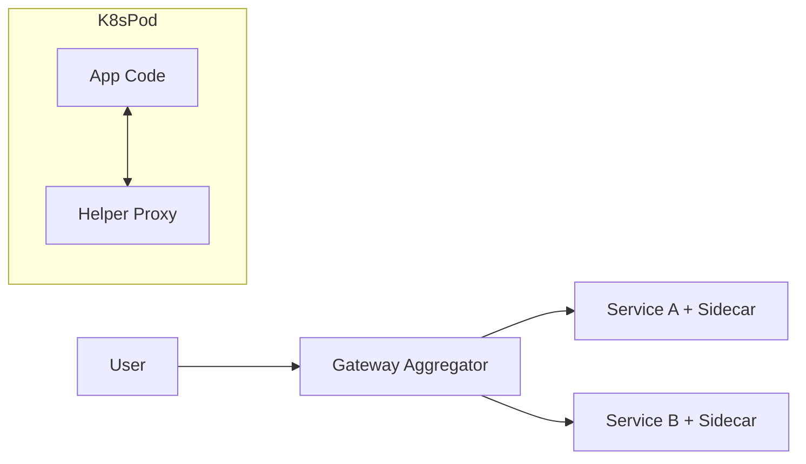

# Cloud Design Patterns: The Architecture of Distributed Utility
============================================================
0. Architectural Vision: The Decoupled Cloud
============================================================
- **Cloud-Native is about "Externalizing" Concerns.** We move logic like logging, monitoring, and security out of the application and into the infrastructure.
- **Sidecar Pattern.** A helper container that runs alongside the main app to handle "Dirty Work" (Networking, Logs).
- **Ambassador Pattern.** A sidecar that acts as a proxy for the app's outgoing requests (Handling retries, circuit breaking).
- **Gateway Aggregation.** Reducing the number of calls from the UI by combining multiple backend responses into one.
- **BFF (Backends for Frontends).** Creating separate API gateways for Mobile, Web, and Desktop to optimize the data payload for each.
- **Architect's View.** We move from "Monolithic Services" to "Composed Proxies". We use **Sidecars for observability** and **Gateways for interface management**. We understand that in the cloud, the "Network" is a first-class citizen that must be managed, not ignored.

============================================================
1. Foundational Problem: The "Feature Bloat" and "Network Complexity"
============================================================
- **Real-World Impact:** You have 100 microservices written in 5 different languages (C#, Go, Python). You need to add "mTLS Authentication" to all of them.
- **What breaks?** "The Maintenance". If you try to add a security library to every language and every service, it will take months, and every library will behave slightly differently.
- **Scale Boundary:** In a massive distributed system, managing "Global Concerns" like Auth, Logging, and Rate Limiting within the application code leads to "Code Rot" and prevents independent team delivery.
- **Failure Story:** A major fintech firm implemented "Retries" in their application code. During a network glitch, all 50 services retried at the exact same millisecond, creating a "Retry Storm" (Self-inflicted DoS) that crashed the database. Migrating to an **Ambassador/Sidecar (Service Mesh)** allowed them to implement **Exponential Backoff and Jitter** at the infrastructure level, neutralizing the storm instantly.

============================================================
2. Internal System Mechanics: Interception and Composition
============================================================

### The Sidecar Lifecycle
1. **The App** sends a request to `localhost:8080` (The Sidecar).
2. **The Sidecar** intercepts the request, adds a JWT token, and logs the metrics.
3. **The Sidecar** forwards the request to the external identity service over the real network.
4. **The Response** flows back through the sidecar, which decrypts it for the app.



============================================================
3. Production Engineering in .NET 8 (YARP & BFF)
============================================================

### Anti-Pattern: The "One Size Fits All" API
```csharp
// TERRIBLE: Sending a 100KB JSON object with 50 fields to a 
// smartwatch app that only needs 2 fields. Large network overhead.
```

### Production-Ready Implementation: YARP Gateway Aggregation
```csharp
// 1. Using YARP to aggregate calls for a 'Dashboard'
public async Task<DashboardDto> GetDashboard(string userId) {
    // Parallel calls through the gateway
    var task1 = _httpClient.GetFromJsonAsync<Profile>($"services/profile/{userId}");
    var task2 = _httpClient.GetFromJsonAsync<Orders>($"services/orders/{userId}");
    
    await Task.WhenAll(task1, task2);
    
    return new DashboardDto {
        User = task1.Result,
        LastOrders = task2.Result.Top(5)
    };
}
```

**Architecture Strategy:** 
- Use **Dapr (Distributed Application Runtime)**. It is the ultimate implementation of the sidecar pattern, providing "building blocks" for state management, pub/sub, and secrets via a simple HTTP/gRPC API.
- Implement **BFF (Backends for Frontends)**. If you have a Mobile app, give it its own "Gateway" that only returns the essentials, saving battery and data for the user.

============================================================
4. System Interaction & Flow (ASCII Architecture)
============================================================

                 ┌──────────────────┐
                 │   User Request   │ (Mobile / Web)
                 └────────┬─────────┘
                          │ 1. Connect to nearest Edge
          ┌───────────────▼───────────────┐
          │      API GATEWAY (BFF)        │ (The Payload Optimizer)
          │  ┌─────────┐   ┌─────────┐    │
          │  │ Filter  │ → │ Aggre-  │    │
          │  │ Logic   │   │ gation  │    │
          │  └────┬────┘   └────┬────┘    │
          └───────┼─────────────┼─────────┘
                  │             │ 2. Parallel Internal Calls
          ┌───────▼─────────────▼─────────┐
          │      SIDECAR / SERVICE MESH   │ (The Security/OTel Proxy)
          └───────────────┬───────────────┘
                          │ 3. Microservice Logic
                ┌─────────▼─────────┐
                │   Business Result │
                └───────────────────┘

============================================================
5. Strategic Scaling & System Evolution
============================================================
- **Internal Service Mesh (Istio/Linkerd).** Managing the complexity of 1,000s of sidecars automatically.
- **Serverless Sidecars.** Using "Lambda Extensions" or "Azure Functions Middleware" to run helper logic without managing full containers.

============================================================
6. Reliability, Observability & Runtime Governance
============================================================
- **Key Metrics:**
    - `Sidecar Latency Overhead`: How many milliseconds does the proxy add? (Target < 2ms).
    - `Gateway Throughput`: Can our entry point handle the spike?
- **Observability:** Use **Distributed Tracing (W3C TraceContext)** to see the request as it hops from Gateway -> Sidecar -> Service.

============================================================
7. Compromises, Tradeoffs & Alternatives
============================================================
- **Latency.** Every "Proxy" or "Sidecar" adds a network hop and a few milliseconds of latency.
- **Complexity.** You now have TWO containers to manage for every one service.
- **Resource Cost.** If every sidecar takes 50MB of RAM and you have 1,000 services, you are paying for 50GB of RAM just for the infrastructure helpers.

============================================================
8. Security Posture & Risk Mitigation
============================================================
- **Zero Trust via Sidecar.** Use the sidecar to perform "Mutual TLS" (mTLS). The application doesn't even know it's happening, but every byte on the wire is encrypted and authenticated.
- **Gateway Rate Limiting.** Stop "Bad Actors" at the entrance before they can even reach your expensive internal services.

============================================================
9. Technical Edge Cases & System Failure Modes
============================================================
- **The "Sidecar Death".** If the sidecar crashes, the application is isolated and cannot communicate.
    - *Architect's Rule:* Use **Kubernetes Readiness Probes** to ensure that if the sidecar isn't healthy, the whole "Pod" is taken out of rotation.
- **Shared Secret Leak.** If an attacker gains access to the "Sidecar" container, they might be able to steal the identity tokens of the main app.

============================================================
10. Architectural Assessment & Career Progression
============================================================
- **Senior:** "We use an API Gateway to handle our JWT validation so the microservices don't have to."
- **Principal:** "Architecture is the **Abstraction of Environmental Complexity**. We leverage **Sidecar Proxies and Gateway Aggregators** to neutralize the friction of distributed networking. We architecturalize for **Operational Purity**, utilizing **BFF Patterns and Mesh Infrastructures** to ensure that our business logic remains decoupled from the mechanics of transit, security, and telemetry. For us, a cloud service is an **Orchestrated Unit of Value**, protected by a managed infrastructure layer."
- **Interview Strategy:** Explain why you would choose a Sidecar over a library. Describe the BFF pattern and its benefits for mobile devices.

============================================================
11. Real-World Case Study: Global E-Commerce Migration
____________________________________________________________
**Scenario:** A large retailer moving 500 legacy APIs to the cloud.
- **The Problem:** They needed consistent logging and security across a chaotic mix of .NET 4.8, Java 8, and Node.js.
- **The Design:** Implemented **Dapr (Sidecar)** and **Azure API Management (Gateway)**.
- **Result:** $80\%$ reduction in "Security Code". Development teams focused only on business logic, while the infrastructure team managed all "Cross-Cutting Concerns" centrally via the sidecars.

============================================================
12. Structural Dependencies & Learning Path
============================================================
- **Foundations:** Containers (Docker), HTTP/gRPC, Reverse Proxies.
- **Future Steps:** Service Mesh (Linkerd), Dapr.io, Proxy-less Meshes.
- **Integration Points:** YARP (Yet Another Reverse Proxy), Ocelot, Azure APIM.
