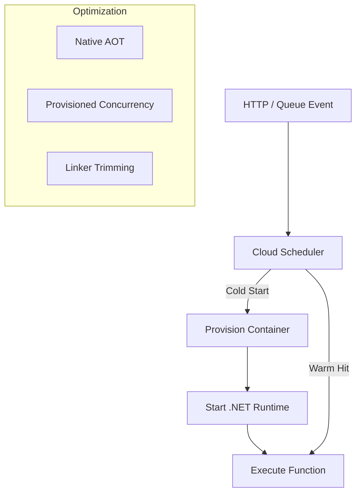

# Serverless & Cold Start Optimization: The Architecture of Event-Driven Zen
============================================================
0. Architectural Vision: The Zero-Infrastructure Illusion
============================================================
- **Serverless (FaaS) is about "Abstracting the Process".** You write the code, and the cloud provider handles the execution, scaling, and patching.
- **Pay-Per-Execution.** You only pay when your code runs. Zero traffic = Zero cost.
- **The "Cold Start".** The latency penalty occurred when the cloud provider has to spin up a new container instance to run your function (because the previous ones were idle and deleted).
- **Proactive Scaling.** Keeping functions "Warm" to ensure consistent sub-second responses.
- **Architect's View.** We move from "Server Management" to "Execution Lifecycle Management". We use **Native AOT**, **Provisioned Concurrency**, and **Warm-up Triggers** to build systems that are infinitely elastic but feel like dedicated hardware.

============================================================
1. Foundational Problem: The "Lagging First Hit"
============================================================
- **Real-World Impact:** You have an "Invoice Generator" function. It hasn't been used in 2 hours. A user clicks "Generate".
- **What breaks?** "The Experience". The cloud (Azure/AWS) has to:
    1. Allocate a container.
    2. Start the OS/Runtime.
    3. Load your .NET DLLs.
    4. Run JIT (Just-In-Time) compilation.
- **Result:** The user waits $5-10$ seconds for a "Generation" that should take $200ms$. The user thinks your app is broken.
- **Scale Boundary:** In a microservices architecture, if 5 different serverless functions participate in one request, a "Cascade of Cold Starts" can lead to $30s$ timeouts and total system failure.
- **Failure Story:** A massive retail site used serverless for their "Flash Sale" logic. When the sale started, 100,000 users hit the site. The cloud provider spun up 1,000 new instances. Every single user experienced a $15s$ delay. By the time the instances were "Warm", the users had left the site in frustration. Migrating to **Provisioned Concurrency** would have kept those 1,000 instances pre-allocated and ready.

============================================================
2. Internal System Mechanics: JIT vs. Native AOT
============================================================

### The Execution Pipeline
1. **Classic .NET:** IL (Intermediate Language) code is compiled at runtime (JIT). This adds CPU overhead to the cold start.
2. **Native AOT:** The code is compiled to machine code *at build time*. The binary starts instantly.
3. **Tree Shaking:** AOT removes all unused code from the .NET libraries, making the "Payload" smaller and faster to load.



============================================================
3. Production Engineering in .NET 8 (Native AOT & Trimming)
============================================================

### Anti-Pattern: Fat Serverless Functions
```csharp
// TERRIBLE: Including Entity Framework, AutoMapper, and 50 other 
// NuGet libraries in a function that just sends one email.
// The "Cold Start" will be massive due to assembly loading.
```

### Production-Ready Implementation: Native AOT Configuration
```xml
<!-- .csproj configuration for minimal cold start -->
<PropertyGroup>
  <PublishAot>true</PublishAot>
  <IsTrimmable>true</IsTrimmable>
  <StackTraceSupport>false</StackTraceSupport>
  <OptimizationPreference>Speed</OptimizationPreference>
</PropertyGroup>
```

```csharp
// 1. Minimal API / Function
var app = await Microsoft.Azure.Functions.Worker.Builder.CreateBuilder(args);
app.ConfigureFunctionsWebApplication();
app.Build().Run();

// 2. Proactive Warm-up (Azure Functions)
[FunctionName("WarmUpListener")]
public void Run([WarmupTrigger] WarmupContext context) {
    // This executes when a new instance is created but BEFORE 
    // it takes real traffic. Useful for pre-loading caches.
}
```

**Architecture Strategy:** 
- **Use "Isolated Worker" mode** in Azure Functions. It allows you to use the latest .NET versions and provides better control over the startup pipeline.
- **Provisioned Concurrency.** In AWS Lambda or Azure Functions Premium, pay a flat fee to keep $X$ instances "Always Warm".

============================================================
4. System Interaction & Flow (ASCII Architecture)
============================================================

                 ┌──────────────────┐
                 │   The Trigger    │ (HTTP / Event Grid)
                 └────────┬─────────┘
                          │ 1. Event Detection
          ┌───────────────▼───────────────┐
          │      PROVISIONING LAYER       │ (The Infrastructure Allocator)
          │  ┌─────────┐   ┌─────────┐    │
          │  │ Find    │ ─ │ Create  │    │
          │  │ Warm    │   │ New     │    │
          │  └────┬────┘   └────┬────┘    │
          └───────┼─────────────┼─────────┘
                  │             │ 2. Load Native Binary (Instant)
          ┌───────▼─────────────▼─────────┐
          │       The Running Code        │ (High-Density Execution)
          └───────────────┬───────────────┘
                          │ 3. Shutdown after idle
                ┌─────────▼─────────┐
                │   Scale to Zero   │
                └───────────────────┘

============================================================
5. Strategic Scaling & System Evolution
============================================================
- **Durable Functions.** Handling long-running workflows (taking days or weeks) on serverless infrastructure by "Saving" the state to storage between execution steps.
- **Edge Functions.** Running your small logic fragments inside the CDN (Cloudflare Workers / Lambda@Edge) to achieve $10ms$ latency globally.

============================================================
6. Reliability, Observability & Runtime Governance
============================================================
- **Key Metrics:**
    - `Cold Start Duration`: How long for the first hit?
    - `Execution Duration`: How long for the actual logic?
    - `Memory Working Set`: Does it fit in a 128MB instance?
- **Observability:** Use **OpenTelemetry** with a "Sampler". If you log every execution of a function running 10M times/day, your logging bill will exceed your compute bill.

============================================================
7. Compromises, Tradeoffs & Alternatives
============================================================
- **Memory Limits.** Serverless functions often have a hard cap (e.g., 1.5GB). They are not suitable for heavy video encoding or large model loading.
- **Timeout Limitations.** Functions usually have a 5-10 minute maximum runtime.

============================================================
8. Security Posture & Risk Mitigation
============================================================
- **Function Permissions (Least Privilege).** Since functions are small, give them ONLY the permissions they need (e.g., "Read from this one S3 bucket only").
- **Cold Start Side-Channels.** If an attacker can measure the "Cold Start" time, they might gain information about the internal state or deployment frequency of your app.

============================================================
9. Technical Edge Cases & System Failure Modes
============================================================
- **The "Library Compatibility" Trap.** Some older .NET libraries use "Reflection" (searching for code at runtime), which is incompatible with Native AOT compilation.
- **The "Throttling" Limit.** Cloud providers have a "Concurrency Limit" (e.g., 1,000 concurrent functions). If you exceed this, new requests are rejected, even if you are willing to pay for cold starts.

============================================================
10. Architectural Assessment & Career Progression
============================================================
- **Senior:** "We use serverless for our background jobs to save money when there's no traffic."
- **Principal:** "Architecture is the **Optimization of Execution Latency**. We leverage **Native AOT and Provisioned Warmth** to neutralize the overhead of virtualized scaling. We architecturalize for **Event-Driven Immediacy**, utilizing **Minimal Runtime Footprints and Proactive Scaling Policies** to ensure that our elasticity is Coupled with predictable performance. For us, a cold start is a **Structural Failure of Readiness**, and we eliminate it through build-time compilation and strategic resource allocation."
- **Interview Strategy:** Explain what a cold start is. Compare JIT and AOT. Describe when you would use a "Warm-up Trigger".

============================================================
11. Real-World Case Study: Global Notification System
============================================================
**Scenario:** A news app sending push notifications to 100M users at once.
- **The Problem:** When a major news event happens, 100M functions need to trigger. A traditional server cluster would melt.
- **The Design:** Used **Serverless (Azure Functions)** with **Native AOT**.
- **Result:** The system scaled from $0$ to $100,000$ concurrent executions in seconds. By using AOT, the cold start was reduced to $150ms$, ensuring that the breaking news reached users while it was still "News".

============================================================
12. Structural Dependencies & Learning Path
============================================================
- **Foundations:** Microservices, HTTP, Event-driven architecture.
- **Future Steps:** Durable Entities, Logic Apps integration.
- **Integration Points:** Azure Functions Core Tools, AWS SAM, Serverless Framework.
