# CDNs and Edge Computing: The Architecture of Proximity
============================================================
0. Architectural Vision: The Speed of Light
============================================================
- **Latency is a Physical Problem.** Even at the speed of light, it takes $130ms$ for a packet to travel round-trip from London to Sydney. 
- **CDN (Content Delivery Network).** Storing "Static Assets" (Images, JS) at hundreds of locations (Edge Locations) near the user.
- **Edge Computing.** Running "Dynamic Logic" (Redirects, Auth, Header manipulation) inside the CDN itself.
- **Anycast Routing.** Routing a user to the closest server (at the network level) using the same IP address globally.
- **Architect's View.** We move from "Centralized Processing" to "Distributed Intelligence". We use **CDNs for asset delivery** and **Edge Workers for instant decision-making**. We understand that the "First Mile" of a user's connection is the most expensive, and we eliminate it by living inside the ISP's network.

============================================================
1. Foundational Problem: The "Global Latency" Gap
============================================================
- **Real-World Impact:** Your server is in Virginia (USA). A user in Tokyo (Japan) opens your app.
- **What breaks?** "The Interactivity". Every click requires a $200ms$ "Wait" for the signal to cross the ocean. The app feels sluggish, "Heavy", and non-responsive.
- **Scale Boundary:** No matter how fast your backend code is ($1ms$ response), the user still perceives $200ms+$ latency. You cannot "Code" your way out of the laws of physics.
- **Failure Story:** A global news site hosted their "Breaking News" images on a single server in New York. When a major event happened in Asia, the images took 10 seconds to load for millions of Japanese users. Migrating to **Azure Front Door (Global CDN)** reduced image load time to $50ms$ worldwide, resulting in a $60\%$ increase in user retention.

============================================================
2. Internal System Mechanics: Termination and Caching
============================================================

### The Edge Lifecycle
1. **DNS Lookup:** The user's computer asks for `site.com`. The Anycast DNS returns the IP of the closest Edge Location.
2. **TCP/TLS Handshake:** Occurs at the Edge ($5ms$ away), not the Origin ($150ms$ away).
3. **Request Processing:** The Edge serves the content from its local cache (Cache Hit) or fetches it from the Origin (Cache Miss).
4. **Edge Logic:** A "Cloudflare Worker" intercepts the request and checks if the user's browser supports WebP images, serving a smaller file automatically.

```mermaid
graph LR
    User[Tokyo User] -- 5ms --> Edge[Edge Node: Tokyo]
    Edge -- Cache Hit --> User
    Edge -- Cache Miss (150ms) --> Origin[Server: Virginia]
    subgraph EdgeLogic
        Auth[JWT Check]
        Img[Image Optimization]
    end
```



============================================================
3. Production Engineering in .NET 8 (Cache Headers & Purging)
============================================================

### Anti-Pattern: No Cache Headers
```csharp
// TERRIBLE: Not setting 'Cache-Control' headers.
// Every user has to fetch Every image every time. Expensive and slow.
```

### Production-Ready Implementation: Cache Control and Versioning
```csharp
// 1. Static Asset Versioning (Cache Busting)
// Ensure that when the file changes, the URL changes.
// 

// 2. Setting Long-Term Caching
app.UseStaticFiles(new StaticFileOptions {
    OnPrepareResponse = ctx => {
        // Cache for 1 year (Immutable status)
        ctx.Context.Response.Headers.Append(
            "Cache-Control", "public,max-age=31536000,immutable");
    }
});
```

**Architecture Strategy:** 
- **Stale-While-Revalidate.** Configure your CDN to serve a "Slightly old" file to the user instantly while it fetches the "New" one from the origin in the background.
- **Edge Side Includes (ESI).** Building a page where the "Header" and "Footer" are cached at the edge, but the "Cart Count" is a dynamic call.

============================================================
4. System Interaction & Flow (ASCII Architecture)
============================================================

                 ┌──────────────────┐
                 │   The User       │ (Global)
                 └────────┬─────────┘
                          │ 1. Anycast DNS Redirect
          ┌───────────────▼───────────────┐
          │      THE EDGE LOCATION        │ (200+ worldwide)
          │  ┌─────────┐   ┌─────────┐    │
          │  │ Local   │ → │ Global  │    │
          │  │ Cache   │   │ Shield  │    │
          │  └────┬────┘   └────┬────┘    │
          └───────┼─────────────┼─────────┘
                  │             │ 2. Compute at Edge (Lambda@Edge)
          ┌───────▼─────────────▼─────────┐
          │       The Dynamic Origin      │ (The Source of Truth)
          └───────────────┬───────────────┘
                          │ 3. Global Cache Propagation
                ┌─────────▼─────────┐
                │   Instant Access  │
                └───────────────────┘

============================================================
5. Strategic Scaling & System Evolution
============================================================
- **Serverless at the Edge.** Using **Cloudflare Workers** (JavaScript/V8) to run complex logic in < 1ms on the edge.
- **WebSocket over Edge.** Keeping a persistent connection open to the nearest edge node to reduce the cost of real-time push events.

============================================================
6. Reliability, Observability & Runtime Governance
============================================================
- **Key Metrics:**
    - `Cache Hit Ratio (CHR)`: Aim for > 90% for static assets.
    - `TTFB (Time To First Byte)`: The true measure of edge performance.
- **Observability:** Monitor your **"Origin Shield" load**. If your CDN is constantly hitting your origin, your "Cache TTL" (Time To Live) is too short.

============================================================
7. Compromises, Tradeoffs & Alternatives
============================================================
- **Propagation Delay.** When you "Update" an image, it might take 10 minutes for that update to reach all 200 edge locations unless you manually "Purge" it.
- **Consistency vs Availability.** Serving a "Stale" news article is better than serving a "404 Error" if the origin is down.

============================================================
8. Security Posture & Risk Mitigation
============================================================
- **Edge WAF (Web Application Firewall).** Blocking SQL Injection and Cross-Site Scripting (XSS) at the edge, so the "Attacker" never even reaches your server.
- **DDoS Shield (Shield/Front Door).** Using the massive bandwidth of a global network (Exabytes/sec) to absorb a DDoS attack that would overwhelm a single server.

============================================================
9. Technical Edge Cases & System Failure Modes
============================================================
- **The "Cache Key" Error.** You cache a "Hello, John" page for "User=John", but you forget to include the user ID in the cache key. User=Pete then sees "Hello, John".
    - *Architect's Rule:* Always **Vary by Header** or **Vary by Cookie** correctly.
- **Thundering Herd.** 1,000 Edge nodes all realize their cache of "logo.png" expired at the same second. They all hit the origin at once.

============================================================
10. Architectural Assessment & Career Progression
============================================================
- **Senior:** "We use a CDN for our JS and CSS files to make the site load faster."
- **Principal:** "Architecture is the **Global Compression of Distance**. We leverage **Anycast Networks and Edge-Native Computation** to neutralize the physical constraints of light-speed. We architecturalize for **Proximity-First Delivery**, utilizing **Origin Shielding and Stale-While-Revalidate Policies** to ensure that our user experience is decoupled from geographical isolation. For us, the edge is the **Perimeter of Intent**, and our goal is to resolve that intent where the user exists, not where the server lives."
- **Interview Strategy:** Describe "Anycast". Explain "Stale-While-Revalidate". Draw the path of a request from user to origin through a CDN.

============================================================
11. Real-World Case Study: Global Video Streaming (Netflix Style)
============================================================
**Scenario:** Streaming a 4K movie to 100 million users.
- **The Problem:** The movie file is $20GB$. If 200,000 people watch it in London, sending $20GB \times 200,000$ over the Atlantic is impossible.
- **The Design:** Created their own CDN (**Open Connect**). They physically place servers *inside* the local ISPs (like Comcast/BT).
- **Result:** $95\%$ of the video traffic never leaves the user's ISP network. This saves billions in bandwidth costs and ensures a "Buffer-Free" 4K experience globally.

============================================================
12. Structural Dependencies & Learning Path
============================================================
- **Foundations:** DNS, HTTP Headers, TCP/IP.
- **Future Steps:** WebAssembly (Wasm) on the Edge, Edge Databases (Turso/Cloudflare D1).
- **Integration Points:** Cloudflare, AWS CloudFront, Azure Front Door, Fastly.
