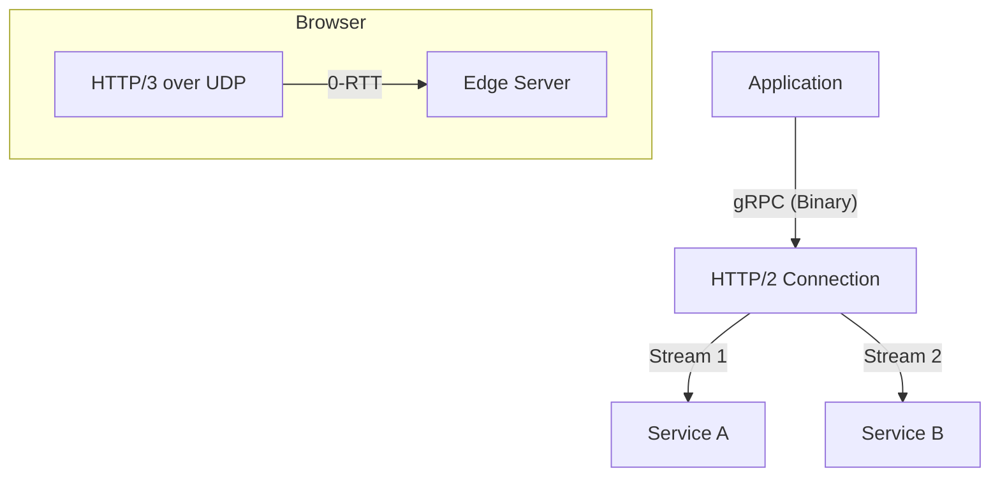

# Network Protocols: The Architecture of Digital Transit
**0. Architectural Vision: The Efficient Wire**
- **Networking is the "Silent Latency".** The choice of protocol defines whether your app feels "Snappy" or "Sluggish".
- **HTTP/1.1.** The legacy. Simple text, "Head-of-Line Blocking" (can only send one request at a time).
- **HTTP/2.** Multiplexing (many requests over one connection), Header Compression (HPACK), and Server Push.
- **HTTP/3 (QUIC).** Runs over UDP. Eliminates "Handshake Bloat" and is more resilient to mobile network "Packet Loss".
- **gRPC.** Binary protocol (Protobuf). $5x-10x$ faster than JSON. The standard for Microservices.
- **WebSocket.** Persistent, bi-directional connection. The standard for real-time (Chat, Games).
- **Architect's View.** We move from "Textual Verbosity" to "Binary Density". We use **gRPC for service-to-service internal communication** and **HTTP/3 for global user-facing performance**. We understand that the "Payload" size matters, but the "Handshake" time matters more.

**1. Foundational Problem: The "Head-of-Line Blocking" and "Handshake Lag"**
- **Real-World Impact:** You have a webpage with 50 small icons. You use HTTP/1.1.
- **What breaks?** "The Loading". The browser can only open 6 connections. It fetches 6 icons, waits for them to finish, then fetches the next 6. The page takes 3 seconds to "Populate" icons.
- **Scale Boundary:** In a mobile world where users move from WiFi to 5G, a TCP-based protocol (HTTP/2) "Freezes" when a single packet is lost, because TCP must deliver everything in order. All 50 icons stop loading while the one lost packet is re-sent.
- **Failure Story:** A major stock trading app used JSON/REST for internal service calls. During a market crash, the "Serialization Overhead" and "Text Verbosity" caused the internal network to saturate. Latency spiked to 2 seconds per trade. Migrating to **gRPC with HTTP/2 Multiplexing** reduced network traffic by $70\%$ and dropped latency to $10ms$, allowing the platform to stay stable during the highest traffic in its history.

**2. Internal System Mechanics: Multiplexing and Streams**

### The Protocol Evolution
1. **HTTP/1.1:** 1 Request = 1 Wait.
2. **HTTP/2 (Binary):** Many "Streams" inside one "Connection". If one stream fails, others continue.
3. **HTTP/3 (UDP-based):** No connection "Setup" wait. If a packet is lost, *only that stream* stops. Others keep moving.



**3. Production Engineering in .NET 8 (gRPC & HTTP/3)**

### Anti-Pattern: Using REST for Latency-Sensitive Inter-Service Calls
```csharp
// TERRIBLE: Manually building JSON and parsing it for every internal call.
// The CPU spent on 'Newtonsoft.Json' is often higher than the business logic itself.
```

### Production-Ready Implementation: gRPC Service Definition
```protobuf
// 1. Defining the Contract (proto)
service OrderService {
  rpc GetOrder (OrderRequest) returns (OrderResponse);
}

message OrderRequest {
  string id = 1; // Field 1 (Binary Tag)
}
```

```csharp
// 2. Enabling HTTP/3 in Kestrel
builder.WebHost.ConfigureKestrel(options => {
    options.ListenAnyIP(5001, listenOptions => {
        listenOptions.Protocols = HttpProtocols.Http1AndHttp2AndHttp3;
        listenOptions.UseHttps();
    });
});
```

**Architecture Strategy:** 
- **Contract-First Development.** Use gRPC `.proto` files as the source of truth for both C#, Go, and Java teams. No more "Missing Field" bugs.
- **Header Compression.** Understand that in HTTP/2, we don't send `User-Agent` and `Cookie` over and over; we only send a "Difference" from the last request.

**4. System Interaction & Flow (ASCII Architecture)**

                 ┌──────────────────┐
                 │   The Request    │ (Typed Message)
                 └────────┬─────────┘
                          │ 1. Protobuf Serialization (Binary)
          ┌───────────────▼───────────────┐
          │      THE TRANSPORT LAYER      │ (HTTP/2 or HTTP/3)
          │  ┌─────────┐   ┌─────────┐    │
          │  │ Frame   │ → │ Stream  │    │
          │  │ Encoder │   │ Handler │    │
          │  └────┬────┘   └────┬────┘    │
          └───────┼─────────────┼─────────┘
                  │             │ 2. Concurrent Multiplexing
          ┌───────▼─────────────▼─────────┐
          │       The Remote Service      │ (Instant Parsing)
          └───────────────┬───────────────┘
                          │ 3. Return Binary Result
                ┌─────────▼─────────┐
                │   Maximum Density │
                └───────────────────┘

**5. Strategic Scaling & System Evolution**
- **Server-Side Events (SSE).** A low-overhead alternative to WebSockets for "One-Way" real-time updates (like Live Sports scores).
- **QUIC in the Enterprise.** Using HTTP/3 not just for browsers, but for database replication between data centers to overcome "Long-Fat Pipes" (High latency/High bandwidth).

**6. Reliability, Observability & Runtime Governance**
- **Key Metrics:**
    - `Connection Count`: HTTP/2 uses FEWER connections than HTTP/1.1.
    - `Serialization overhead`: How much CPU is spent on JSON vs Protobuf?
- **Observability:** Use **Wireshark** with the "gRPC Dissector" to see the binary frames on the wire.

============================================================
7. Compromises, Tradeoffs & Alternatives
____________________________________________________________
- **Proxies.** Some old Load Balancers (and many corporate Firewalls) still don't support HTTP/3 (UDP).
    - *Architect's Tip:* Always implement **Protocol Fallback**. If HTTP/3 fails, drop to HTTP/2.
- **Browser Support.** Old browsers (IE11) don't support gRPC directly (requires gRPC-Web).

**8. Security Posture & Risk Mitigation**
- **Amplification Attacks (UDP).** Because HTTP/3 uses UDP, a server could be used to amplify a DDoS attack.
    - *Architect's Rule:* Enforce **Handshake Verification** before sending large payloads over UDP.
- **ALPN (Application-Layer Protocol Negotiation).** Ensure your TLS handshake includes the protocol list to prevent "Protocol Downgrade" attacks.

**9. Technical Edge Cases & System Failure Modes**
- **The "UDP Block".** Some hotels and airlines block all UDP traffic except for DNS. Your HTTP/3 site will fail to load or be extremely slow.
- **Idle Timeout.** HTTP/2 connections are long-lived. If they idle too long, the Load Balancer might kill them, causing "GoAway" errors in your logs.

**10. Architectural Assessment & Career Progression**
- **Senior:** "We use gRPC for our internal microservices because it's faster than REST."
- **Principal:** "Architecture is the **Optimization of Digital Transit Density**. We leverage **Binary Framing and Connection Multiplexing** to neutralize the overhead of textual verbosity. We architecturalize for **Uninterrupted Flow**, utilizing **UDP-based QUIC and Header Compression** to ensure that our throughput is decoupled from network volatility and packet loss. For us, a packet is a **Typed Unit of Intent**, and its journey from client to server must be mathematically minimal."
- **Interview Strategy:** Explain how HTTP/2 differs from HTTP/1.1. Describe why gRPC is better than REST for internals. Talk about the "Handshake" difference in HTTP/3.

**11. Real-World Case Study: Global Gaming Launcher**
**Scenario:** A launcher (like Steam or Epic) that needs to check 1,000 game updates.
- **The Problem:** 1,000 HTTP/1.1 calls took forever. 1,000 JSON payloads were heavy.
- **The Design:** Migrated to **gRPC with HTTP/2**.
- **Result:** Update checks drop from $5s$ to $200ms$. Because all 1,000 checks shared ONE connection, the network overhead was virtually eliminated.

**12. Structural Dependencies & Learning Path**
- **Foundations:** TCP vs UDP, TLS Handshake, JSON vs Binary.
- **Future Steps:** QUIC over Satellite (Starlink), WebTransport.
- **Integration Points:** Grpc.Net.Client, Kestrel HTTP/3, Protobuf.NET.
