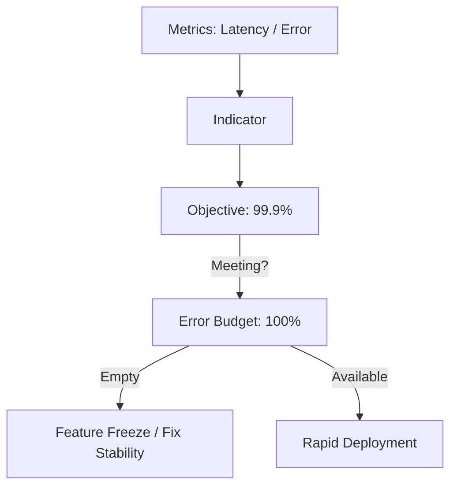

# SRE Principles: The Architecture of Reliability
**0. Architectural Vision: The Science of "Running"**
- **Reliability is a "Feature".** If the system is down, no other feature matters.
- **SRE (Site Reliability Engineering).** What happens when you ask a software engineer to design an operations function.
- **SLI (Service Level Indicator).** A specific metric (e.g., Latency, Error Rate).
- **SLO (Service Level Objective).** A target value for an SLI (e.g., "99.9% of requests < 200ms").
- **SLA (Service Level Agreement).** A legal contract with the user ("If we go below 99.9%, we pay you back money").
- **Error Budget.** The amount of "Calculated Risk" you can take. If your SLO is 99.9%, you are allowed to be down for 43 minutes a month.
- **Architect's View.** We move from "Hope-Based Operations" to "Mathematical Reliability". We use **Error Budgets to decide deployment speed** and **SLOs to define system health**. We understand that $100\%$ reliability is a trap—it's too expensive and the user's internet isn't $100\%$ anyway.

**1. Foundational Problem: The "Feature vs. Stability" Conflict**
- **Real-World Impact:** The "Product Team" wants to release 10 features today. The "Operations Team" wants to release 0 because releases are risky.
- **What breaks?** "The Culture". The two teams fight. Product releases buggy code; Operations is blamed for the downtime.
- **Scale Boundary:** In a system with 1,000 microservices, "Manual Monitoring" is impossible. You cannot have a human looking at 1,000 dashboards to see if the system is "OK".
- **Failure Story:** A major bank had a $100\%$ reliability goal. They were so afraid of downtime that they only released updates once every 6 months. When a critical security bug was found, they didn't know how to deploy a "Quick Fix" safely. A hacker exploited the bug, stealing $200M$. Migrating to **SRE with Error Budgets** would have allowed them to practice "Fast, Safe Deployments" every day, making the bug fix routine and instant.

**2. Internal System Mechanics: The Error Budget**

### The Reliability Equation
1. **Define the SLO:** 99.9% Availability.
2. **Calculate the Budget:** 43 minutes of downtime allowed per month.
3. **If Budget > 0:** Release new features! Take risks!
4. **If Budget < 0:** Feature Freeze. All engineering effort must go toward "Fixing Reliability".



**3. Production Engineering in .NET 8 (Metrics & SLIs)**

### Anti-Pattern: Monitoring "Averages"
```csharp
// TERRIBLE: Measuring the 'Average' latency.
// If 90 users have 10ms and 10 users have 5s, the average is 500ms.
// The average looks 'fine', but 10% of your users are hating your app.
```

### Production-Ready Implementation: Percentile Metrics (OpenTelemetry)
```csharp
// 1. Defining a Counter for SLIs
private static readonly Histogram<double> _requestDuration = 
    Meter.CreateHistogram<double>("api.request.duration");

public async Task ProcessRequest() {
    var sw = Stopwatch.StartNew();
    // Logic...
    _requestDuration.Record(sw.ElapsedMilliseconds);
}
// 2. Dashboarding the SLI
// Show P95 (95th percentile) and P99. 
// "99% of our users wait less than X ms."
```

**Architecture Strategy:** 
- **Eliminate Toil.** Toil is manual, repetitive work (like manual server restarts). If a human has to do it twice, write a script to do it forever.
- **The "Golden Signals".** Follow Google's advice. Monitor these 4: **Latency, Traffic, Errors, and Saturation**.

**4. System Interaction & Flow (ASCII Architecture)**

                 ┌──────────────────┐
                 │   The Service    │ (Living / Running)
                 └────────┬─────────┘
                          │ 1. Telemetry Capture (OTel)
          ┌───────────────▼───────────────┐
          │      PROMETHEUS / GRAFANA     │ (The Analyzer)
          │  ┌─────────┐   ┌─────────┐    │
          │  │ SLI     │ → │ SLO     │    │
          │  │ Tracker │   │ Checker │    │
          │  └────┬────┘   └────┬────┘    │
          └───────┼─────────────┼─────────┘
                  │             │ 2. Budget Depletion Check
          ┌───────▼─────────────▼─────────┐
          │       THE RELEASE PIPELINE    │ (The Gatekeeper)
          └───────────────┬───────────────┘
                          │ 3. Enable/Disable Releases
                ┌─────────▼─────────┐
                │   Stable Velocity │
                └───────────────────┘

**5. Strategic Scaling & System Evolution**
- **Chaos Engineering.** Intentionally breaking things in production (e.g. killing a random server) to prove that your SLO can still be met.
- **Automation of Incident Response.** If an SLO is breached, a "Runbook" (Automation script) should automatically scale the database or clear the cache without waking up an engineer.

**6. Reliability, Observability & Runtime Governance**
- **Key Metrics:**
    - `MTTD (Mean Time To Detect)`: How fast do we know we are down?
    - `MTTR (Mean Time To Recovery)`: How fast do we fix it?
    - `Error Budget Burn Rate`: Are we burning our monthly budget too fast?
- **Observability:** Use **Grafana Cloud** or **Datadog** to build "Reliability Dashboards" that show the SLO status to everyone (including the CEO).

**7. Compromises, Tradeoffs & Alternatives**
- **99.9% vs 99.99%.** Every "9" costs $10x$ more.
    - *Architect's Tip:* Ask the business, "What happens if we are down for 4 hours?". If they say "Nothing much", don't waste money on 99.99%.
- **Toil vs Features.** Spending 3 months automating a restart script that takes 5 minutes once a month is a bad tradeoff.

**8. Security Posture & Risk Mitigation**
- **Post-Mortems (Blameless).** When a hack or crash happens, focus on "What broke in the system", not "Who made the mistake". This culture ensures that engineers are honest about security failures.

**9. Technical Edge Cases & System Failure Modes**
- **The "False Alert" Fatigue.** If your alert triggers 100 times a day for "Small" things, you will eventually ignore it when the "Big" crash happens.
- **Burn Rate Spikes.** A bug in a "Logout" button might not affect "Traffic", but it burns your "Core User" happiness budget instantly.

**10. Architectural Assessment & Career Progression**
- **Senior:** "We have alerts that tell us when our error rate goes above 1%."
- **Principal:** "Architecture is the **Operationalization of Resilience**. We leverage **Mathematical SLOs and Atomic Error Budgets** to neutralize the friction between speed and stability. We architecturalize for **Deterministic Survival**, utilizing **Golden Signal Monitoring and Automated Remediation** to ensure that our system's reliability is a measurable, engineering constraint, not a subjective hope. For us, downtime is an **Investment in Learning**, governed by the rigor of SRE science."
- **Interview Strategy:** Define SLI, SLO, and SLA. Explain why "100% Reliability" is bad. Describe a "Blameless Post-Mortem".

**11. Real-World Case Study: Global E-Commerce "Black Friday"**
**Scenario:** A retailer expecting 1,000% more traffic.
- **The Problem:** In previous years, they crashed. "Operations" was afraid of "Product's" changes.
- **The Design:** Created a **99.5% SLO** for Checkout.
- **Result:** They realized they had $30\%$ of their Error Budget left the day before Black Friday. Instead of "Fixing nothing", they used that budget to do a **Load Test** on the real production site. This found a bottleneck that would have crashed them. They fixed it and had zero downtime during the sale.

**12. Structural Dependencies & Learning Path**
- **Foundations:** Statistics, Monitoring tools, Basic Shell Scripting.
- **Future Steps:** Kubernetes SRE training, Chaos Mesh.
- **Integration Points:** Prometheus, Grafana, OpenTelemetry, Azure Monitor.
