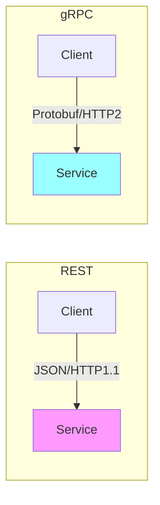
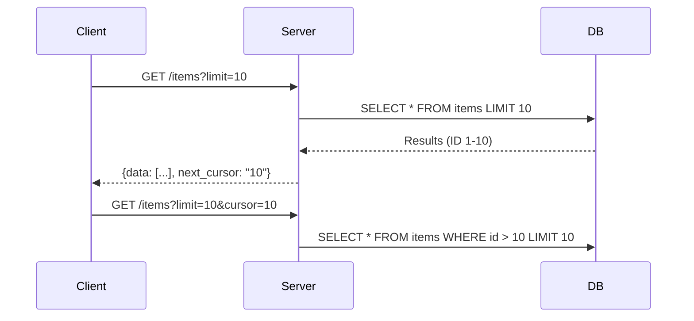
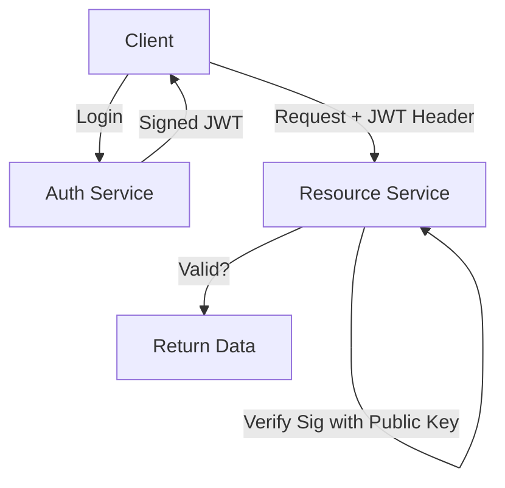

# API Design: Beyond the Interface

API design is the contract between your services. In a system design interview, a well-designed API demonstrates your ability to think about scalability, security, and developer experience.

---

## 1. Choosing the Protocol (REST vs. GraphQL vs. gRPC)

Choosing the right protocol is about balancing flexibility, performance, and complexity.

| Feature | REST | GraphQL | gRPC |
| :--- | :--- | :--- | :--- |
| **Data Format** | JSON / XML | JSON | Protocol Buffers (Binary) |
| **Coupling** | Loosely coupled | Loosely coupled | Tight (Contract-first) |
| **Over-fetching** | Common | Minimal | Potential (internal) |
| **Performance** | Good | Moderate | Exceptional |
| **Streaming** | Request/Response only | Subscription-based | Bidirectional Streaming |

### The gRPC Performance Advantage
gRPC uses **HTTP/2** and **Protocol Buffers**. 
- **Binary Serialization**: Protocol Buffers are significantly smaller and faster to serialize/deserialize than JSON.
- **Multiplexing**: HTTP/2 allows multiple requests over a single TCP connection, eliminating head-of-line blocking.

---

## 2. Pagination: Managing Large Datasets

When an endpoint returns thousands of records, you must paginate.

### Offset-based Pagination (`LIMIT x OFFSET y`)
- **How it works**: Uses a page number or item count to "skip" records.
- **Pros**: Easy to implement, supports "Jump to Page X".
- **Cons**: `O(N)` performance. As `OFFSET` grows, the DB must still scan all previous records. Inconsistent when items are added/deleted.

### Cursor-based Pagination
- **How it works**: The client sends a "cursor" (usually the ID or timestamp of the last item seen).
- **Pros**: `O(1)` performance (uses indices). Consistent even if data changes between requests.
- **Cons**: Does not support jumping to a specific page. More complex implementation.

---

## 3. API Security & Identity

In distributed systems, identity must be verifiable without hitting a central database every time.

### JWT (JSON Web Tokens)
JWTs are self-contained. The server signs the payload, and anyone with the public key can verify it.
1. **Header**: Algorithm used.
2. **Payload**: User claims (ID, roles, expiration).
3. **Signature**: `HMACSHA256(header + payload + secret)`

---

## 4. Rate Limiting: Protecting the System

Rate limiting protects your infrastructure from abuse and "noisy neighbors."

### Common Algorithms
- **Token Bucket**: Tokens are added to a bucket at a fixed rate. Each request costs a token. Supports bursts.
- **Leaky Bucket**: Requests are handled at a constant rate. Excess requests "overflow." Smooths out traffic.
- **Fixed Window**: 100 requests per minute. Simple but has "edge" issues where a user can double-dip at the boundary.

---

## 5. Versioning Strategies

Never break a production API.
- **URL Versioning**: `/v1/users` (Most common, easy to cache).
- **Header Versioning**: `Accept: application/vnd.company.v1+json` (Cleaner URLs but harder for browsers).
- **Query Parameter**: `/users?version=1` (Flexible but can get messy).

> **Senior Tip**: Always default to **Idempotency** for `POST` and `PUT` requests using an `Idempotency-Key` header. This allows clients to safely retry failed requests without duplicate side effects (e.g., double charging a credit card).
