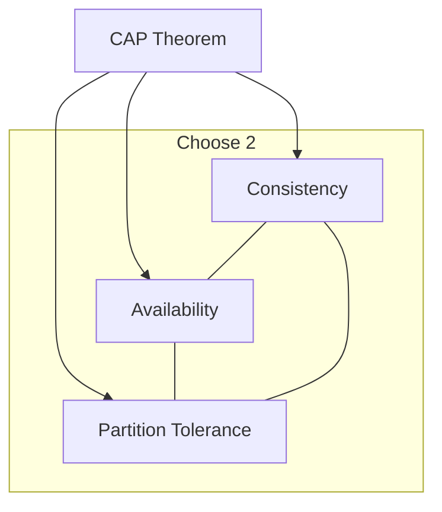

# Advanced Consistency: CAP and PACELC

Modern distributed systems must balance the need for speed (Low Latency) with the need for accuracy (Strong Consistency).

---

## 1. The CAP Theorem

In the presence of a **Network Partition (P)**, a distributed system must choose between **Consistency (C)** and **Availability (A)**. You cannot have both.

- **CP (Consistency + Partition Tolerance)**: The system stops responding to ensure data remains consistent across all nodes. (e.g., MongoDB, Redis, HBase).
- **AP (Availability + Partition Tolerance)**: The system keeps responding even if some nodes are out of sync. (e.g., Cassandra, DynamoDB, CouchDB).

---

## 2. Beyond CAP: The PACELC Theorem

CAP only describes what happens during a failure (Partition). PACELC describes the trade-off during **normal operation** as well.

> **P**artitioned: choose **A**vailability or **C**onsistency; **E**lse (normally): choose **L**atency or **C**onstancy.

- **PA / EL**: Available during partitions, favors low latency during normal times (DynamoDB).
- **PC / EC**: Consistent during partitions, favors consistency during normal times (SQL DBs, BigTable).

---

## 3. BASE Consistency (The anti-ACID)

NoSQL databases often follow the BASE model:
- **Basically Available**: The system responds even if nodes are down.
- **Soft State**: Data might change over time without a write (due to background syncing).
- **Eventually Consistent**: All nodes will eventually show the same data, but there is no time guarantee.

---

## 4. Consistency Models in Practice

1. **Strong Consistency**: All users see the same update at the same time. Performance is slow.
2. **Eventual Consistency**: Users might see old data for a few seconds. High performance.
3. **Causal Consistency**: If A happens before B, then every user sees A before B.
4. **Read-Your-Writes**: A user will always see their own latest updates, even if they don't see others'.

---

## 5. Interview "Senior" Discussion Points

- **Linearizability**: The strongest guarantee—the system behaves as if there is only one copy of data and all operations are atomic.
- **Vector Clocks**: How to resolve conflicts in an eventually consistent system (like Amazon's cart).
- **Quorum Reads/Writes**: Tuning `R + W > N` to balance your specific application's consistency requirements.

> **Senior Tip**: Many cloud DBs (like AWS DynamoDB or Azure CosmosDB) allow you to choose your consistency level per query. Mentioning this flexibility shows practical, production-level engineering experience.
