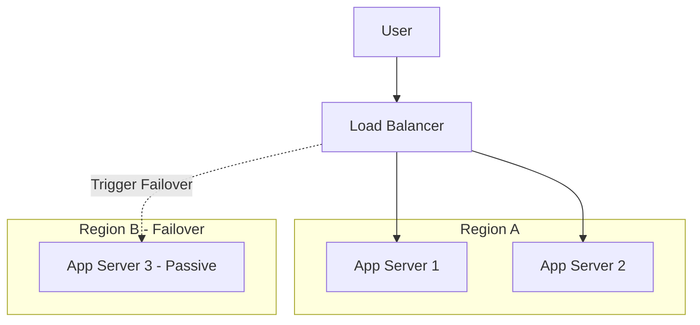

# Availability and Scalability

In system design, we often talk about these two concepts as the "gold standard" for enterprise applications.

---

## 1. Scalability: Horizontal vs Vertical

Scalability is the ability of a system to handle increased load by adding resources.

### Vertical Scaling (Scaling UP)
Adding more power (CPU, RAM, SSD) to an existing server.
- **Pros**: Simple, no code changes required.
- **Cons**: Rigid upper limit (hardware cap), SPOF (if the server dies, the app dies), expensive at high end.

### Horizontal Scaling (Scaling OUT)
Adding more servers to your pool.
- **Pros**: No upper limit, high redundancy, cost-effective (use many cheap servers).
- **Cons**: Requires a **Load Balancer**, necessitates "Stateless" application design (sessions must be stored externally in Redis/DB).

---

## 2. Availability: Calculating the 9s

Availability is the percentage of time a system is functional and accessible.

| Availability % | Downtime per Year | Downtime per Day |
| :--- | :--- | :--- |
| **99% (Two 9s)** | 3.65 days | 14.4 minutes |
| **99.9% (Three 9s)** | 8.77 hours | 1.44 minutes |
| **99.99% (Four 9s)** | 52.6 minutes | 8.6 seconds |
| **99.999% (Five 9s)** | 5.26 minutes | 0.86 seconds |

---

## 3. High Availability Strategy

### A. Redundancy
Eliminating Single Points of Failure (SPOF) by having duplicate components.
- **Active-Active**: All servers are active and share the load.
- **Active-Passive**: One server is active, the others are idle (Failover) and only take over if the active one dies.

### B. Replication
Ensuring data is copied across multiple nodes (usually in different Availability Zones or Regions) so that a fire in one data center doesn't cause data loss.

---

## 4. Fault Tolerance vs High Availability

- **High Availability (HA)**: Goal is to keep the service running. There might be a brief interruption during failover.
- **Fault Tolerance (FT)**: Goal is zero interruption. The system handles hardware/software failures gracefully without the user ever noticing. FT is significantly more expensive and complex.

---

## 5. Interview "Senior" Discussion Points

- **Statelessness**: Why is horizontal scaling impossible for "Stateful" applications without complex sharding?
- **Failure Domains**: Designing for Rack fail, DC fail, and Region fail.
- **Graceful Degradation**: If the database is slow, can we serve stale data from a cache instead of returning a 500?

> **Senior Tip**: When discussing scalability, always mention **Elasticity**. Scalability is about handling peak load; Elasticity is the ability to scale *down* during off-peak hours to save costs (Auto-scaling groups).
