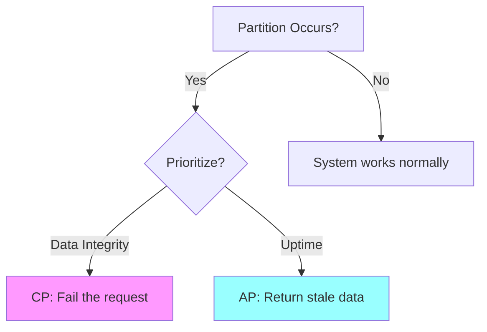

# CAP Theorem: Navigating the Trade-offs of Distributed Systems

The CAP theorem states that a distributed system can only provide two of the following three guarantees: **Consistency**, **Availability**, and **Partition Tolerance**.

---

## 1. Defining the Pillars

1. **Consistency (C)**: Every read receives the most recent write or an error.
2. **Availability (A)**: Every request receives a (non-error) response, without the guarantee that it contains the most recent write.
3. **Partition Tolerance (P)**: The system continues to operate despite an arbitrary number of messages being dropped (or delayed) by the network between nodes.

> **The Reality**: In a distributed system, network partitions (P) are inevitable. Therefore, the choice is almost always between **CP** and **AP**.

---

## 2. CP vs. AP: The Decision

### CP (Consistency + Partition Tolerance)
If a partition occurs, the system shuts down non-consistent nodes to ensure data integrity.
- **Use Case**: Banking, Stock Trading, Ticket Reservations.
- **Examples**: HBase, MongoDB (default), Google Spanner.

### AP (Availability + Partition Tolerance)
If a partition occurs, nodes continue to serve requests, even if they have stale data.
- **Use Case**: Social Media feeds, Service discovery, Error logging.
- **Examples**: Cassandra, DynamoDB, CouchDB.



---

## 3. PACELC: The Modern Extension

CAP only applies when there is a partition. **PACELC** adds the "Else" (when the network is fine).
- **P** (If Partition): Choose **A** or **C**.
- **EL** (Else): Choose **L**atency or **C**onsistency.

**Example**: Even if the network is healthy, do you wait for all replicas to sync (Consistency) or return immediately after one write (Latency)?

| Database | PACELC Classification |
| :--- | :--- |
| **DynamoDB** | PA/EL (Available during P, Low Latency during E) |
| **HBase** | PC/EC (Consistent during P, Consistent during E) |
| **Cassandra** | PA/EL (highly tunable) |

---

## 4. Quorum-Based Consistency

How do you tune C vs A? By using **Quorum**.
- **N**: Number of replicas.
- **W**: Nodes that must acknowledge a write.
- **R**: Nodes that must respond to a read.

To guarantee **Strong Consistency**: $R + W > N$.
If $R + W \leq N$, you get **Eventual Consistency**.

```mermaid
graph LR
    subgraph Nodes [N=3]
    N1[Node 1]
    N2[Node 2]
    N3[Node 3]
    end
    Client -- "Write (W=2)" --> N1
    Client -- "Write (W=2)" --> N2
    Note right of N3: Misses the update
    style N1 fill:#9ff
    style N2 fill:#9ff
```

---

## 5. Practical Interview Strategy

1. **Requirements**: Ask if the system can tolerate stale data (AP) or if data integrity is paramount (CP).
2. **Trade-offs**: If you choose CP, explain how you'll handle the resulting downtime or high latency.
3. **Hybrid**: Real systems often use **Tunable Consistency** (like in Cassandra) to provide different levels for different operations.

> **Senior Tip**: Don't say "CA". In a distributed system, a network failure is a given. If you don't support Partition Tolerance, your system isn't truly distributed; it's a single point of failure.
