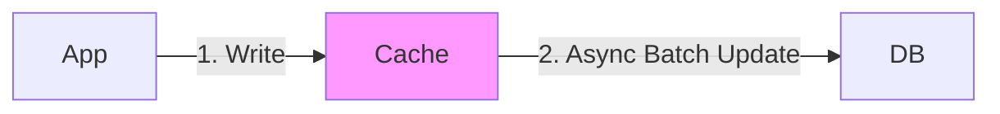
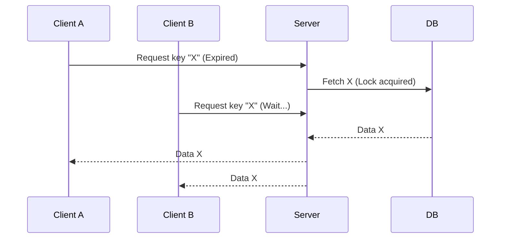

# Caching: High Performance at the Edge and Core

Caching is the most effective way to reduce latency and database load. However, the complexity of caching lies in **consistency** and **eviction**.

---

## 1. Where to Cache?

- **CDN**: Near the user. Best for static assets and public API responses.
- **API Gateway**: Reduces load on downstream microservices.
- **In-Process Cache**: Fastest (local RAM). Risk of memory pressure and stale data across instances.
- **Distributed Cache (Redis/Memcached)**: Shared across all instances. Scalable and supports complex data structures.

---

## 2. Reading and Writing Strategies

The way you interact with the cache determines your data consistency.

### Cache-Aside (Lazy Loading)
1. Check Cache.
2. If Miss, read from DB.
3. Update Cache.
- **Pros**: Only requested data is cached.
- **Cons**: First-time latency (miss). Data can become stale unless invalidated.

### Write-Through
1. Application writes to Cache.
2. Cache synchronously writes to DB.
- **Pros**: Data in cache is never stale.
- **Cons**: High write latency.

### Write-Back (Write-Behind)
1. Application writes to Cache.
2. Cache asynchronously updates DB.
- **Pros**: Incredible write speed.
- **Cons**: Risk of data loss if the cache node crashes before flushing to DB.

---

## 3. Eviction Policies: When the Cache is Full

- **LRU (Least Recently Used)**: Discards the least recently accessed items first.
- **LFU (Least Frequently Used)**: Discards items used the least often.
- **W-TinyLFU**: A modern policy (used by Caffeine) that balances frequency and recency using a frequency sketch.

---

## 4. Advanced Problems & Solutions

### The Thundering Herd (Cache Stampede)
When a hot key expires, thousands of requests hit the database simultaneously to rebuild it.
- **Solution**: **Single-Flight (Request Coalescing)**. Only allow one request to hit the DB; others wait for the result.

### Hot Keys
A single key (e.g., a celebrity's profile) resides on one Redis node, overwhelming it.
- **Solution**: **Key Replication**. Append a suffix (e.g., `user:123:1`, `user:123:2`) and load balance across nodes.

### Cache Penetration
Requesting keys that don't exist in the DB or Cache.
- **Solution**: **Bloom Filters**. A space-efficient probabilistic structure that tells you if a key *might* exist or *definitely does not*.

---

## 5. Cache Consistency

- **TTL (Time to Live)**: The safety net for eventual consistency.
- **Invalidation**: Deleting the key from the cache when the DB is updated. Preferred over updating the cache (which can lead to race conditions).

> **Senior Tip**: Always use a **Cache-Aside** pattern with a **Delete-on-Write** invalidation strategy for most web applications. It's the most robust against race conditions.
