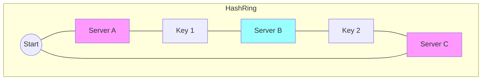
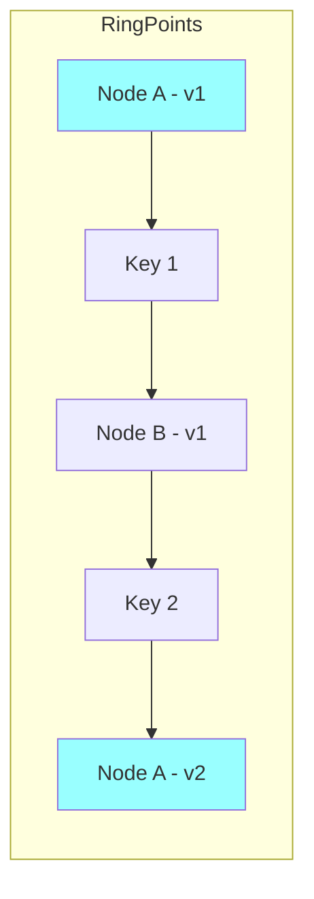

# Consistent Hashing: Scaling Nodes without the Chaos

Consistent Hashing is the most important algorithm for building distributed caches and databases. It allows you to add or remove servers with minimal data movement.

---

## 1. The Problem: The "Rehashing Storm"

In simple modulo hashing (`hash(key) % N`), every scaling event is a disaster.
- If you have 3 servers and add 1 (total 4), the result of `hash(key) % 4` will be different for almost **all** existing keys.
- **Result**: A distributed cache would experience a near-zero hit rate, or a database would need to move 90%+ of its data.

---

## 2. The Solution: The Hash Ring

Instead of mapping keys directly to servers, we map both keys and servers to a circular space (the **Hash Ring**).

1. **Map Servers**: Hash the server IP/name and place it on the ring.
2. **Map Keys**: Hash the key and place it on the ring.
3. **Assignment**: A key belongs to the **first server encountered** while moving clockwise from the key's position.

---

## 3. Virtual Nodes (vnodes): Dealing with Real-World Imbalance

Simple consistent hashing has two problems:
1. **Unbalanced Load**: Nodes might be placed close to each other, leaving some nodes with huge ranges.
2. **Heterogeneous Servers**: Some servers are 10x more powerful than others.

**Virtual Nodes** solve this by mapping each physical server to multiple points (e.g., 200 points) on the ring.
- **Benefit**: If Node B fails, its keys are distributed across nodes A, C, and D instead of all dumping onto Node C.

---

## 4. Scaling Efficiency

- **Node Added**: Only the keys that would clockwise-land on the new node move. This is roughly $1/N$ of the total keys.
- **Node Removed**: Only the keys on the removed node move to its successor.

---

## 5. Real-World Applications

- **Amazon Dynamo & Apache Cassandra**: Use consistent hashing to partition data across the cluster.
- **Akamai CDN**: Uses it to balance requests across edge servers without thrashing the cache.
- **Discord**: Uses it to route users to specific gateway services.

> **Senior Tip**: When asked about "hotkeys" in a consistent hashing cluster, mention **Rendezvous Hashing** (Highest Random Weight) as an alternative that can sometimes provide even better distribution and stability for smaller clusters.
