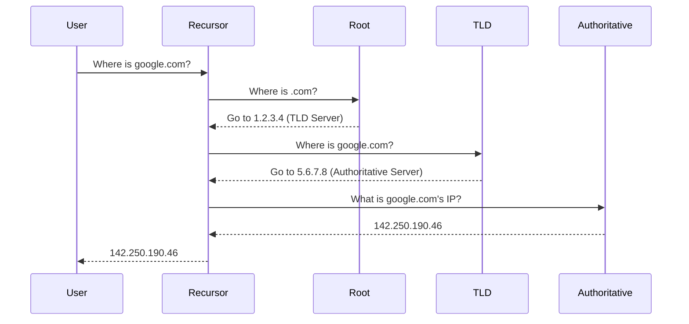

# Domain Name System (DNS)

DNS is the "Phonebook of the Internet." It translates human-readable domain names (like `google.com`) into IP addresses (like `142.250.190.46`) that computers use to identify each other on the network.

---

## 1. The Resolution Process

When you type a URL into your browser, a multi-step lookup occurs:

1. **DNS Recursor**: The process begins with a DNS recursor (provided by your ISP or a public provider like Cloudflare/Google).
2. **Root Nameserver**: The recursor queries a root nameserver, which directs it to the appropriate Top-Level Domain (TLD) nameserver (e.g., `.com`, `.org`).
3. **TLD Nameserver**: The recursor queries the TLD nameserver, which returns the IP of the authoritative nameserver for that specific domain.
4. **Authoritative Nameserver**: This server contains the actual IP address for the domain and returns it to the recursor.
5. **Caching**: Every level (browser, OS, recursor) caches the result for the duration of its **Time To Live (TTL)**.

---

## 2. Common DNS Record Types

| Type | Name | Purpose |
| :--- | :--- | :--- |
| **A** | Address | Maps a hostname to an IPv4 address. |
| **AAAA** | IPv6 Address | Maps a hostname to an IPv6 address. |
| **CNAME** | Canonical Name | Maps a hostname to another hostname (alias). Useful for pointing `www.example.com` to `example.com`. |
| **MX** | Mail Exchange | Specifies the mail server responsible for receiving emails for the domain. |
| **TXT** | Text | Stores arbitrary text data (often used for SPF/DKIM email verification). |
| **NS** | Name Server | Specifies the authoritative nameservers for the domain. |

---

## 3. DNS Routing Strategies

### A. Round Robin DNS
A simple way to balance load. The authoritative server returns a list of multiple IP addresses for a single domain. The client typically picks the first one, and the list is rotated for subsequent requests.
- **Pro**: Easy to setup.
- **Con**: No health checking. If one IP is down, DNS still serves it.

### B. Anycast
Anycast allows multiple servers to share the **same IP address**. The global BGP (Border Gateway Protocol) routing infrastructure automatically routes the user's request to the "nearest" server geographically or topologically.
- **Pro**: Extremely low latency, DDoS resilience.
- **Con**: Complex to implement and manage.

---

## 4. Interview "Senior" Discussion Points

- **TTL (Time To Live)**: Why is a low TTL (e.g., 60s) better for disaster recovery but worse for latency? 
- **DNS over HTTPS (DoH)**: Encrypting DNS queries to prevent ISP snooping and "DNS hijacking."
- **Propogation Delay**: Why does it sometimes take 24-48 hours for DNS changes to reflect globally? (Answer: Caching at various recursive layers).

> **Senior Tip**: In a system design interview, always mention that DNS is the global entry point. Use it for **Global Load Balancing** (GLB) to route users to the nearest data center before they even hit your load balancer.
