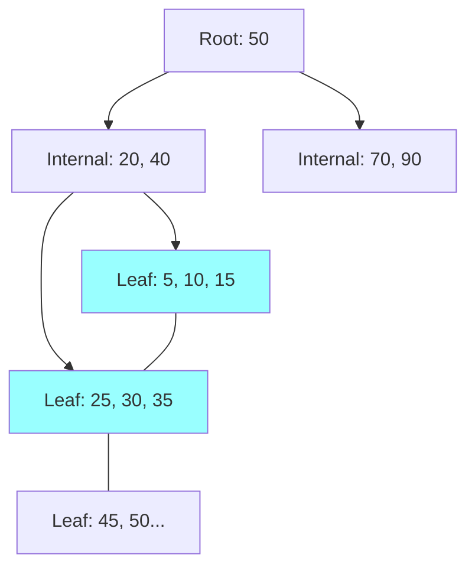
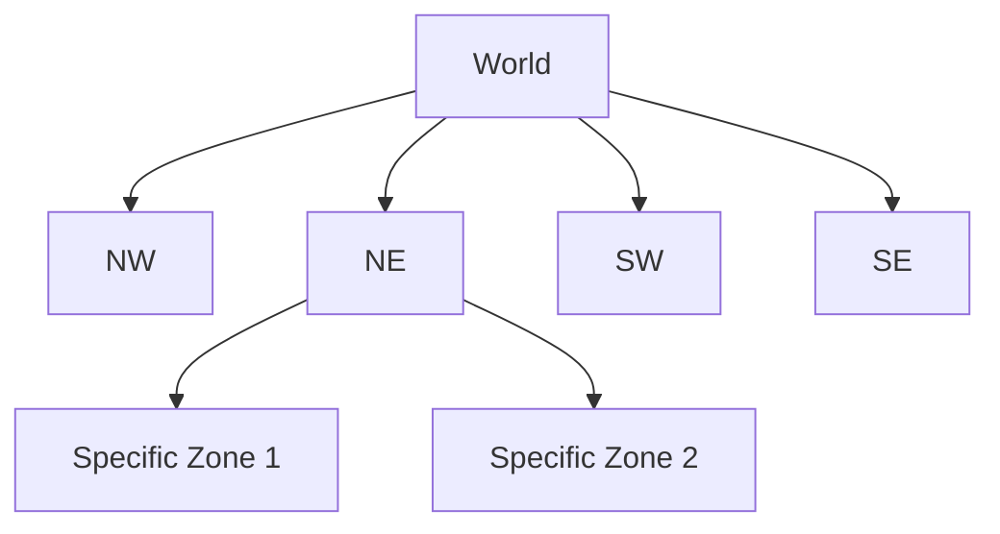

# Database Indexing: The Secret to High-Performance Queries

An index is a data structure designed to improve the speed of data retrieval operations on a database table at the cost of additional storage and slower writes.

---

## 1. How Indexes Work: The B+ Tree

Most relational databases use **B+ Trees** for indexing.
- **Balance**: The tree stays balanced, ensuring $O(\log N)$ search time.
- **Range Queries**: All values are stored in the leaf nodes, which are linked together, making range scans (e.g., `WHERE age > 18`) extremely efficient.

---

## 2. Clustered vs. Non-Clustered Indexes

### Clustered Index (The Table itself)
- The table data is physically stored in the same order as the index.
- Only **one** per table (usually the Primary Key).
- **Pros**: Fastest retrieval for the PK.

### Non-Clustered Index (A Reference)
- A separate structure that contains the indexed value and a pointer (bookmark) to the actual data.
- Multiple allowed per table.
- **Cons**: Requires an extra lookup (Bookmark Lookup) to get the actual data.

---

## 3. Composite Indexes and the Leftmost Prefix Rule

A composite index is an index on multiple columns, e.g., `INDEX(last_name, first_name)`.

- **Leftmost Prefix Rule**: The index is useful ONLY if you provide the leftmost columns in your query.
    - ✅ `WHERE last_name = 'Doe'`
    - ✅ `WHERE last_name = 'Doe' AND first_name = 'John'`
    - ❌ `WHERE first_name = 'John'` (The index cannot be used)

---

## 4. Optimization Patterns

### Covering Indexes (Index-Only Scan)
A covering index is a non-clustered index that includes all the columns requested in the `SELECT` clause.
- **Result**: The database never has to look at the actual table data; it gets everything it needs from the index itself.

### Sparse vs. Dense Indexes
- **Dense**: Every record in the table has a corresponding index entry.
- **Sparse**: Only some records are indexed (saves space, used in NoSQL like DynamoDB).

---

## 5. Geospatial Indexing

Standard B-Trees don't work for "Find restaurants within 5 miles." For this, we use:
- **Quadtrees**: Recursively divide space into four quadrants.
- **Geohashing**: Convert lat/long into a base32 string. Nearby locations share prefix strings.

> **Senior Tip**: Too many indexes will slow down your `INSERT` and `UPDATE` operations significantly. Always monitor the **Write-to-Read ratio** before adding a new index.
