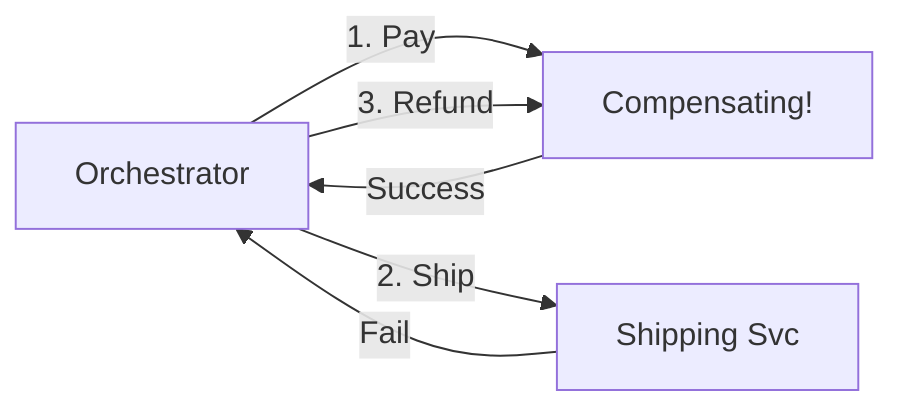

# Distributed Transactions

In a microservices architecture, a single business transaction (e.g., "Place Order") might span multiple services and databases. Ensuring data consistency across these boundaries is one of the hardest challenges in system design.

---

## 1. The Atomic Commitment Problem

A traditional database transaction follows **ACID** (Atomicity, Consistency, Isolation, Durability). However, ACID doesn't scale across multiple independent databases easily.

---

## 2. Two-Phase Commit (2PC)

A synchronous protocol that ensures all participants in a transaction either commit or rollback.
- **Phase 1 (Prepare)**: The Coordinator asks all participants to "Prepare." Participants lock resources and reply "Yes" if they can commit.
- **Phase 2 (Commit/Abort)**: If everyone said "Yes," the Coordinator sends a "Commit" command. If anyone said "No" (or timed out), everyone "Rolls Back."
- **Pros**: Strong consistency.
- **Cons**: **Blocking**. If the Coordinator or a participant fails during Phase 1, everyone stays locked. High latency. Scalability bottleneck.

---

## 3. The Saga Pattern

Sagas are the modern alternative to 2PC for microservices. Instead of a single atomic transaction, a Saga is a sequence of local transactions. Each step has a **Compensating Transaction** to undo its changes if a later step fails.

### A. Choreography
Each service listens to events and triggers the next step.
- **Pro**: Simple, decentralized.
- **Con**: Hard to track the overall state as the number of steps grows.

### B. Orchestration
A central **Saga Orchestrator** tells each service when to execute its transaction.
- **Pro**: Easy to monitor. Centralized complex logic.
- **Con**: The Orchestrator becomes a central point of logic.

---

## 4. TCC (Try-Confirm-Cancel)

A variant of the Saga pattern often used in financial systems.
1. **Try**: Reserve resources (e.g., set status to "Pending").
2. **Confirm**: Finalize the action (e.g., status to "Success").
3. **Cancel**: Release resources if the Confirm fails (e.g., status back to "Available").

---

## 5. Interview "Senior" Discussion Points

- **The Dual-Write Problem**: Ensuring you update your database and publish an event to Kafka atomically. (Solution: **Transactional Outbox Pattern**).
- **Idempotency**: Why every step in a Saga *must* be idempotent in case of retries.
- **Read Isolation**: Sagas are eventually consistent. A user might see an "Order Paid" status before it has been "Shipped." Is this okay for the business?

> **Senior Tip**: Avoid distributed transactions whenever possible. Try to redesign your domain boundaries so that data that *must* be consistent stays in a single microservice with a single database.
