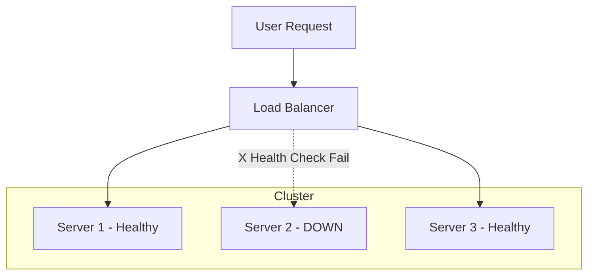

# Load Balancing

A Load Balancer is a device or software that acts as a reverse proxy and distributes network or application traffic across a number of servers. This increases the concurrent user capacity and overall reliability of applications.

---

## 1. L4 vs L7 Load Balancing

Load balancers operate at different levels of the OSI model:

| Level | Name | How it Works | Pros/Cons |
| :--- | :--- | :--- | :--- |
| **L4** | Transport | Decides where to send packets based on IP address and Port (TCP/UDP). It does not look at the message content. | **Pro**: Extremely fast. **Con**: No smart routing based on URL or headers. |
| **L7** | Application | Decides where to send requests based on the content of the header, cookies, or URL. | **Pro**: Smart routing (e.g., `/video` goes to Video Server). **Con**: Slower due to SSL termination and packet inspection. |

---

## 2. Common Algorithms

1. **Round Robin**: Requests are distributed sequentially. Best when all servers have equal capacity.
2. **Weighted Round Robin**: Servers with higher specs get more frequent requests.
3. **Least Connections**: Sends traffic to the server with the fewest active sessions. Best for long-running processes (e.g., live streaming).
4. **IP Hash**: Uses the user's IP to consistently route them to the same server. Useful for **Session Persistence** (though Redis-based session storage is often preferred).

---

## 3. Health Checks

A load balancer must periodically "ping" its backend servers to ensure they are alive.
- **Passive Health Check**: If a server returns a 5xx error, the load balancer temporarily stops sending traffic there.
- **Active Health Check**: The load balancer sends a dedicated heartbeat request (e.g., `GET /health`) every 5-10 seconds.

---

## 4. Hardware vs Software Load Balancers

- **Hardware**: Dedicated physical devices (e.g., F5). High cost, high performance, low flexibility.
- **Software**: Run on standard servers (e.g., **Nginx**, **HAProxy**, **Envoy**). Low cost, highly configurable, and cloud-native.

---

## 5. Interview "Senior" Discussion Points

- **SSL Termination**: Decrypting SSL traffic at the load balancer level to save CPU cycles on the application servers.
- **Single Point of Failure (SPOF)**: How do you scale the load balancer itself? (Answer: Use **Anycast DNS** or a floating IP with **Keepalived** / VRRP).
- **Service Discovery**: How does the LB know when a new microservice instance starts up? (Answer: Integration with **Consul**, **Eureka**, or K8s Service objects).

> **Senior Tip**: Mention the **"Thundering Herd"** problem. If a load balancer detects a server going from "Down" to "Up" and immediately dumps 100k requests on it, the server might crash again. Use **Slow Start** / Warm-up logic to gradually increase traffic.
