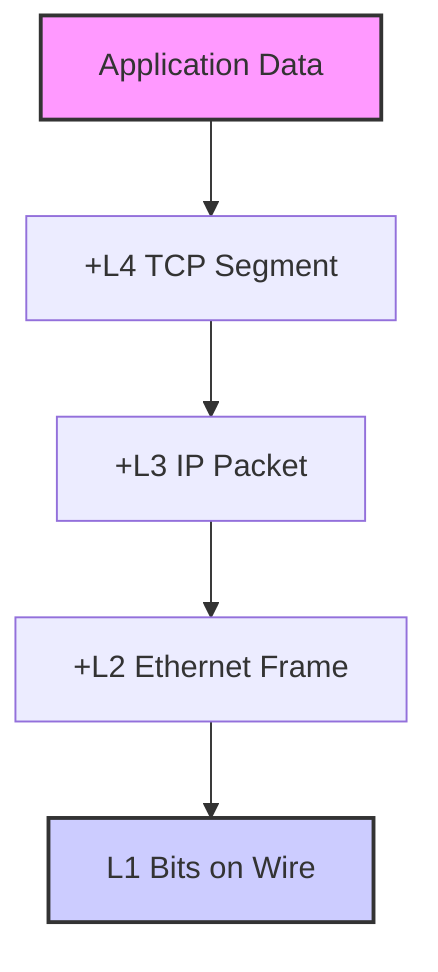

# Networking Essentials: The Backbone of System Design

In system design interviews, "Networking" is often treated as a black box. However, the difference between a Senior and a Staff-level engineer often lies in their understanding of what happens "under the hood" during a request flow.

---

## 1. Networking layers: OSI vs. TCP/IP

The OSI (Open Systems Interconnection) model is a conceptual framework that standardizes the functions of a telecommunication or computing system.

### The 7 Layers of OSI
1. **Physical**: Hardware, cables, bits.
2. **Data Link**: MAC addresses, frames (Ethernet).
3. **Network**: IP addresses, packets (Routers).
4. **Transport**: Ports, segments (TCP/UDP).
5. **Session**: Session management.
6. **Presentation**: Data formatting, encryption (SSL/TLS).
7. **Application**: High-level APIs (HTTP, FTP, SMTP).

### Data Encapsulation
When you send data, it travels down the stack, with each layer adding a **Header**. When it arrives, it travels up, and headers are stripped.

---

## 2. DNS: The Internet's Phonebook

DNS (Domain Name System) translates human-readable names (e.g., `google.com`) into IP addresses.

### Recursive Resolution Process
1. **Client**: "What is the IP for `example.com`?"
2. **Recursive Resolver**: Checks cache. If not found, asks the **Root Server**.
3. **Root Server**: "I don't know, but here is the `.com` TLD server."
4. **TLD Server**: "I don't know, but here is the Authoritative Nameserver for `example.com`."
5. **Authoritative Nameserver**: "Here is the IP: `93.184.216.34`."

### Critical Concepts
- **TTL (Time to Live)**: How long a record stays in cache. Low TTL = fast updates but more load.
- **DNS Caching**: Happens at the browser, OS, ISP, and Resolver levels.

---

## 3. Transport Layer: TCP vs. UDP

### TCP (Transmission Control Protocol) - "The Reliable One"
TCP is connection-oriented and guarantees delivery and order.
- **Handshake (The 3-Way handshake)**:
    1. Client -> SYN
    2. Server -> SYN-ACK
    3. Client -> ACK
- **Pros**: Reliability, error correction, flow control.
- **Cons**: High latency (head-of-line blocking), overhead.

### UDP (User Datagram Protocol) - "The Fast One"
UDP is connectionless and "fire-and-forget."
- **Pros**: Low latency, lightweight.
- **Cons**: No delivery guarantee, no ordering.
- **Use Cases**: VoIP, Gaming, Streaming, HTTP/3 (QUIC/UDP).

---

## 4. Load Balancing: L4 vs. L7

Load balancers distribute traffic across multiple servers.

### Layer 4 (Transport)
- **Basis**: IP addr and Port.
- **Action**: Forwards packets without inspecting the application data.
- **Pros**: Extremely fast, low CPU usage.
- **Cons**: No content-based routing (e.g., cannot route based on /api vs /auth).

### Layer 7 (Application)
- **Basis**: URL, Headers, Cookies, Content.
- **Action**: Terminates the connection, inspects the request, and opens a new connection to the backend.
- **Pros**: Smart routing, TLS termination, sticky sessions.
- **Cons**: CPU intensive, higher latency.

---

## 5. Resilience: Powering through Failure

### Circuit Breakers
Prevents a cascading failure by "opening" the circuit when a downstream service is struggling.
- **Closed**: Everything is normal. Requests go through.
- **Open**: Error threshold exceeded. Requests fail immediately.
- **Half-Open**: After a timeout, allow a few "test" requests to see if the service recovered.

### Retries with Exponential Backoff & Jitter
Don't just retry immediately. You might cause a "thundering herd" effect.
- **Backoff**: Wait longer between each retry (2s, 4s, 8s...).
- **Jitter**: Add a random small amount of time to the wait so all clients don't retry at the exact same millisecond.
