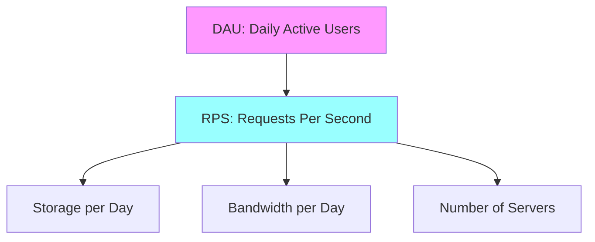

# Numbers to Know: The Back-of-the-Envelope Math

In a system design interview, you aren't just designing an architecture; you're proving it can work at scale. This requires "Back-of-the-Envelope" calculations.

---

## 1. Latency: The Speed of Light (and Silicon)

Understanding latency helps you decide where to place your data (Cache vs. DB vs. Disk).

| Operation | Latency (Approx) | Human Scale (1ns = 1s) |
| :--- | :--- | :--- |
| **L1 Cache Reference** | 0.5 ns | 0.5 s |
| **L2 Cache Reference** | 7 ns | 7 s |
| **Main Memory (RAM)** | 100 ns | 1.6 min |
| **SSD Random Read** | 16,000 ns | 4.4 hours |
| **Round Trip in Data Center** | 500,000 ns | 5.8 days |
| **Disk Seek (HDD)** | 10,000,000 ns | 4 months |
| **Packet (CA to NY to CA)** | 40,000,000 ns | 1.3 years |

---

## 2. Modern Hardware Limits

What can a single high-end cloud instance (e.g., AWS m6i.32xlarge) handle?

- **Network**: Up to 100 Gbps.
- **RAM**: Up to 1 TB (U-metal can go up to 24 TB).
- **Storage**: Non-volatile memory (NVMe) SSDs can do millions of IOPS.
- **CPU**: Up to 128 vCPUs.

---

## 3. Capacity Planning: The Formula

To estimate requirements, follow this flow:

### Example Calculation: Twitter-like System
- **DAU**: 100 Million
- **Write RPS**: If each user posts 1 tweet/day: $100M / 86400s \approx 1,200$ writes/sec.
- **Peak Write RPS**: $1,200 \times 2 = 2,400$ writes/sec.
- **Storage**: If 1 tweet is 200 bytes: $100M \times 200B = 20 GB$ per day.
- **Yearly Storage**: $20 GB \times 365 = 7.3 TB$.

---

## 4. Throughput Benchmarks

- **Redis**: ~100k+ operations per second on a single thread.
- **MySQL/Postgres**: ~1k-10k writes per second (depending on hardware/indexing).
- **Kafka**: Millions of events per second (horizontally scalable).

---

## 5. Availability (The "Nines")

| Availability % | Downtime per Year |
| :--- | :--- |
| **99% (Two Nines)** | 3.65 days |
| **99.9% (Three Nines)** | 8.77 hours |
| **99.99% (Four Nines)** | 52.6 minutes |
| **99.999% (Five Nines)** | 5.26 minutes |

> **Senior Tip**: When estimating storage, always add a **Replication Factor** (usually 3) and a **Buffer** (20-30%) for spikes and logs. $7.3 TB \times 3 \approx 22 TB$ real storage needed.
