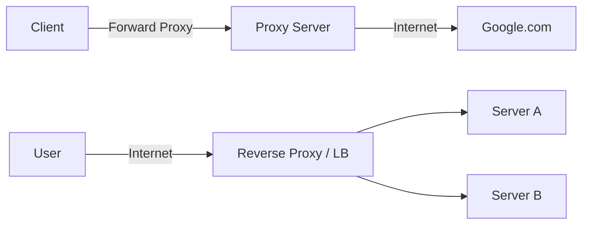

# Proxy and Clustering

Proxies and Clusters are the building blocks of scaling and securing internet traffic.

---

## 1. Forward Proxy vs. Reverse Proxy

### Forward Proxy
A server that sits in front of a **group of client machines**. When a client makes a request, the proxy intercepts it and talks to the internet on the client's behalf.
- **Use Case**: Bypassing firewalls, anonymizing client IPs, caching web content for an office.
- **Client Side**: The client knows they are using a proxy.

### Reverse Proxy
A server that sits in front of a **group of web servers**. When a request comes in from the internet, the proxy routes it to one of the servers.
- **Use Case**: Load balancing, SSL termination, caching static content (CDN style), security.
- **Server Side**: The client thinks they are talking directly to the web server.

---

## 2. Clustering

A cluster is a set of connected servers that work together so that, in many respects, they can be viewed as a single system.

- **High Availability (HA) Clustering**: Designed to improve the availability of services. If one node fails, another takes over.
- **Load Balancing Clustering**: Distributes traffic to prevent any single node from being overwhelmed.
- **High-Performance (HPC) Clustering**: Nodes work together to solve complex computational problems (e.g., Render farms, Scientific simulations).

---

## 3. Sticky Sessions (Session Affinity)

In a clustered environment, how do you ensure a user always talks to the same server?
- **Load Balancer Level**: The LB tracks the user (via IP or a Cookie) and routes them to Server A every time.
- **Risk**: If Server A dies, the user's session data is lost.
- **Better Approach**: Move session data to a distributed cache like **Redis**. Any server can handle any user.

---

## 4. Interview "Senior" Discussion Points

- **L7 Proxy vs L4 Proxy**: Why Nginx (L7) is better for path-based routing than HAProxy (L4) which is faster.
- **Transparent Proxy**: A proxy that doesn't modify the request/response and is often implemented at the network level without the user's knowledge.
- **Sidecar Proxy**: Using a proxy (like Envoy) as a sidecar in a Service Mesh to handle retries and security for a microservice.

> **Senior Tip**: When using a Reverse Proxy, always ensure the **`X-Forwarded-For`** header is passed through. Without it, your application servers will only see the IP address of the proxy, making bot detection and logging impossible.
