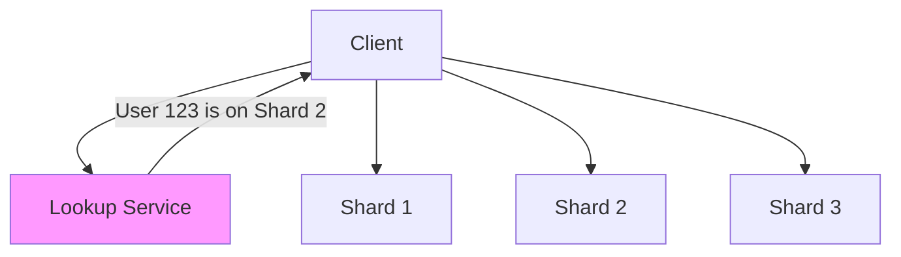
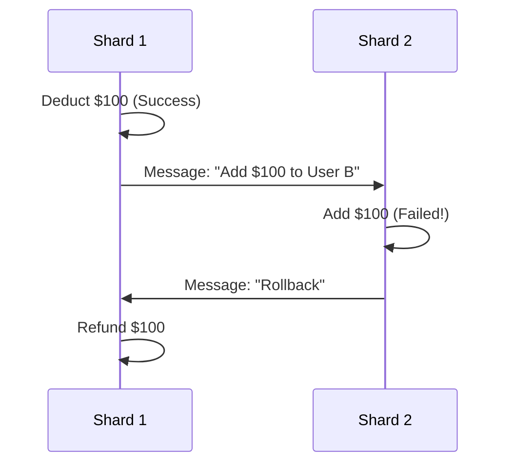

# Database Sharding: Scaling Beyond the Single Machine

Sharding is the process of splitting a large dataset into smaller, faster, more manageable parts called **shards**. It is the ultimate solution for horizontal scaling when a single database instance reaches its CPU, RAM, or storage limits.

---

## 1. Vertical vs. Horizontal Scaling

- **Vertical Scaling (Scaling Up)**: Adding more CPU/RAM to a single server. 
    - *Limit*: Hardware has a physical ceiling and becomes exponentially expensive.
- **Horizontal Scaling (Scaling Out)**: Adding more database instances and splitting the data across them.
    - *Limit*: Increases complexity (joins, transactions, consistency).

---

## 2. Sharding Strategies

### Hash-Based (Key-Based) Sharding
Apply a hash function to a key (e.g., `user_id`) to determine the shard: `shard_id = hash(key) % total_shards`.
- **Pros**: Uniform data distribution.
- **Cons**: Adding/removing shards requires moving almost all data.

### Range-Based Sharding
Data is split based on ranges of values (e.g., `A-M` in Shard 1, `N-Z` in Shard 2).
- **Pros**: Range queries are efficient.
- **Cons**: Risk of **Hot Spots** (e.g., if most users have names starting with 'S').

### Directory-Based Sharding
A lookup service (catalog) maps keys to specific shards.
- **Pros**: Extremely flexible; allows moving individual users to different shards easily.
- **Cons**: The lookup service is a single point of failure and adds latency to every query.

---

## 3. The "Hot Shard" Problem

Even with sharding, some shards can become overloaded.
- **Example**: In a social network sharded by `user_id`, a celebrity with 100M followers might reside on one shard.
- **Solution**: **Compound Shard Keys**. Shard by `user_id + post_id` to distribute the celebrity's posts across multiple shards.

---

## 4. Distributed Transactions & Joins

### The Challenge
Executing a transaction that spans multiple shards (e.g., a bank transfer between Users on different shards) is difficult.

### 2-Phase Commit (2PC)
A central coordinator ensures all shards commit or rollback.
- **Problem**: Very slow; if the coordinator fails, resources remain locked.

### Saga Pattern
A sequence of local transactions. If one fails, "compensating transactions" are run to undo the previous steps.
- **Result**: Eventual consistency instead of strong consistency.

---

## 5. Shard Key Selection: The Most Important Decision

A bad shard key leads to resharding (a nightmare).
- **High Cardinality**: The key must have many unique values.
- **Even Distribution**: Avoid keys that grow monotonically (like `created_at` or auto-increment IDs) as all new data will hit the same shard.

> **Senior Tip**: If possible, push sharding logic down to the database layer using tools like **Vitess** (for MySQL) or **Citus** (for Postgres) rather than managing it in your application code.
