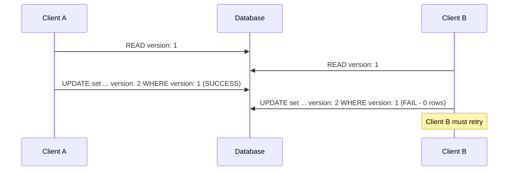
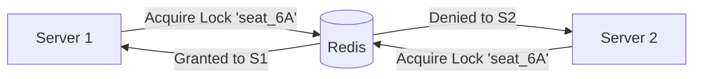

# Dealing with Contention: Managing Concurrent Access

In a high-scale system, the same piece of data (e.g., a limited-edition sneaker, a flight seat, or a bank balance) is often accessed by thousands of users simultaneously. This is called **Contention**.

---

## 1. The Single Node Problem

On a single database node, we use **Isolation Levels** and **Locking**.

- **Pessimistic Locking**: "I'm changing this, so nobody else can even look at it."
    - **How**: `SELECT ... FOR UPDATE`.
    - **Pros**: Guarantees consistency.
    - **Cons**: Can lead to deadlocks and poor performance under high load.
- **Optimistic Concurrency Control (OCC)**: "I'll assume nobody else is changing this. If they did, I'll fail and retry."
    - **How**: Use a `version` or `last_updated_at` column. `UPDATE balance = 100 WHERE id = 1 AND version = current_version`.
    - **Pros**: High performance for low-to-medium contention.
    - **Cons**: "Retry storms" if contention is extremely high.

---

## 2. Distributed Contention (Multiple Nodes)

When data is sharded or replicated, single-node locks aren't enough.

### Distributed Locks (Redis/ZooKeeper)
A central authority grants a "lease" to a node.
- **Redis (Redlock)**: Fast, but has edge cases with system clock skews.
- **ZooKeeper**: Extremely reliable (via ephemeral nodes), but slower.

---

## 3. The Saga Pattern: Long-Lived Transactions

In distributed systems, we often replace a massive "All-or-Nothing" lock with a sequence of small, reversible steps.
- **Choreography**: Each service produces and listens to events (decentralized).
- **Orchestration**: A central "Brain" manages the state machine (centralized).

---

## 4. Anti-Patterns to Avoid

- **Sticky Sessions for Consistency**: It doesn't scale and leads to imbalanced load.
- **Over-locking**: Locking a whole table when you only need a row.

> **Senior Tip**: For extremely high contention (e.g., Ticketmaster), use **Request Queueing**. Instead of letting everyone hit the DB, put them in a FIFO queue and process requests one by one or in small batches.
