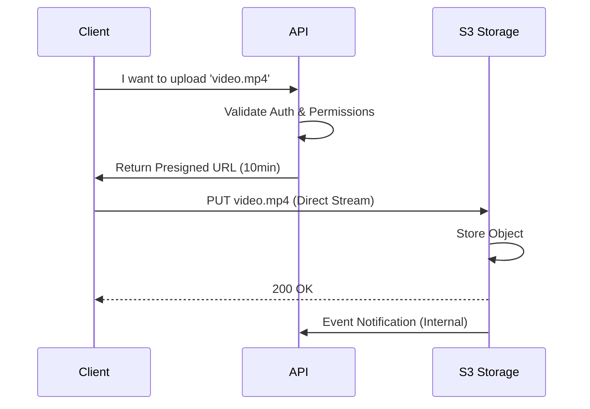

# Handling Large Blobs: Efficient File Uploads & Downloads

System design interviews for YouTube, Instagram, or Dropbox require a strategy for handling large files (Binary Large Objects) without killing your API servers.

---

## 1. The Anti-Pattern: Sending through the API

**Don't** upload bytes directly to your backend server.
- **Risk**: Your API server's memory/CPU gets tied up in I/O wait.
- **Risk**: Your server becomes a bottleneck for bandwidth.

---

## 2. The Solution: Presigned URLs

A Presigned URL allows the client to interact directly with the storage provider (S3/GCS) using temporary, secure permissions.

### The Write Flow (Upload)
1. **Metadata Call**: Client asks API for an upload URL.
2. **URL Generation**: API generates a Presigned URL with a short TTL.
3. **Direct Upload**: Client PUTs the file directly to S3.
4. **Completion**: (Optional) S3 triggers a Lambda or Webhook to notify the API that the file is ready.

---

## 3. Multipart Uploads

For files $> 100MB$, use multipart uploads.
- **Parallelism**: Upload multiple 5MB chunks simultaneously.
- **Resumes**: If chunk 4 fails, you only retry chunk 4, not the whole file.
- **Assembly**: Once all chunks reach S3, the client calls `CompleteMultipartUpload`.

---

## 4. Serving Blobs: CDN & Cache-Control

- **Signed Cookies**: For private content (Netflix), use Signed Cookies instead of URLs to allow one signature for multiple files (e.g., manifest + chunks).
- **Edge Caching**: Use a CDN (CloudFront/Cloudflare) to serve blobs close to users.
- **Hot Object Scaling**: If 1 million users try to download the same file, use S3 replication across multiple prefixes to distribute the I/O load.

---

## 5. Summary: Security vs. Performance

| Strategy | Performance | Security | Complexity |
| :--- | :--- | :--- | :--- |
| **Through API** | Low (Bottleneck) | High (Full Logic) | Low |
| **Presigned URL** | High (Direct) | High (Short TTL) | Medium |
| **Public CDN** | Highest | Low (Public) | Low |

> **Senior Tip**: Mention **Content-Type Validation**. Since the API doesn't see the bits, it can't verify if it's a real `.jpg`. Use an S3 trigger (Lambda) to run a virus scan or file-type check *after* the upload and before making it public.
