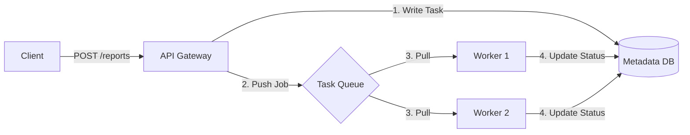

# Managing Long-Running Tasks: Asynchronous Processing

Long-running tasks (e.g., video encoding, report generation, data imports) cannot be handled in the request-response cycle. They require an asynchronous architectural pattern.

---

## 1. The Core Pattern: Worker Queues

The standard approach is to decouple the **Producer** (API) from the **Consumer** (Worker) via a **Task Queue**.

1. **Submission**: User sends request; API validates and writes task to DB and Queue.
2. **Acceptance**: API returns `202 Accepted` with a `task_id`.
3. **Processing**: Workers pull tasks from the queue and update status in the DB.

---

## 2. Notification Strategies: How to tell the User?

### A. Polling (The Pull Model)
The client periodically hits `GET /tasks/{id}` to check the status.
- **Pros**: Simple to implement, works with all networks.
- **Cons**: High overhead if many clients poll simultaneously.

### B. Webhooks (The Push Model - System to System)
The user provides a `callback_url`. When the task is done, the worker sends a POST request to that URL.
- **Pros**: Efficient, real-time.
- **Cons**: Caller must host a publicly accessible endpoint.

### C. WebSockets/SSE (The Push Model - User Browser)
The client maintains a persistent connection. The server pushes a notification when the task completes.
- **Pros**: Instant UI update.

---

## 3. Retries & Idempotency

In a distributed system, tasks will fail or be processed multiple times.
- **Retries**: Use **Exponential Backoff** with **Jitter** to avoid the "Thundering Herd" problem.
- **Idempotency**: Every task must be idempotent. If a worker processes the same task twice, the side effect should be the same as once. Use a `request_id` or `deduplication_key`.

---

## 4. Visibility & Dead Letter Queues (DLQ)

- **Visibility Timeout**: Amount of time a task is hidden from other workers while being processed. If the worker crashes, the timeout expires and the task reappears.
- **DLQ**: If a task fails $N$ times, move it to a DLQ for manual inspection to avoid "Poison Pillar" tasks that crash workers repeatedly.

---

## 5. Summary: When to use it?

- **Use it if**: Any task takes longer than 500ms-1s or depends on slow external APIs.
- **Senior Tip**: Discuss **At-Least-Once** vs **Exactly-Once** delivery. Most queues (SQS, RabbitMQ) are at-least-once. Achieving exactly-once requires idempotency at the application layer.
