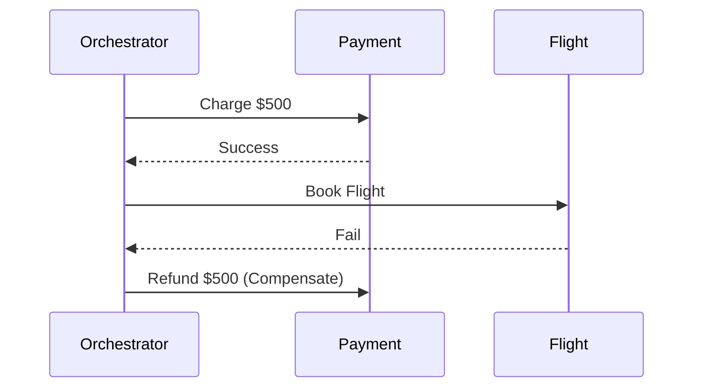

# Multi-step Processes: Ensuring Reliability in Workflows

Complex business logic (like booking a trip with a flight, hotel, and car rental) involves multiple services. If one fails halfway through, the system must not be left in an inconsistent state.

---

## 1. The Difficulty: Partial Failures

In a single monolith, you could use a database transaction. In microservices, "The Network is Unreliable."

### The Problem Scenario
1. Step 1: Charge Credit Card (Payments Service) - ✅
2. Step 2: Book Flight (Flight Service) - ✅
3. Step 3: Book Hotel (Hotel Service) - ❌ (Out of rooms!)

Now you've charged the user, but they have no hotel.

---

## 2. The Solution: Sagas (Distributed Transactions)

A Saga is a sequence of local transactions. Each step has a **Compensating Transaction** to undo it.

### Orchestration (The "Brain" approach)
A central orchestrator service tells each participant what to do.

### Choreography (The "Event" approach)
Each service listens to events and triggers its own logic. Harder to debug but more decoupled.

---

## 3. Idempotency: The Golden Rule

Every step in a multi-step process **must be idempotent**.
- If the network times out after the payment is made, the orchestrator might retry the "Charge" command.
- The Payment service must recognize the `Request-ID` and not charge the card twice.

---

## 4. Durable Execution (Temporal / AWS Step Functions)

Instead of building your own state machine, use "Durable Execution." 
- These frameworks save the variables and stack trace after every line of code.
- If the server restarts, the workflow resumes exactly where it left off.

---

## 5. Summary Table

| Approach | Consistency | Complexity | Reliability |
| :--- | :--- | :--- | :--- |
| **2-Phase Commit** | Strong | High | Low (Blocking) |
| **Saga** | Eventual | Moderate | High |
| **Durable Execution**| Application-level | Low/Moderate | Very High |

> **Senior Tip**: In interviews, start with **Orchestration Sagas**. They are easier to explain, easier to monitor, and satisfy almost all requirements for complex business flows.
