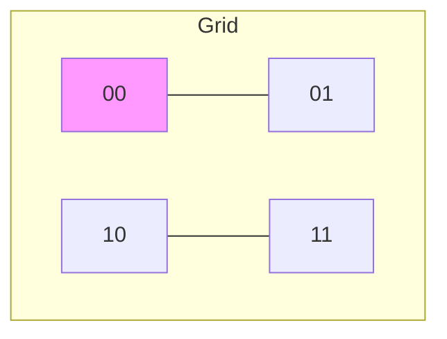
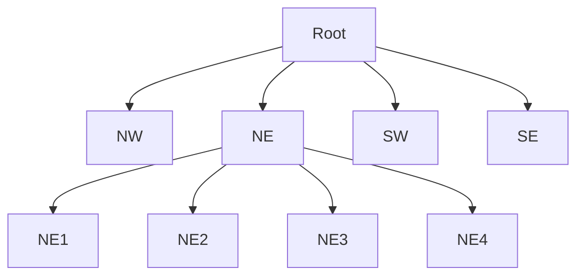

# Proximity-Based Services: Finding "Nearby" Things

Proximity services (Yelp, Uber, Tinder) solve the "Find all X within radius R" problem. Standard SQL indices (`WHERE lat=X AND lon=Y`) cannot handle 2D range queries efficiently.

---

## 1. Geohashing: Z-Order Curves

Geohashing reduces a 2D coordinate into a 1D string.
- The Earth is divided into a grid. Each cell is assigned a hash.
- **Prefix Matching**: Cells with the same prefix are geographically close.
- **Precision**: Shorter hash = larger area (e.g., `dr5ru` is NYC).

---

## 2. Quadtrees: Recursive Partitioning

A Quadtree is a tree structure where each node has exactly four children.
- If a node contains too many points, it splits into 4 quadrants.
- **Interview Tip**: Quadtrees are built in-memory. To scale, you must shard them across servers based on geographic regions.

---

## 3. Google S2 Geometry

Modern standard used by Uber/Pokemon Go.
- Maps the Earth onto a 3D sphere, then projects it onto a cube.
- **Hibert Curve**: A space-filling curve that maintains much better spatial locality than Geohash.

---

## 4. Scalability: Real-time vs. Static

### Static Entities (Yelp/Google Maps)
Businesses don't move. You can index them once and cache heavily. Use **PostGIS** or **Elasticsearch** (Geo-point).

### Dynamic Entities (Uber/Lyft)
Drivers move every second. You need a fast, in-memory store.
- **Redis Geospatial**: Uses Sorted Sets (ZSET) under the hood with 52-bit Geohashes as scores.
- `GEOADD drivers 40.71 74.00 "driver_1"`
- `GEORADIUS drivers 40.72 74.05 5 km`

---

## 5. Summary Table: Indexing Comparison

| Technique | Type | Best For | Complexity |
| :--- | :--- | :--- | :--- |
| **Geohash** | String Prefix | Static search | Low |
| **Quadtree** | In-memory Tree | Highly dense areas | Medium |
| **S2 Cells** | Numerical ID | Global scale/Real-time | High |
| **PostGIS** | SQL Extension | Complex geometry (Polygons) | Low |

> **Senior Tip**: When querying a radius, always query the user's geohash **plus the 8 surrounding hash neighbors**. A user might be at the very edge of a cell, and the "closest" business could be in the next cell over.
