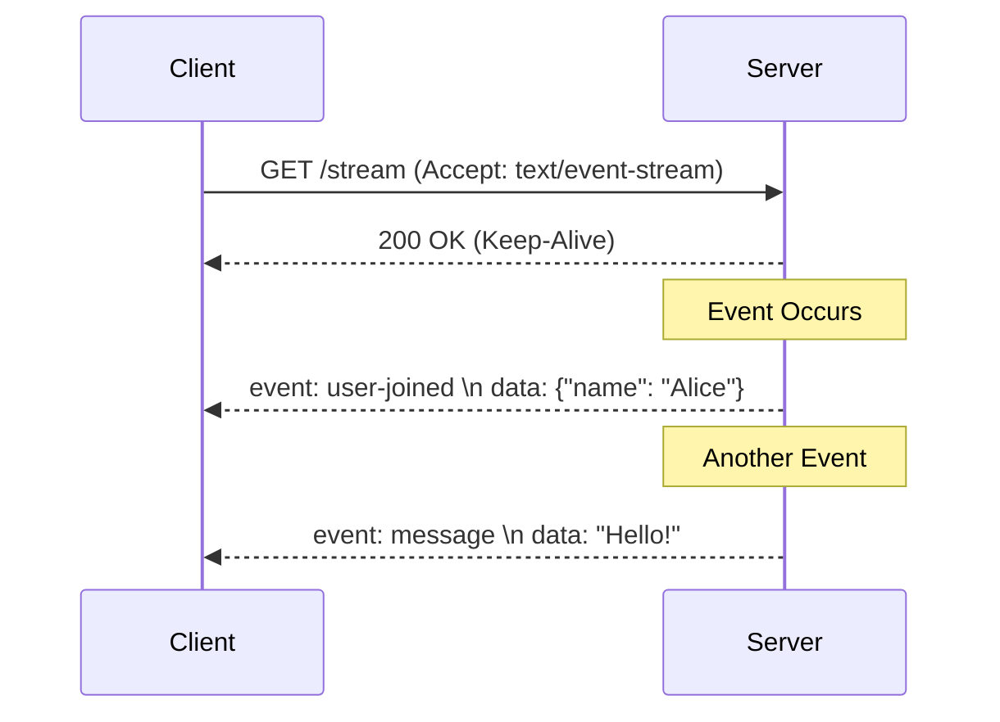
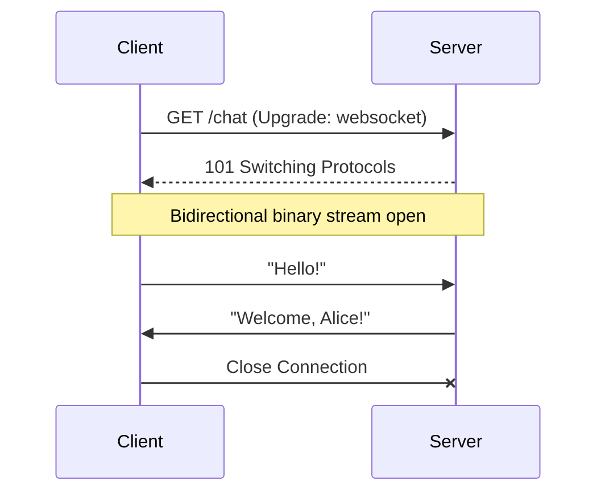
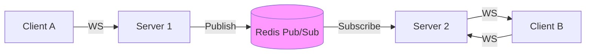

# Real-time Updates: Pushing Data to the Client

In modern system design, the "Request/Response" model is often too slow. From chat apps to live auctions, we need ways to push data from the server to the client instantly.

---

## 1. The Strategy Spectrum

Choosing a real-time protocol is a trade-off between **latency**, **complexity**, and **battery life**.

| Technique | Direction | Transport | Connection | Use Case |
| :--- | :--- | :--- | :--- | :--- |
| **Short Polling** | Unidirectional | HTTP/1.1 | Closed | Low-priority status updates |
| **Long Polling** | Unidirectional | HTTP/1.1 | Held | Legacy real-time systems |
| **SSE** | One-way (S->C) | HTTP | Persistent | News feeds, Stock tickers |
| **WebSockets** | Full Duplex | TCP | Persistent | Chat, Gaming, Collaboration |
| **WebRTC** | Peer-to-Peer | UDP/TCP | Direct | Video calls, P2P file sharing |

---

## 2. Server-Sent Events (SSE)

SSE is standard HTTP that stays open. The server sends "events" as they happen.

- **Pros**: Automatic reconnection, lightweight (no binary overhead), works over standard HTTP/HTTPS.
- **Cons**: One-way only (Server to Client). Max connection limits (6 per browser in HTTP/1.1).

---

## 3. WebSockets: The Full-Duplex Champion

WebSockets provide a persistent, bi-directional connection over a single TCP socket.

- **The Handshake**: Starts as an HTTP request with an `Upgrade` header. If the server agrees, the protocol switches to WebSocket (`ws://` or `wss://`).
- **Binary Support**: Messages are sent in "frames," which can be binary or text.

---

## 4. Scaling WebSockets: The Pub/Sub Challenge

The hardest part of WebSockets is that **connections are stateful**.
- If Client A is on Server 1 and Client B is on Server 2, how does Server 1 send a message to Client B?
- **Solution**: **Pub/Sub (Redis or Kafka)**.

---

## 5. WebRTC: Eliminating the Middleman

WebRTC allows browsers to talk directly to each other without passing data through a server.
- **Signaling**: You still need a central server just to help clients "find" each other.
- **NAT Traversal**: Uses **STUN** (to find public IP) and **TURN** (as a relay fallback if direct P2P fails).

---

## 6. Hot Topic: HTTP/2 and Server Push

While HTTP/2 "Server Push" exists, it's mostly for pushing resources (CSS/JS) to the cache, not for application-level data. For real-time data, stick to **WebSockets** or **gRPC Streaming**.

> **Senior Tip**: When selecting a protocol in an interview, start with **SSE** if the traffic is one-way (like a notification system) because it is simpler to load balance and manage. Only jump to **WebSockets** if the client needs to talk back frequently.
