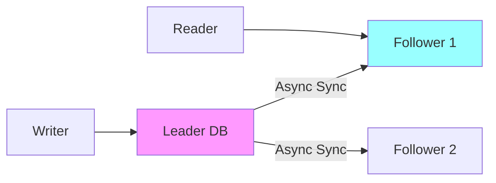
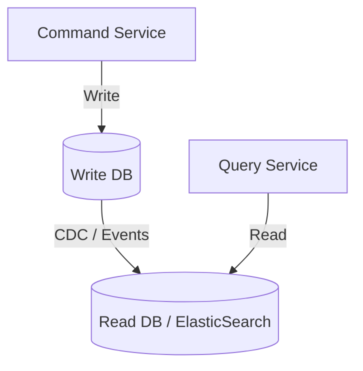

# Scaling Reads & Writes: Maximizing Throughput

As your application grows, you will eventually hit the "Read Wall" or the "Write Wall."

---

## 1. Scaling Reads (The "Easy" Problem)

Reads are $O(1)$ to scale—just add more replicas!

### Read Replicas
- **The Flow**: One "Leader" (Writes) and multiple "Followers" (Reads).
- **The Catch**: **Replication Lag**. A user might write their status and then refresh, hitting a follower that hasn't synced yet (AP in CAP).

### Fan-out (The Social Media Pattern)
When User A posts, you can:
- **Pull**: Fans fetch from User A's table on demand (High read load).
- **Push (Fan-out)**: The system pushes User A's post into the "Home Feed" (Inbox) of all 1,000 followers during the write (High write load).

---

## 2. Scaling Writes (The "Hard" Problem)

You can't just add replicas for writes without complex partitioning.

### Write-Behind Caching (Asynchronous Writes)
Write to a fast memory-store (Redis) and return "Success" immediately. A background thread flushes to the DB.
- **Risk**: Data loss if the cache crashes.

### Sharding (Partitioning)
Split the database. This is the only true way to scale writes infinitely. (See [Sharding.md](file:///c:/WorkSpace/DSA+SD+Interview/HelloInterview/Sharding.md))

---

## 3. CQRS (Command Query Responsibility Segregation)

Separate the data model for **Writing** (Highly normalized) from the model for **Reading** (Highly denormalized/Search-optimized).

---

## 4. Managing Hot-Keys

In high-read systems (Twitter/Reddit), certain keys will be hit millions of times per second.
- **Solution**: **Multi-layer Caching** (Browser -> CDN -> Redis -> Local RAM).

---

## 5. Summary Table

| Strategy | Primary Benefit | Main Trade-off |
| :--- | :--- | :--- |
| **Read Replicas** | Massively more reads | Stale data (Lag) |
| **CQRS** | Optimized reads and writes | Extreme complexity |
| **Sharding** | Infinite write scaling | Hard to query across shards |

> **Senior Tip**: Always mention **Materialized Views**. They are a middle-ground between a standard index and a full CQRS setup, allowing you to store pre-joined and pre-computed results of expensive queries.
