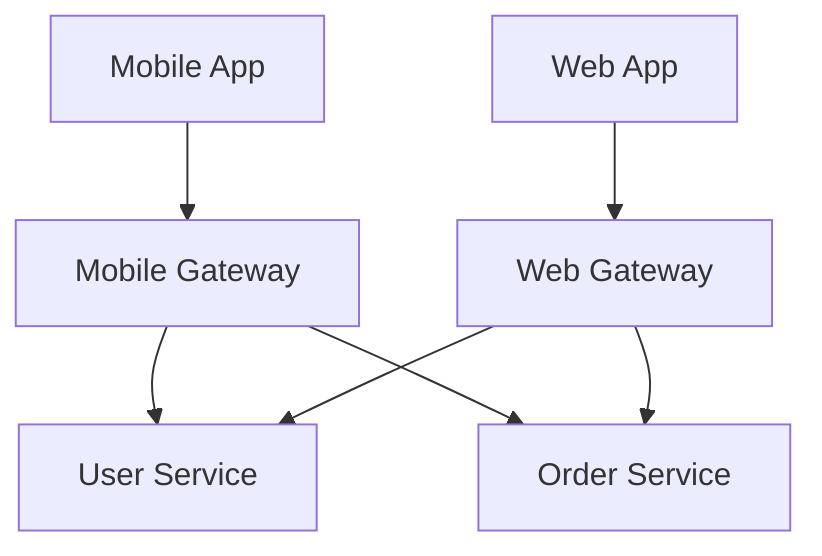

# API Gateway: The Entry Point of the System

An API Gateway is a server that acts as an API front-end, receiving API requests, enforcing throttling and security policies, and passing requests to the back-end service.

---

## 1. Core Responsibilities

- **Routing**: Mapping public URLs to internal microservices.
- **Authentication/Authorization**: Verifying JWTs or API keys before the request hits the service.
- **Rate Limiting/Throttling**: Protecting backends from spikes in traffic.
- **Payload Transformation**: Converting between protocols (e.g., JSON to gRPC).
- **Aggregation**: Combining data from multiple microservices into a single response.

---

## 2. Architecture: Centralized vs. Decentralized

### Shared API Gateway
A single entry point for all clients.
- **Pros**: Consistent security, easy to manage.
- **Cons**: Single point of failure, can become a bottleneck.

### Backends for Frontends (BFF)
Different gateways for different clients (iOS, Web, Android).
- **Pros**: Tailored responses for each device.
- **Cons**: Duplicated logic across gateways.

---

## 3. Implementation Patterns

- **Reverse Proxy (Nginx/HAProxy)**: High-performance routing and SSL termination.
- **Custom Gateway**: Built in Go/Node.js for complex aggregation logic.
- **Service Mesh (sidecars)**: Offloading gateway-like features (retries, circuit breaking) to individual proxies next to each service.

---

## 4. Throttling Algorithms

- **Leaky Bucket**: Smooths out traffic spikes.
- **Token Bucket**: Allows for bursts of traffic up to the bucket size.
- **Fixed/Sliding Window**: Simple but can be "gamed" at window boundaries.

---

## 5. Summary: Gateway vs. Load Balancer

- **Load Balancer**: Works at L4/L7, focuses on distributing traffic to *identical* servers.
- **API Gateway**: Works at L7, focuses on *routing* to different services and adding logic.

> **Senior Tip**: Beware of "Mega-Gateways." If you put too much business logic in the gateway, you recreate a **monolith** in front of your microservices, making it a nightmare to deploy and test.
