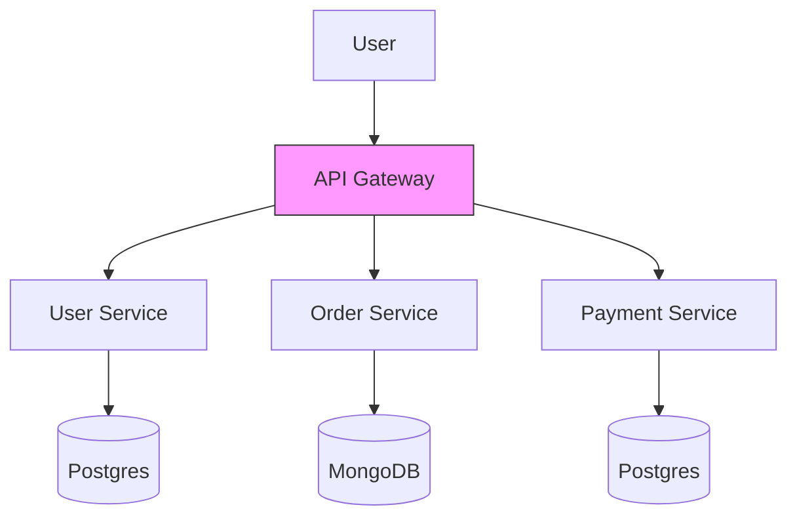

# Architecture Styles

Choosing an architecture style defines how the components of your system interact and scale. There is no "perfect" architecture—only trade-offs.

---

## 1. Monolithic Architecture
The entire application (UI, Business Logic, Data Access) is built as a single unit and deployed as one file (e.g., a `.war` or `.jar`).
- **Pros**: Simple to develop, test, and deploy. Low latency between components.
- **Cons**: Scaling is "all or nothing," large codebase becomes hard to manage, deployment is slow.

---

## 2. N-Tier Architecture
Divides the application into logical layers (often 3-Tier: Presentation, Application, and Data).
- **Pros**: Clear separation of concerns. Layers can be managed by different teams.
- **Cons**: Still often deployed as a monolith. High overhead for simple applications.

---

## 3. Microservices Architecture
The application is a collection of small, independent services that communicate via APIs (REST/gRPC/Messaging).
- **Pros**: Independent scaling and deployment. Technology flexibility (Polyglot). High fault isolation.
- **Cons**: High operational complexity (Service Discovery, Observability). Data consistency is hard (Distributed Transactions).

---

## 4. Serverless (Function as a Service - FaaS)
The developer writes code (functions) and the cloud provider handles all infra, scaling, and execution. (e.g., AWS Lambda, Azure Functions).
- **Pros**: Zero infra management. Pay-per-execution (No cost for idle). Infinite auto-scaling.
- **Cons**: "Cold Start" latency. Vendor lock-in. Limited execution time and resources.

---

## 5. Interview "Senior" Discussion Points

- **Distributed Monolith**: The worst of both worlds. Services are split but so tightly coupled that they must be deployed together.
- **Database per Service**: Why this is mandatory for microservices and how it leads to the **Saga Pattern** for consistency.
- **Bounded Contexts**: Using Domain-Driven Design (DDD) to decide where one microservice ends and another begins.

> **Senior Tip**: Don't start with microservices. Follow the **"Monolith First"** strategy. Build a well-structured monolith (Modular Monolith) and only split into services when you have proven scaling or team-boundary friction.
