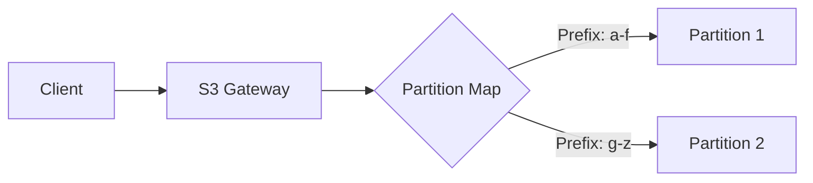

# Blob Storage: Storing the Internet's Assets

Blob Storage (Binary Large Object) is designed for unstructured data like images, videos, and backups. AWS S3 is the industry standard.

---

## 1. Object Storage vs. File Storage

- **File Storage (POSIX)**: Hierarchical (folders), supports partial updates (random access writes).
- **Object Storage**: Flat namespace (Bucket + Key). **Objects are immutable.** To change even 1 byte, you must re-upload the entire object.

---

## 2. S3 Internals: Partitioning & Scaling

S3 scales horizontally by partitioning based on the **Key name**.
- **Request Limits**: 3,500 PUT/POST/DELETE and 5,500 GET requests per second per prefix.
- **Scaling Tip**: If you hit limits, randomize the prefix (e.g., `user-123/img.jpg` -> `4a-user-123/img.jpg`) to distribute load across more partitions.

---

## 3. Durability & Availability

- **11 Nines of Durability**: S3 stores data across at least 3 Availability Zones (AZs) by default.
- **Eventual Consistency**: S3 now provides **Strong Read-after-Write Consistency** for new objects and overwrites. (Historically it was eventual).

---

## 4. Performance Optimizations

- **Multipart Upload**: Break large files into chunks and upload in parallel. Required for files $> 5GB$.
- **Byte-Range Fetch**: Download only a specific part of an object (e.g., the first 1MB of a video).
- **S3 Select**: Run SQL queries directly on CSV/JSON objects in S3 to filter data *before* it travels the network.

---

## 5. Lifecycle Management

- **Storage Classes**: Standard, IA (Infrequent Access), Glacier (Cold storage).
- **Transitions**: Automatically move data to cheaper storage after N days to save costs.

> **Senior Tip**: If asked about storing metadata (e.g., image tags), never store them in S3 Metadata headers for querying. S3 is bad at "list objects with tag X." Instead, store metadata in **DynamoDB** and only the file content in S3.
