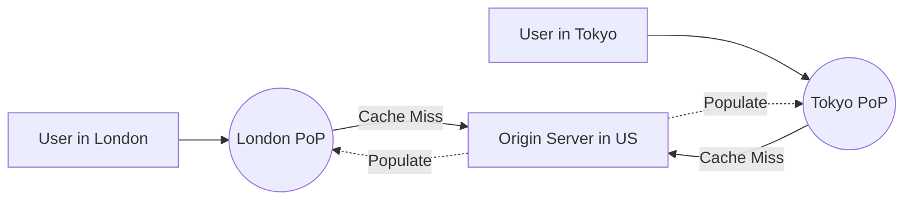

# CDN: Bridging the Distance

A Content Delivery Network (CDN) is a geographically distributed group of servers that work together to provide fast delivery of Internet content.

---

## 1. PoPs and Edge Locations

- **Point of Presence (PoP)**: Data centers located at the edge of the internet (close to ISPs).
- **Edge Node**: The individual servers within a PoP that cache and serve content.
- **Origin Server**: The source of truth where the content is originally hosted (e.g., your S3 bucket).

---

## 2. Push vs. Pull Models

- **Pull (Default)**: The CDN requests the content from the origin only when a user asks for it. Best for large amounts of rarely accessed data.
- **Push**: You proactively "push" content to the CDN. Best for small files that are updated frequently and need to be consistently available across all edges.

---

## 3. Dynamic Content & acceleration

CDNs can optimize even non-cacheable data:
- **TCP Optimization**: Keeping connections open between PoP and Origin to avoid multiple handshakes.
- **Edge Computing (Cloudflare Workers, Lambda@Edge)**: Running lightweight logic (A/B testing, auth checks) at the edge before hitting the origin.

---

## 4. Cache Invalidation Strategies

- **TTL (Time to Live)**: The most common way. Content expires after X hours.
- **Purge/Invalidate**: Manually telling the CDN to delete a file.
- **Versioning**: Changing the filename (e.g., `style.v2.css`) so the CDN sees it as a completely new object.

---

## 5. Security: DDoS & WAF

CDNs are your first line of defense.
- **DDoS Mitigation**: Their massive scale can absorb L3/L4 floods.
- **WAF (Web Application Firewall)**: Filtering malicious L7 requests (SQL injection, XSS) at the edge.

> **Senior Tip**: Mention **Anycast Routing**. In a CDN, all PoPs share the same IP address. BGP routing automatically sends the user's request to the "nearest" PoP geographically/network-wise.
