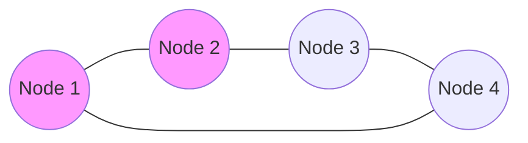

# Cassandra: High-Availability NoSQL and the Ring Architecture

Apache Cassandra is a distributed wide-column store designed for massive write throughput and no single point of failure (Zero-Master architecture).

---

## 1. The Ring Architecture & Gossip

Every node in Cassandra is equal.
- **Consistent Hashing**: Data is distributed across a ring using hash ranges.
- **Gossip Protocol**: Nodes share their state (health, load) every second. If a node fails, the cluster detects it via the **Phi Accrual Failure Detector**.

---

## 2. Write Internals: The LSM Tree

Cassandra writes are optimized for speed by never seeking the disk.
1. **Commit Log**: Append-only log for durability.
2. **Memtable**: Sorted in-memory buffer.
3. **SSTable (Sorted String Table)**: When the Memtable is full, it's flushed to disk as an immutable file.

---

## 3. Read Optimization: Bloom Filters

Reading from multiple immutable files (SSTables) is slow. Cassandra uses **Bloom Filters** (probabilistic data structures) to tell if a partition key *might* exist in an SSTable before opening it.

---

## 4. Tunable Consistency

You can choose your level of CAP per request.
- **ANY**: Success if 1 node (even a hinted handoff) gets the write.
- **ONE/TWO/THREE**: Success if N replicas acknowledge.
- **QUORUM**: $N/2 + 1$ replicas.
- **ALL**: Every replica must acknowledge.

---

## 5. Compaction: The Cleanup

Since SSTables are immutable, updates/deletes just write new values (with a "Tombstone"). Periodically, Cassandra merges SSTables into a new one, discarding old values and tombstones.

> **Senior Tip**: Cassandra is bad for **Frequent Updates** or **Deletes**. High update volume leads to "Tombstone Bloat," which significantly degrades read performance as the system has to scan through thousands of "deleted" markers.
