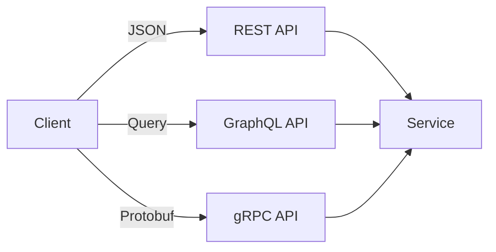

# Communication Protocols: REST, GraphQL, gRPC, and Webhooks

Services interact through protocols that define how data is exchanged. Choosing the right protocol depends on your requirements for speed, flexibility, and compatibility.

---

## 1. REST (Representational State Transfer)
The most common protocol for public web APIs.
- **Key Concepts**: Resource-based (URIs), Stateless, HATEOAS, HTTP Verbs (GET, POST, PUT, DELETE).
- **Pros**: Simple, widely understood, cacheable, works in any browser.
- **Cons**: "Over-fetching" (getting more data than you need) or "Under-fetching" (needing multiple calls for one view).

---

## 2. GraphQL
A query language for APIs that allows clients to request exactly the data they need.
- **Key Concepts**: Typed Schema, Single Endpoint (`/graphql`), Queries, Mutations, Subscriptions.
- **Pros**: No over-fetching. Perfectly suited for complex frontends with many small data points.
- **Cons**: High server-side complexity to implement (N+1 query problem). Hard to cache locally.

---

## 3. gRPC (Google Remote Procedure Call)
A modern, high-performance RPC framework built on HTTP/2.
- **Key Concepts**: Interface Definition Language (Protocol Buffers), Binary serialization, Bi-directional streaming.
- **Pros**: Extremely fast (binary is smaller than JSON). Code generation for many languages. Built-in flow control.
- **Cons**: Binary data is not human-readable. Poor browser support (requires a proxy like gRPC-web).

---

## 4. Webhooks
A "Reverse API." Instead of the client polling the server, the server pushes data to the client's URL when an event occurs.
- **Use Case**: Payment confirmation (Stripe), CI/CD notifications.
- **Pro**: Real-time, efficient (no polling).
- **Con**: Client must expose a public endpoint. Requires retry logic and security (shared secrets).

---

## 5. Interview "Senior" Discussion Points

- **Versioning**: How do you handle breaking changes in REST (URL vs Headers) vs GraphQL (additive fields)?
- **Protocol Buffers**: Why is binary serialization 5-10x faster than JSON for high-throughput inter-service communication?
- **Schema Management**: Using a Schema Registry (Confluent/Apollo) to ensure services don't break each other.

> **Senior Tip**: In a Microservices architecture, use **gRPC** for internal communication (Speed) and **REST** or **GraphQL** for external client communication (Ease of use).
