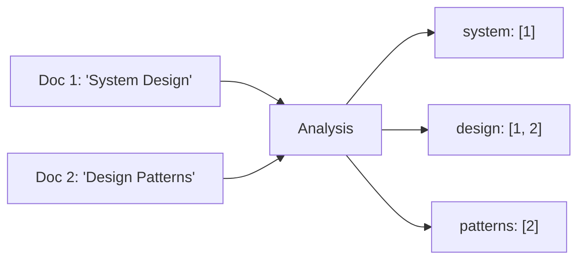
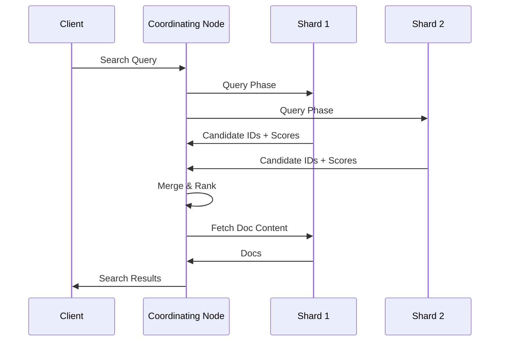

# Elasticsearch: Scalable Distributed Search

Elasticsearch is a distributed, JSON-based search and analytics engine. It is built on top of **Apache Lucene**.

---

## 1. The Inverted Index: The Secret Sauce

Standard DBs map `Record -> Content`. Elasticsearch maps `Word -> List of Records`.
- **Tokenization**: Breaking text into words (tokens).
- **Normalization**: Lowercasing, removing punctuation.
- **Stemming**: Reducing "running" to "run".

---

## 2. Lucene Segments & Immutability

Indices are divided into **Shards**, and Shards are composed of **Segments**.
- Segments are **immutable** files on disk.
- **Writes**: New documents go to a new segment.
- **Compaction**: Periodically merges small segments into larger ones and removes deleted documents.

---

## 3. Node Roles in a Cluster

- **Master Node**: Manages cluster state (shards, metadata).
- **Data Node**: Stores data and performs searches.
- **Coordinating Node**: Acts as a load balancer/aggregator for search requests.
- **Ingest Node**: Pre-processes documents before indexing.

---

## 4. Search Request Flow

1. **Query Phase**: The Coordinating node broadcasts the query to all shards. Each shard returns its top-K results.
2. **Fetch Phase**: The Coordinating node merges results and asks the local shards for the full document content for the final top results.

---

## 5. Summary: When to use it?

- **Use it if**: You need full-text search, fuzzy matching, or log analysis (ELK stack).
- **Skip it if**: You need primary storage for transactions or frequent updates (Updates are expensive re-indexes).

> **Senior Tip**: Explain **Mapping Explosion**. If you have dynamic fields and hit the limit (1000 by default), the cluster's memory usage spikes and search performance degrades. Always use explicit mappings for production systems.
