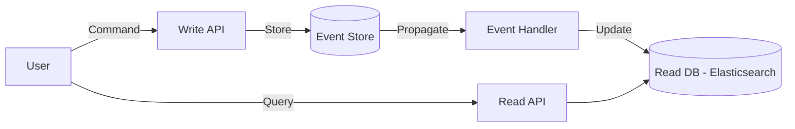

# Event-Driven Systems: EDA, Event Sourcing, and CQRS

Event-driven systems move away from traditional "Request-Response" cycles, allowing services to react to changes in real-time.

---

## 1. Event-Driven Architecture (EDA)
Instead of Service A calling Service B (synchronous), Service A publishes an **Event** (e.g., `OrderPlaced`) to a message broker, and any interested services (Billing, Shipping) consume that event asynchronously.
- **Pro**: Extreme decoupling. High scalability.
- **Con**: Hard to trace the flow of a single request. Eventual consistency.

---

## 2. Event Sourcing
Instead of storing the *current state* of an object (e.g., `Balance = $50`), you store the entire *history of events* that led to that state (`+$100`, `-$25`, `-$25`).
- **Pro**: 100% accurate audit log. Ability to "Replay" state to any point in time. Great for financial and legal systems.
- **Con**: Reading state is slow because you have to replay thousands of events. (Solved by **Snapshots**).

---

## 3. CQRS (Command Query Responsibility Segregation)
Separating the models for **Writing** (Commands) and **Reading** (Queries).
- **Command Side**: Optimized for complex business logic and validation. (Updates the Event Store).
- **Query Side**: Optimized for fast reads. (Often a denormalized projection in a search index or cache).
- **The Link**: An **Event Handler** listens to the command side and updates the query side.

---

## 4. Choreography vs Orchestration

- **Orchestration**: A central "Brain" (Orchestrator) tells everyone what to do. (Synchronous or Workflow-driven).
- **Choreography**: Each service knows what to do when it sees an event. No central controller. (More decoupled, but harder to monitor).

---

## 5. Interview "Senior" Discussion Points

- **Idempotency**: In EDA, events might be delivered twice. Every consumer must be able to handle duplicate events safely.
- **Poison Pill Events**: What happens when an event fails to process repeatedly? (Answer: **Dead Letter Queues - DLQ**).
- **Schema Evolution**: How do you handle changing an event structure when you have 10 TB of historical events? (Answer: Avro/Protobuf with backward compatibility).

> **Senior Tip**: Mention **Outbox Pattern**. How to ensure that writing to your database and publishing an event to Kafka happen atomically (or never). This prevents the "DB updated but Event lost" nightmare.
