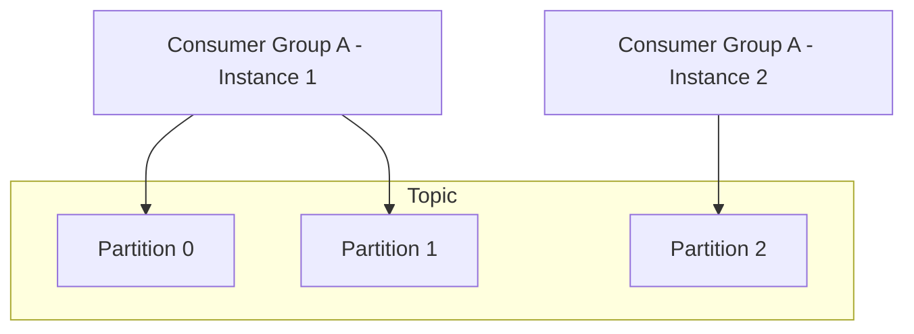

# Kafka: The Distributed Event Streaming Platform

Kafka is built for high throughput, low latency, and massive durability. It is effectively a distributed append-only log.

---

## 1. Architectural Components

- **Topic**: A category or feed name.
- **Partition**: Topics are split into partitions for horizontal scaling. **Ordering is only guaranteed within a partition.**
- **Broker**: A Kafka server.
- **Consumer Group**: A group of consumers reading from the same topic. Each partition is assigned to exactly one consumer in the group.

---

## 2. Why is Kafka so Fast?

- **Sequential I/O**: Kafka writes data as an append-only log, which is extremely fast for both HDDs and SSDs.
- **Zero-Copy Optimization**: Uses the `sendfile` system call to transfer data directly from the kernel's Page Cache to the network card, bypassing the application RAM.
- **End-to-End Batching**: Producers, brokers, and consumers all process messages in batches to minimize network overhead.

---

## 3. Durability & Delivery Guarantees

- **ISR (In-Sync Replicas)**: Replicas that are current with the leader.
- **Acks Settings**:
    - `acks=0`: Fire and forget (Fastest, least reliable).
    - `acks=1`: Leader acknowledges (Fast, consistent if leader stays alive).
    - `acks=all`: All ISRs acknowledge (Slowest, most reliable).

---

## 4. Retries & Dead Letter Queues (DLQ)

When processing fails:
1. **Exponential Backoff**: Retry with increasing delays.
2. **Retry Topics**: Move the message to a separate topic (e.g., `orders_retry_5m`).
3. **Dead Letter Queue**: If all retries fail, move to a DLQ for manual inspection.

---

## 5. Zookeeper vs. KRaft

- **Zookeeper**: Historically used to manage cluster metadata and elect leaders.
- **KRaft (Modern)**: Metadata is stored in Kafka itself (internal __cluster_metadata topic). This allows Kafka to scale to millions of partitions more efficiently.

> **Senior Tip**: If you need to scale beyond Kafka's partition limit, explain how you would use **Tiered Storage** (e.g., S3 for old data) to keep the local disk usage low while maintaining infinite retention.
