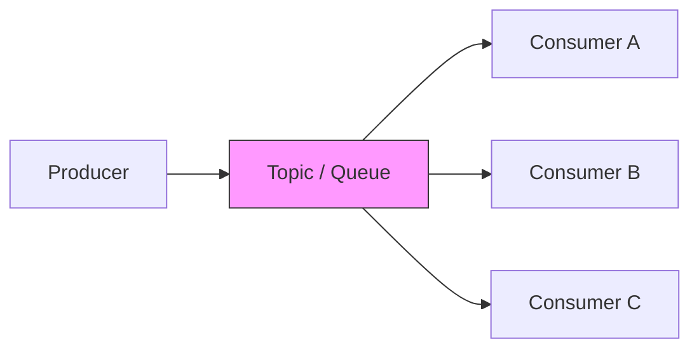

# Message Patterns: Queues, Pub-Sub, and Brokers

Messaging systems decouple producers from consumers, allowing for asynchronous processing and high fault tolerance.

---

## 1. Message Queues (Point-to-Point)
A producer sends a message to a queue, and **one** consumer processes it. (e.g., SQS, RabbitMQ).
- **Pro**: Load balancing (multiple workers can pull from one queue). Guaranteed delivery.
- **Con**: No one else can see the message once it's consumed.

---

## 2. Publish-Subscribe (Pub-Sub)
A producer (Publisher) sends a message to a **Topic**, and **all** services subscribed to that topic receive a copy. (e.g., Redis Pub/Sub, SNS, Kafka).
- **Pro**: Perfect for broadcasting events (e.g., "UserSignedUp" needs to trigger Email AND Analytics).
- **Con**: Harder to ensure every subscriber received the message if the system goes down.

---

## 3. Message Broker vs. Event Log

- **Message Broker (RabbitMQ)**: Focuses on "The Message." Once it's acknowledged, it's deleted. Use for task delegation.
- **Event Log (Kafka)**: Focuses on "The Stream." Messages are persisted on disk and can be replayed. Use for EDA and analytical pipelines.

---

## 4. Enterprise Service Bus (ESB)
A centralized "Middleware" that handles routing, transformation, and protocol conversion between legacy systems.
- **Modern View**: ESBs are often considered "Anti-patterns" in microservices because they put too much "Intelligence in the network" (Smart Pipes). Microservices prefer "Smart Endpoints, Dumb Pipes."

---

## 5. Interview "Senior" Discussion Points

- **At-Least-Once vs At-Most-Once**: Understanding delivery guarantees and why "Exactly-Once" is the Holy Grail of messaging.
- **Backpressure**: How a message queue protects a slow database from being overwhelmed by a fast stream of requests.
- **Dead Letter Queues (DLQ)**: Managing failed messages for manual inspection or automatic retry.

> **Senior Tip**: Mention **Consumer Groups**. In Kafka, a consumer group allows multiple workers to share the load of a single topic while still allowing other groups to receive their own copy of the same messages.
