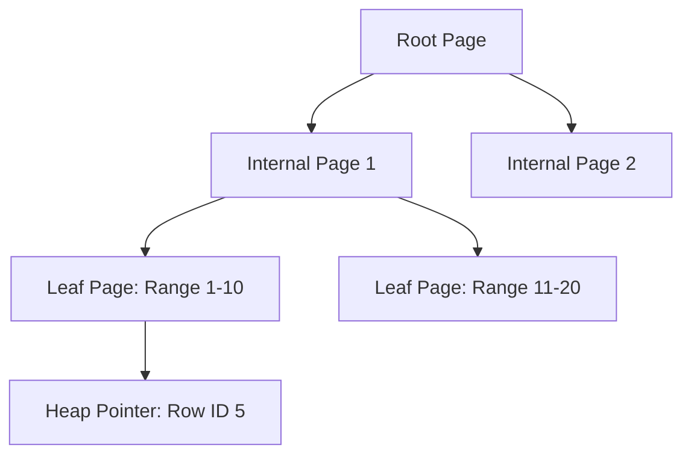

# PostgreSQL: The Reliable Relational Foundation

PostgreSQL is a powerful, open-source object-relational database system. In an interview, it is the "gold standard" for relational data.

---

## 1. ACID Properties & MVCC

Postgres ensures data integrity through **ACID** (Atomicity, Consistency, Isolation, Durability).
- **MVCC (Multi-Version Concurrency Control)**: Instead of locking the database for every change, Postgres keeps multiple versions of a row. This allows readers to read a snapshot of the data without being blocked by writers.
- **WAL (Write Ahead Log)**: Changes are first written to a log on disk before being applied to the data files, ensuring durability even in a crash.

---

## 2. Storage Engine: Heap & B-Trees

- **Heap Files**: Tables are stored as a collection of pages (typically 8KB). New rows are placed wherever there is space.
- **Indices (B-Trees)**: Indices are separate structures that point to the location of rows in the heap. Postgres uses B-Tree as the default index type because it's optimized for disk-based storage and provides $O(\log n)$ performance.

---

## 3. Advanced Indexing

- **Composite Index**: An index on multiple columns. **Order matters!** (Query must use columns from left to right).
- **Partial Index**: Indexing only a subset of rows (e.g., `WHERE status = 'ACTIVE'`). Reduces index size.
- **Covering Index (INCLUDE)**: Adding extra columns to the index so the database doesn't have to look up the heap table.

---

## 4. Replication & High Availability

- **Single-Leader Replication**: One master handles writes; multiple replicas handle reads.
- **Streaming Replication**: Continuously sends WAL records from the primary to the standbys.
- **Failover**: Use tools like **Patroni** or **repmgr** for automatic master election if the leader dies.

---

## 5. Summary: When to use it?

- **Use it if**: You need complex joins, strict schema, and ACID transactions.
- **Skip it if**: You have massive write volume (>10k-50k TPS) or need to scale horizontally without sharding.

> **Senior Tip**: Mention **Vacuuming**. Because of MVCC, old versions of rows (dead tuples) accumulate. Postgres' "Autovacuum" process cleans these up. In high-write systems, vacuuming can become a bottleneck and "bloat" the database.
