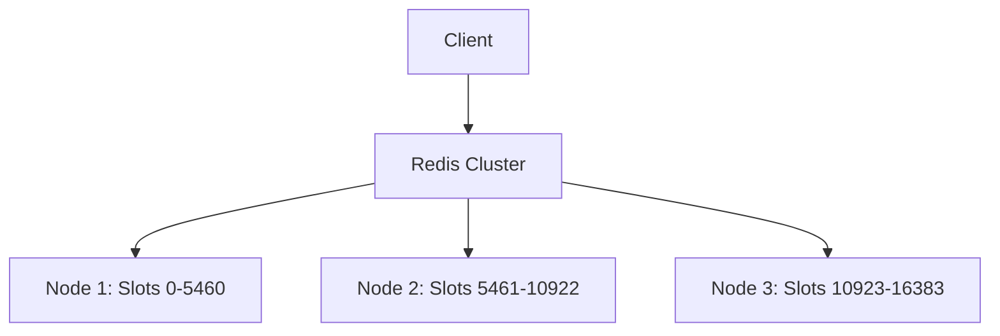

# Redis: High-Performance In-Memory Data Store

Redis is not just a cache; it is a **data structure store**. Understanding its single-threaded nature and persistence models is key to using it correctly at scale.

---

## 1. Why is Redis so Fast?

Despite being single-threaded, Redis can handle 100k+ RPS.
- **In-Memory**: No disk I/O for data retrieval.
- **I/O Multiplexing (epoll)**: Uses a single thread to manage thousands of concurrent connections efficiently.
- **Efficient Data Structures**: Optimized Skip Lists, Hashes, and Intsets.

---

## 2. Core Data Types & Use Cases

| Type | Use Case | Internal Structure |
| :--- | :--- | :--- |
| **Strings** | Simple key-value, Session storage | SDS (Simple Dynamic String) |
| **Hashes** | User profiles, Objects | ZipList / Hash Table |
| **Lists** | Message queues, Timelines | QuickList (Linked List + ZipList) |
| **Sets** | Unique visitors, Tagging | Intset / Hash Table |
| **Sorted Sets** | Leaderboards, Rate limiting | ZipList / Skip List |
| **HyperLogLog** | Cardinality estimation (UV count) | Probabilistic hashing |

---

## 3. Persistence: RDB vs. AOF

### RDB (Redis Database Backup)
A point-in-time snapshot of the dataset.
- **Pros**: Fast restarts, compact files.
- **Cons**: Potential data loss between snapshots.

### AOF (Append Only File)
Logs every write operation received by the server.
- **Pros**: High durability (can sync every second).
- **Cons**: Files grow large; restarts are slower.
- **Modern Redis**: Uses a hybrid approach (RDB preamble + AOF log).

---

## 4. Scaling: Redis Cluster vs. Sentinel

- **Sentinel**: High availability (automatic failover) for a single master-slave setup.
- **Redis Cluster**: Horizontal scaling. Shards data across nodes using **Hash Slots** (16,384 total).

---

## 5. Hot Key Mitigation

- **Key Salting**: Append random noise to hot keys to distribute them.
- **Read Replicas**: Direct read-intensive traffic to slaves.
- **Local Caching**: Keep the most popular keys in the application's RAM (L1 cache).

> **Senior Tip**: When using Redis as a **Distributed Lock**, always mention **Redlock** and the potential issues with system clock skew or long GC pauses that could invalidate the lock's expiration.
