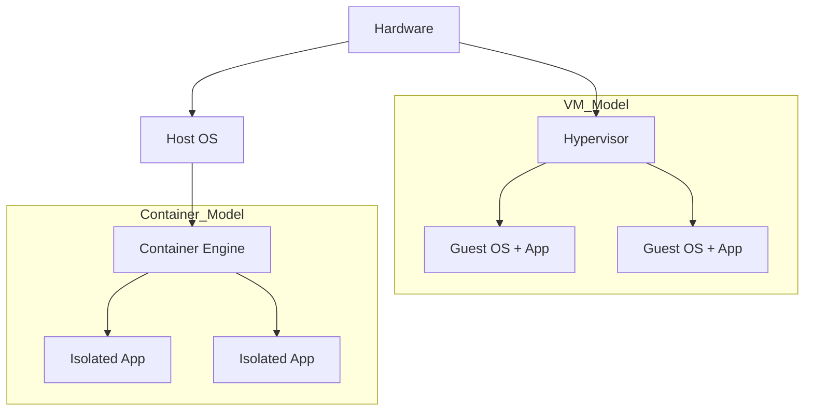

# Virtualization and Containers

Modern infrastructure relies on isolating applications from the underlying hardware. This guide explains the evolution from bare metal to containers.

---

## 1. Virtual Machines (VMs)
A VM is an emulation of a physical computer. It includes a full guest operating system.
- **Hypervisor**: The software that creates and runs VMs (e.g., VMware, Hyper-V, KVM).
- **Pro**: Strong isolation. Can run different OSs on the same hardware.
- **Con**: Heavyweight (requires GBs of RAM and disk for the Guest OS). Slow boot times (minutes).

---

## 2. Containers (Docker)
Containers share the host's operating system kernel but isolate the application processes.
- **Container Engine**: The software that manages containers (e.g., Docker, Containerd).
- **Pro**: Lightweight (MBs instead of GBs). Fast boot times (seconds). "Write once, run anywhere" portability.
- **Con**: Weaker isolation than VMs (shared kernel). Limited to the host's OS type (e.g., Linux containers on Linux).

---

## 3. Orchestration (Kubernetes)
Managing 1,000s of containers manually is impossible. Orchestrators automate:
- **Scheduling**: Deciding which server should run which container.
- **Auto-scaling**: Adding/removing containers based on CPU/RAM load.
- **Self-healing**: Restarting a container if it crashes.
- **Service Discovery**: Helping containers find each other.

---

## 4. Interview "Senior" Discussion Points

- **The "Thundering Herd" in K8s**: What happens when a node fails and 100 containers try to restart at once?
- **Sidecar Pattern**: Running a tiny utility container (like a logging agent or service mesh proxy) next to your main application container.
- **Infrastructure as Code (IaC)**: Using Terraform or CloudFormation to manage the underlying VMs and clusters.

---

## 5. Security Note: Container Escapes
While rare, a malicious process in a container could potentially exploit a kernel vulnerability to access the host OS. This is why tools like **gVisor** (from Google) exist—to provide an extra layer of isolation for untrusted code.

> **Senior Tip**: Mention **Immutable Infrastructure**. Instead of "patching" a running server, you build a new container image, test it, and replace the old one. This ensures your staging environment is *exactly* the same as production.
