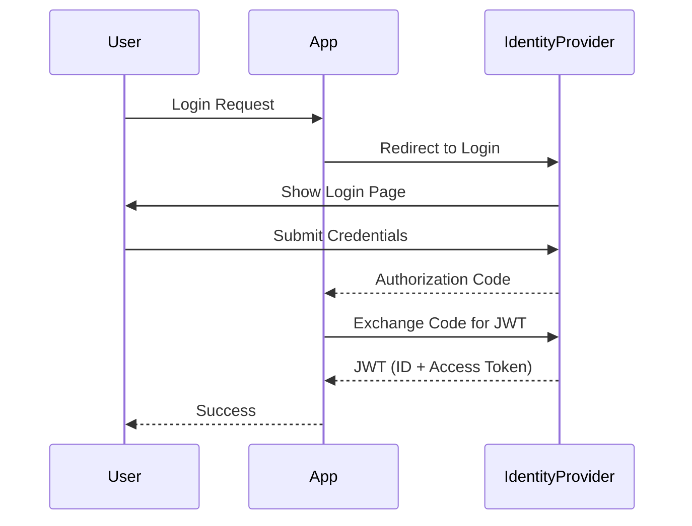

# Auth and Security: OAuth 2.0, OIDC, and JWT

In a distributed system, you cannot ask every service to handle login. You need a centralized and standardized way to handle identity and permissions.

---

## 1. Authentication vs Authorization

- **Authentication (AuthN)**: Proving who you are (e.g., Login with Username/Password).
- **Authorization (AuthZ)**: Proving what you can do (e.g., "User X has permission to delete this file").

---

## 2. OAuth 2.0 (The Authorization Framework)
OAuth 2.0 allows a third-party application to obtain limited access to a user's data on another service (like "Sign in with Google").
- **Roles**:
    - **Resource Owner**: The User.
    - **Client**: The app wanting access.
    - **Authorization Server**: The service that verifies the user (e.g., Google).
    - **Resource Server**: The API that holds the data.

---

## 3. OIDC - OpenID Connect (The Identity Layer)
OIDC is a simple identity layer on top of the OAuth 2.0 protocol. It allows clients to verify the identity of the end-user based on the authentication performed by an Authorization Server.
- **Access Token**: "What I can do" (OAuth 2.0).
- **ID Token**: "Who I am" (OIDC - in JWT format).

---

## 4. JWT (JSON Web Tokens)
A compact, URL-safe way of representing claims to be transferred between two parties.
- **Structure**: `Header.Payload.Signature`
- **Mechanism**: The server signs the payload. The client stores it (often in LocalStorage or a Cookie). Every subsequent request includes this token. The service verifies the signature to trust the user.
- **Pro**: Stateless. No need to query a DB for every request.
- **Con**: Hard to revoke (until they expire). Large payloads increase latency.

---

## 5. SSO (Single Sign-On)
A session/user authentication service that permits a user to use one set of login credentials to access multiple applications.
- **Benefits**: Improved user experience, reduced password fatigue, centralized security policy.

---

## 6. Interview "Senior" Discussion Points

- **Token Revocation**: Since JWTs are stateless, how do you handle a compromised token? (Answer: **Revocation Lists** in Redis or short-lived tokens with **Refresh Tokens**).
- **CSRF vs XSS**: How to secure tokens in the browser (HttpOnly, Secure, SameSite cookies).
- **Role-Based Access Control (RBAC)**: Embedding user roles directly in the JWT payload for instant authorization checks.

> **Senior Tip**: Mention **PKCE (Proof Key for Code Exchange)**. For mobile or single-page apps (SPA) where the "Client Secret" cannot be stored safely, PKCE is the modern security standard for the OAuth flow.
