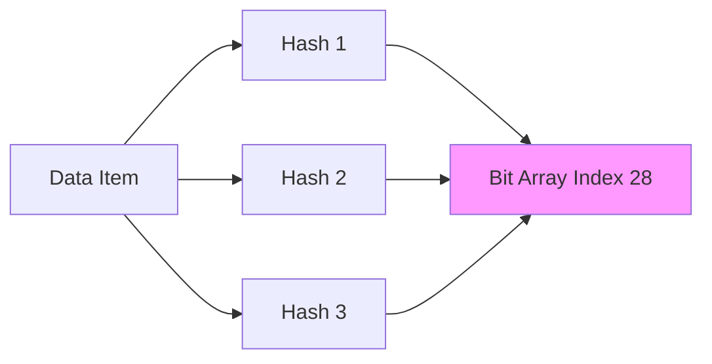
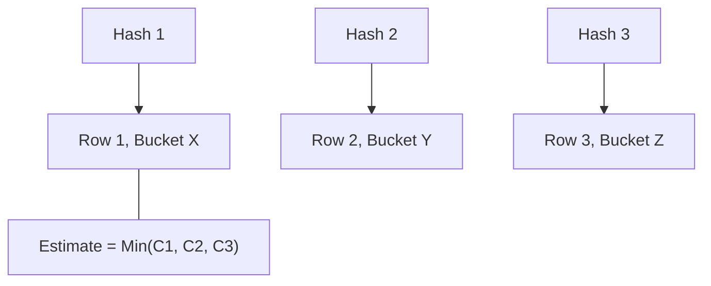

# Big Data Structures: Probabilistic Mastery

When dealing with trillions of items, exact answers are too expensive. Probabilistic data structures offer massive memory savings by trading off a tiny amount of accuracy.

---

## 1. Bloom Filters: Membership Testing

Answers: "Is this item in the set?"
- **Response**: "No" (100% Certain) or "Probably Yes" (Targeted False Positive rate).
- **Internals**: A bit array and multiple hash functions.

---

## 2. HyperLogLog (HLL): Cardinality Estimation

Answers: "How many unique users visited today?"
- **Memory**: Can count 1 billion items using only 1.5 KB of RAM with ~2% error.
- **Intuition**: Based on the probability of seeing a long run of leading zeros in a hash. If you see $k$ zeros, you likely have $\approx 2^k$ unique items.

---

## 3. Count-Min Sketch: Frequency Estimation

Answers: "What are the Top 100 most frequent search terms?"
- **Internals**: A 2D array of counters and multiple hash functions.
- **Trade-off**: It over-estimates frequency but never under-estimates.

---

## 4. Skip Lists: Sorted Search in Memory

Used in Redis Sorted Sets and LevelDB/RocksDB Memtables.
- **Complexity**: $O(\log N)$ for search/insert.
- **Why?**: Much easier to implement and rebalance than Red-Black Trees in a concurrent environment.

---

## 5. Summary Table

| Structure | Problem | Accuracy | Memory |
| :--- | :--- | :--- | :--- |
| **Bloom Filter** | Membership | False Positives | Very Low |
| **HyperLogLog** | Count Unique | Standard Error | Extremely Low |
| **Count-Min Sketch** | Frequency | Over-estimation | Low |
| **Cuckoo Filter** | Membership | Better than Bloom | Low (Supports Deletes) |

> **Senior Tip**: Mention **Cuckoo Filters** as a modern alternative to Bloom Filters if you need to support **deletions**. Bloom filters cannot easily remove items without affecting other hashes.
